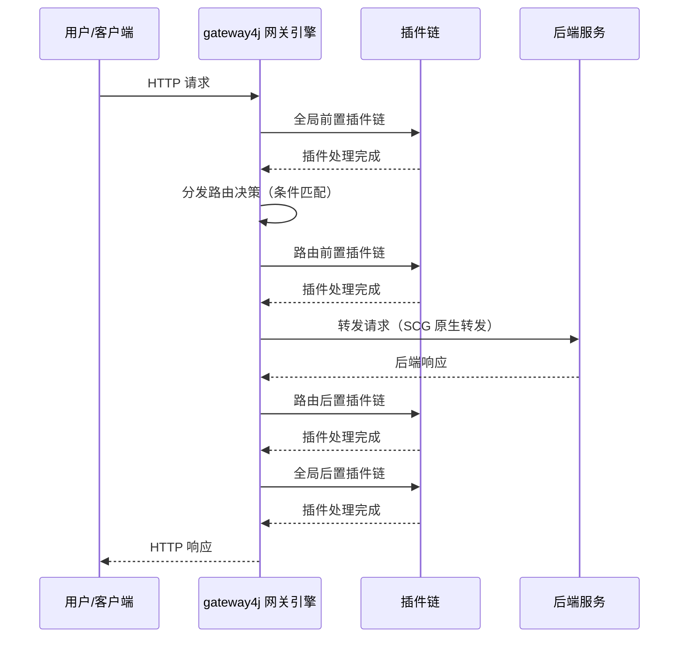
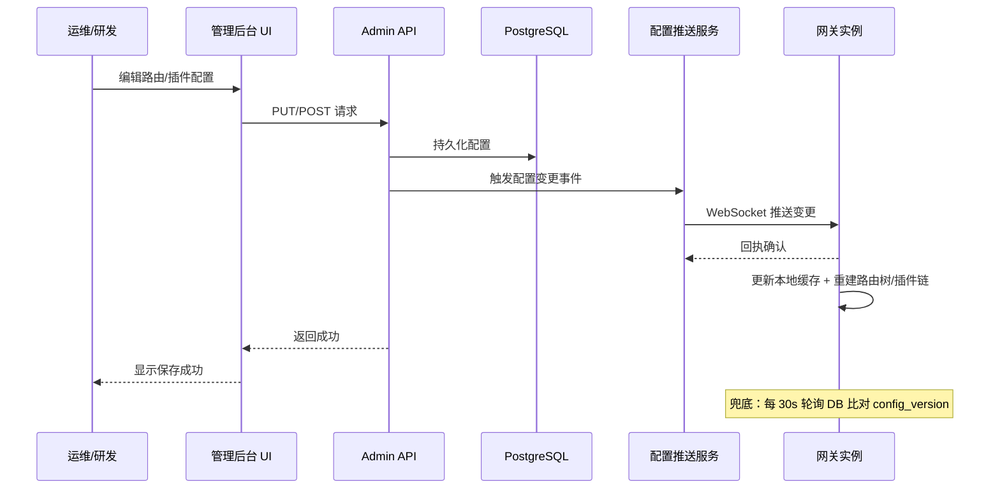
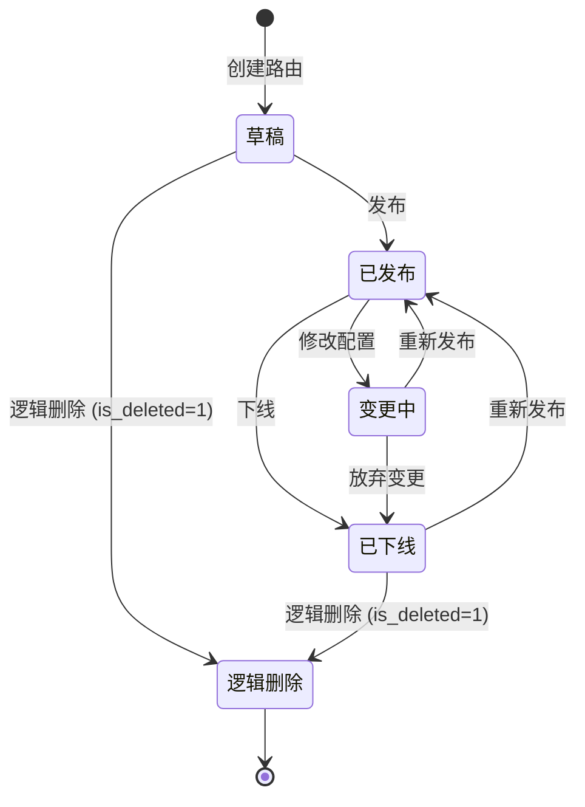
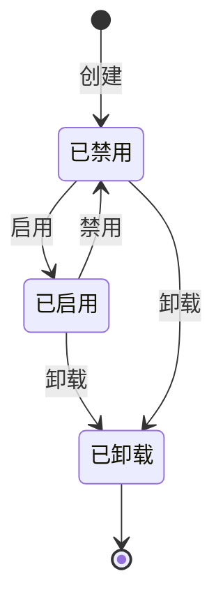
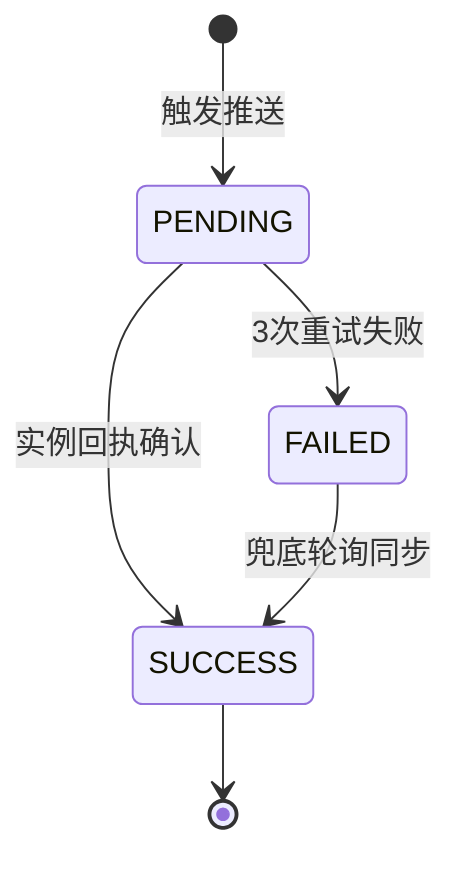

# 可视化网关 PRD V1.2.0

## 1. 基础信息

### 1.1 项目信息表

| 项 | 值 |
|---|---|
| 项目名称 | 可视化网关（gateway4j） |
| 项目代号 | gateway4j-V1.0 |
| 文档状态 | 草稿 |
| 创建日期 | 2026-07-13 |
| 产品负责人（PM） | - |
| 技术负责人（Lead） | - |
| 前端负责人（Vue） | - |
| 后端负责人（Java） | - |
| 测试负责人（QA） | - |
| 交互 / UI 设计 | - |

### 1.2 修订历史

| 版本号 | 修订日期 | 修订类型 | 修订内容摘要 | 修订人 | 审核 / 批准人 |
|---|---|---|---|---|---|
| V1.0.0 | 2026-07-13 | 新建 | 初始化发布，核心功能需求 | - | - |
| V1.1.0 | 2026-07-18 | 更新 | 扩展内置插件至 20+；新增路由条件/绑定/插件链/插件类型 Schema 接口需求；更新 API 契约至 V1.2.0 | - | - |
| V1.2.0 | 2026-07-19 | 更新 | 新增路由导入导出、开放 API（HMAC 签名）；内置插件扩展至 30 种（新增钉钉认证、安全水印）；API 契约至 V1.3.0 | - | - |

---

## 2. 导言与业务模型

### 2.1 项目背景

#### 痛点描述

当前 Java 生态网关存在以下问题：

- **Spring Cloud Gateway**：无可视化配置，路由和过滤器需硬编码，每次变更需重新部署；路由模型为扁平匹配，无法表达多层条件分发逻辑
- **Apache ShenYu**：有 Admin 后台但仅表单配置，无流程图编排；路由为单层条件匹配，不支持嵌套分发；自定义插件必须写 Java 打包，轻量逻辑过重
- **APISIX / Kong**：Lua 技术栈，Java 团队维护成本高，插件开发需跨语言

#### 产品定位

gateway4j 是面向 Java 团队的可视化 HTTP 网关平台，基于 Spring Cloud Gateway 构建，提供流程图式路由编排、插件化过滤器体系、多层分发路由决策，以及实时状态监控。面向 WEB 门户和小程序门户场景。

#### 业务价值

- 路由配置效率：代码配置 → 可视化拖拽，配置变更时间从小时级降至分钟级
- 运维门槛：需研发介入 → 运维自主配置，减少 80% 研发配合工时
- 轻量定制：写 Java 打包 → Groovy 脚本热加载，定制逻辑从天级降至分钟级

### 2.2 用户角色与权限定义

| 角色名称 | 角色 Code | 业务职责 | 关联菜单 / 页面 | 敏感操作权限 |
|---|---|---|---|---|
| 超级管理员 | `ROLE_ADMIN` | 管理全系统配置、用户、插件 | 全系统菜单 | 插件安装/卸载、用户禁用、路由删除、系统参数修改 |
| 网关运维 | `ROLE_OPS` | 配置路由、监控状态、管理插件 | 路由管理、插件管理、状态大盘 | 路由发布/下线、插件启用/禁用 |
| 研发人员 | `ROLE_DEV` | 开发自定义插件、调试脚本 | 插件管理、脚本编辑器 | JAR 插件上传、Groovy 脚本编辑/调试 |
| 访客 | `ROLE_GUEST` | 仅查看状态大盘 | 状态大盘（只读） | 无 |

### 2.3 全局业务流程图

> 以下泳道图采用 UML 序列图表示，每个 participant 代表一个泳道角色。

#### 2.3.1 运行时请求流程（泳道图）

#### 2.3.2 配置管理流程（泳道图）

---

## 3. 功能需求详述

### F-ROUTE-001 - 动态路由配置

#### 1. 入口与路由

- 菜单路径：路由管理 → 路由列表
- 前端路由：@/views/route/list.vue
- 路由名：RouteList
- 是否需登录：是
- 所需权限：`route:read`

#### 2. 原型参考

[待补充]

#### 3. 交互要素

- **页面加载逻辑**：进入时加载路由列表（API: GET /v1/routes），左侧为路由树，右侧为画布
- **加载状态**：Skeleton 屏显占位
- **组件化建议**：
  - 路由树 → RouteTree.vue
  - 流程图画布 → RouteCanvas.vue
  - 路由属性面板 → RoutePropertyPanel.vue

#### 4. 数据元素与输入校验表

| 字段名称 | 元素类型 | 必填 | 前端校验规则 | 异常提示文字 | 后端字段映射 | 字典 Code |
|---|---|---|---|---|---|---|
| 路由名称 | Input | 是 | 2-50 位，字母数字下划线 | "路由名称需 2-50 位字母数字下划线" | `route_name VARCHAR(50)` | - |
| 路由类型 | Select | 是 | 必选 | "请选择路由类型" | `route_type VARCHAR(20)` | `ROUTE_TYPE` |
| 路由状态 | Tag | 否 | 显示当前状态 | - | `status VARCHAR(20)` | `ROUTE_STATUS` |
| 匹配路径 | Input | 条件必填（后置路由时必填） | 合法 URI 路径，以 / 开头 | "请输入合法路径" | `path VARCHAR(500)` | - |
| 后端地址 | Input | 条件必填（后置路由时必填） | 合法 HTTP(S) URL | "请输入合法后端地址" | `upstream_url VARCHAR(500)` | - |
| 条件规则 | JSON Editor | 条件必填（分发路由时必填） | 合法 JSON | "条件规则格式错误" | `conditions TEXT` | - |
| 描述 | Textarea | 否 | ≤ 200 字 | "描述不超过 200 字" | `remark VARCHAR(200)` | - |

#### 5. 边界逻辑

- **防重提交**：路由保存按钮点击后置灰（Loading），后端幂等（Idempotency-Key Header）
- **路由状态机**：

> 删除通过 is_deleted=1 标记，不改变 status 字段

- **分发路由嵌套深度**：最大 5 层，超出前端提示"分发路由嵌套不可超过 5 层"
- **循环检测**：保存时后端校验分发路由是否存在循环引用，存在则拒绝并返回错误
- **配置推送**：路由发布/下线后，配置变更推送至所有网关实例，3s 内生效

#### 6. 接口需求

| # | URL | Method | 用途 | 关键字段 |
|---|---|---|---|---|
| 1 | /v1/routes | GET | 路由列表（树形，含 children + plugins） | route_type, status |
| 2 | /v1/routes | POST | 创建路由 | route_name, route_type, path, upstream_url, conditions, bindings |
| 3 | /v1/routes/{id} | PATCH | 修改路由（含 parent_route_id） | route_name, conditions, upstream_url, parent_route_id |
| 4 | /v1/routes/{id} | DELETE | 删除路由（草稿/已下线） | - |
| 5 | /v1/routes/{id}/publish | POST | 发布路由 | - |
| 6 | /v1/routes/{id}/offline | POST | 下线路由 | - |
| 7 | /v1/routes/validate | POST | 校验路由配置（循环检测等） | conditions |
| 8 | /v1/routes/sort | PUT | 批量路由排序（拖拽） | route_ids |
| 9 | /v1/routes/{id}/conditions | POST | 添加单条分发条件 | condition_type, operator, target_route_id |
| 10 | /v1/routes/{id}/conditions/{condId} | PUT | 修改单条分发条件 | condition_type, operator |
| 11 | /v1/routes/{id}/conditions/{condId} | DELETE | 删除单条分发条件 | - |
| 12 | /v1/routes/{id}/children | GET | 查询子路由列表 | - |
| 13 | /v1/routes/{id}/plugins | GET | 查询路由绑定插件列表 | - |
| 14 | /v1/routes/{id}/plugins | POST | 绑定插件到路由 | plugin_id, binding_config |
| 15 | /v1/routes/{id}/plugins/{bindingId} | PUT | 修改绑定配置 | binding_config |
| 16 | /v1/routes/{id}/plugins/{bindingId} | DELETE | 解绑插件 | - |
| 17 | /v1/routes/{id}/plugins/sort | PUT | 路由级插件排序（拖拽） | plugin_phase, binding_ids |
| 18 | /v1/routes/{id}/plugin-chain | GET | 预览完整插件链 | - |
| 19 | /v1/routes/export | GET | 导出路由包 | route_ids, status |
| 20 | /v1/routes/import | POST | 导入路由包 | data, strategy |
| 21 | /v1/routes/import/validate | POST | 导入预检 | data |

契约维护：Apifox（项目链接待项目启动后补充）

---

### F-ROUTE-002 - 图形化路由编排

#### 1. 入口与路由

- 菜单路径：路由管理 → 路由编排
- 前端路由：@/views/route/canvas.vue
- 路由名：RouteCanvas
- 是否需登录：是
- 所需权限：`route:edit`

#### 2. 原型参考

[待补充]

#### 3. 交互要素

- **画布操作**：
  - 左侧组件面板：分发路由、后置路由、插件节点
  - 拖拽节点到画布
  - 连线建立分发路由→后置路由的决策关系
  - 点击节点弹出属性配置面板
- **组件化建议**：
  - 组件面板 → ComponentPanel.vue
  - 画布引擎 → RouteFlowCanvas.vue（基于 Vue Flow / AntV X6 X6）
  - 属性面板 → NodePropertyPanel.vue
  - 条件编辑器 → ConditionEditor.vue

#### 4. 数据元素与输入校验表

| 字段名称 | 元素类型 | 必填 | 前端校验规则 | 异常提示文字 | 后端字段映射 | 字典 Code |
|---|---|---|---|---|---|---|
| 连线条件 | Condition Editor | 是（分发路由连线时） | 合法条件表达式 | "请配置分发条件" | `condition_expr TEXT` | - |
| 条件类型 | Select | 是 | 必选 | "请选择条件类型" | `condition_type VARCHAR(20)` | `COND_TYPE` |
| 优先级 | InputNumber | 否 | 1-999 | "优先级范围 1-999" | `priority INT` | - |

#### 5. 边界逻辑

- **防重提交**：路由保存按钮点击后置灰（Loading），后端幂等（Idempotency-Key Header）
- **自动保存**：画布变更后 3s 自动保存草稿，防止丢失
- **撤销/重做**：支持 Ctrl+Z / Ctrl+Y，最多 50 步
- **连线校验**：后置路由不可连出，分发路由至少连一条线
- **实时预览**：画布右上角展示当前路由的请求路径预览
- **画布节点上限**：单画布 ≤ 200 节点，超出提示"画布节点不可超过 200"

#### 6. 接口需求

| # | URL | Method | 用途 | 关键字段 |
|---|---|---|---|---|
| 1 | /v1/routes/{id}/canvas | GET | 获取画布数据（节点+连线） | - |
| 2 | /v1/routes/{id}/canvas | PUT | 保存画布数据 | nodes, edges |

契约维护：Apifox（项目链接待项目启动后补充）

---

### F-PLUGIN-001 - 插件管理

#### 1. 入口与路由

- 菜单路径：插件管理 → 插件列表
- 前端路由：@/views/plugin/list.vue
- 路由名：PluginList
- 是否需登录：是
- 所需权限：`plugin:read`

#### 2. 原型参考

[待补充]

#### 3. 交互要素

- **页面加载逻辑**：进入时加载插件列表（API: GET /v1/plugins），按类型分组展示
- **加载状态**：Skeleton 屏显占位
- **组件化建议**：
  - 插件卡片 → PluginCard.vue
  - 插件配置弹窗 → PluginConfigDialog.vue
  - JAR 上传弹窗 → JarUploadDialog.vue
  - Groovy 编辑器 → GroovyEditor.vue

#### 4. 数据元素与输入校验表

| 字段名称 | 元素类型 | 必填 | 前端校验规则 | 异常提示文字 | 后端字段映射 | 字典 Code |
|---|---|---|---|---|---|---|
| 插件名称 | Input | 是 | 2-50 位，字母数字下划线 | "插件名称需 2-50 位字母数字下划线" | `plugin_name VARCHAR(50)` | - |
| 插件类型 | Select | 是 | 必选 | "请选择插件类型" | `plugin_type VARCHAR(20)` | `PLUGIN_TYPE` |
| 插件阶段 | Select | 是 | 必选 | "请选择插件阶段" | `plugin_phase VARCHAR(20)` | `PLUGIN_PHASE` |
| 插件状态 | Tag | 否 | 显示当前状态 | - | `status VARCHAR(20)` | `PLUGIN_STATUS` |
| 排序值 | InputNumber | 否 | 1-9999 | "排序值范围 1-9999" | `sort_order INT` | - |
| JAR 文件 | Upload | 条件必填（JAR 插件时） | .jar，≤ 50MB | "仅支持 .jar 文件，≤ 50MB" | `jar_path VARCHAR(500)` | - |
| Groovy 脚本 | Code Editor | 条件必填（Groovy 插件时） | 合法 Groovy 语法 | "脚本语法错误" | `script_content TEXT` | - |
| 配置参数 | JSON Editor | 否 | 合法 JSON | "配置参数格式错误" | `config TEXT` | - |
| 描述 | Textarea | 否 | ≤ 200 字 | "描述不超过 200 字" | `remark VARCHAR(200)` | - |

#### 5. 边界逻辑

- **防重提交**：插件保存按钮点击后置灰（Loading），后端幂等（Idempotency-Key Header）
- **插件状态机**：

- **JAR 插件安装**：上传后后端校验 JAR 是否实现 SDK 接口，校验失败返回具体原因
- **Groovy 脚本校验**：保存前前端调用后端编译校验接口，语法错误高亮行号
- **分组插件**：选择多个已有插件组合，分组内插件按排序值执行
- **热加载**：插件启用/禁用后实时生效，无需重启网关

#### 6. 接口需求

| # | URL | Method | 用途 | 关键字段 |
|---|---|---|---|---|
| 1 | /v1/plugins | GET | 插件列表 | plugin_type, status |
| 2 | /v1/plugins | POST | 创建插件 | plugin_name, plugin_type, plugin_phase, config |
| 3 | /v1/plugins/{id} | PATCH | 修改插件 | plugin_name, config, sort_order |
| 4 | /v1/plugins/{id} | DELETE | 删除插件（已禁用/已卸载） | - |
| 5 | /v1/plugins/{id}/enable | POST | 启用插件 | - |
| 6 | /v1/plugins/{id}/disable | POST | 禁用插件 | - |
| 7 | /v1/plugins/upload-jar | POST | 上传 JAR 插件 | file (multipart) |
| 8 | /v1/plugins/validate-groovy | POST | 校验 Groovy 脚本 | script_content |

契约维护：Apifox（项目链接待项目启动后补充）

---

### F-PLUGIN-002 - 全局过滤器插件

#### 1. 入口与路由

- 菜单路径：插件管理 → 全局插件
- 前端路由：@/views/plugin/global.vue
- 路由名：GlobalPlugin
- 是否需登录：是
- 所需权限：`plugin:global`

#### 2. 原型参考

[待补充]

#### 3. 交互要素

- 展示全局前置/后置插件列表，支持拖拽排序调整执行顺序
- 全局插件对所有后置路由生效

#### 4. 数据元素与输入校验表

同 F-PLUGIN-001，额外字段：

| 字段名称 | 元素类型 | 必填 | 前端校验规则 | 异常提示文字 | 后端字段映射 | 字典 Code |
|---|---|---|---|---|---|---|
| 作用范围 | Select | 是 | 必选 | "请选择作用范围" | `scope VARCHAR(20)` | `PLUGIN_SCOPE` |
| 执行阶段 | Select | 是 | 必选 | "请选择执行阶段" | `phase VARCHAR(20)` | `PLUGIN_PHASE` |

#### 5. 边界逻辑

- **防重提交**：排序保存按钮点击后置灰，后端幂等（Idempotency-Key Header）
- 全局插件不可删除，仅可启用/禁用
- 全局前置插件在所有路由匹配前执行，全局后置插件在所有响应返回后执行
- 排序变更后实时推送至网关实例
- **排序冲突**：同一阶段内插件排序值不可重复，后端自动按提交顺序重排

#### 6. 接口需求

| # | URL | Method | 用途 | 关键字段 |
|---|---|---|---|---|
| 1 | /v1/plugins/global | GET | 全局插件列表 | phase |
| 2 | /v1/plugins/global/sort | PUT | 调整全局插件排序 | plugin_ids (有序) |

契约维护：Apifox（项目链接待项目启动后补充）

---

### F-PLUGIN-003 - 内置插件

内置插件随系统预装，不可卸载，可配置参数和启用/禁用。V1.2.0 扩展至 30 种内置插件。

#### 内置插件清单

| 分类 | 插件 | plugin_id | 阶段 | 说明 |
|---|---|---|---|---|
| **安全认证(6)** | 安全插件 | security | PRE | IP 黑白名单 + Header 验证 |
| | Basic Auth | basic-auth | PRE | HTTP Basic 认证 |
| | Key Auth | key-auth | PRE | API Key 认证 |
| | JWT | jwt | PRE | JWT Token 验证（HS/RS/ES 系列） |
| | OAuth2 | oauth2 | PRE | OAuth2 令牌校验 + 用户信息注入 |
| | 签名验证 | sign | PRE | HMAC 请求签名校验 |
| **限流熔断(3)** | 限流插件 | rate-limiter | PRE | 令牌桶限流（本地/Redis 分布式） |
| | 熔断插件 | circuit-breaker | PRE | Resilience4j 熔断 + 限流 + 降级 |
| | Sentinel | sentinel | PRE | Alibaba Sentinel 流控 + 熔断 |
| **流量改写(5)** | 重写插件 | rewrite | PRE | 正则路径重写 + 灰度百分比 |
| | 重定向 | redirect | PRE | 内部转发 / 外部重定向 |
| | 参数映射 | param-mapping | PRE | 请求参数增删改（JSON Path / Form） |
| | 上下文路径 | context-path | PRE | 路径前缀剥离/添加/改写 |
| | 请求改写 | request | PRE | Header/Query/Cookie 增删改 |
| **可观测(5)** | 日志插件 | logging | PRE+POST | 结构化请求/响应日志 + 脱敏 |
| | 日志-Kafka | logging-kafka | POST | 访问日志推送到 Kafka |
| | 日志-ES | logging-es | POST | 访问日志批量写入 Elasticsearch |
| | 链路追踪 | tracing | PRE | W3C Trace Context trace-id 注入 |
| | 指标采集 | metrics | PRE | Micrometer 请求计数/延迟/错误指标 |
| **流量控制(4)** | 缓存插件 | cache | PRE+POST | 响应缓存（本地/Redis 分布式） |
| | 重试插件 | retry | PRE | 固定/退避/故障转移重试 |
| | WebSocket | websocket | PRE | WebSocket 代理 |
| | WAF | waf | PRE | Web 应用防火墙（黑名单/混合模式） |
| **响应处理(3)** | 响应改写 | modify-response | POST | 响应 Header/状态码/Body 修改 |
| | 请求加密 | cryptor-request | PRE | 请求体 JSON 字段 AES 解密 |
| | 响应加密 | cryptor-response | POST | 响应体 JSON 字段 AES 加密 |
| **其他(4)** | 共享插件 | sharing | PRE+POST | 跨插件数据共享 |
| | Mock | mock | PRE | 模拟响应（短路返回） |
| | 钉钉认证 | dingtalk | PRE | 钉钉 SSO OAuth2 登录，用户信息注入 X-User 头 |
| | 安全水印 | watermark | POST | HTML 响应注入水印 JS（防截屏泄密），移除 CSP 头 |

#### 1. 入口与路由

- 菜单路径：插件管理 → 内置插件
- 前端路由：@/views/plugin/builtins.vue
- 路由名：BuiltinPlugins
- 是否需登录：是
- 所需权限：`plugin:read`

#### 2. 交互要素

- 展示 6 个内置插件卡片，每个卡片显示：名称、阶段、状态开关、配置按钮
- 点击配置按钮弹出 JSON Editor 编辑插件参数

#### 3. 字段校验表

| 字段名称 | 元素类型 | 必填 | 前端校验规则 | 异常提示文字 | 后端字段映射 | 字典 Code |
|---|---|---|---|---|---|---|
| 插件配置 | Dynamic Form | 否 | 由 config_schema 驱动校验 | "配置参数格式错误" | `config JSONB` | - |
| 启用状态 | Switch | 是 | - | - | `status VARCHAR(20)` | `PLUGIN_STATUS` |

> 各插件的配置表单由 `GET /v1/plugins/builtin-types/{pluginId}/schema` 返回的 JSON Schema 动态生成，前端无需硬编码每个插件的表单字段。校验规则由 Schema 的 required/type/minimum/maximum/enum 等约束自动生成。保存前可调用 `POST /v1/plugins/validate-config` 进行后端校验。

#### 4. 边界逻辑

- **防重提交**：配置保存按钮点击后置灰（Loading），后端幂等（Idempotency-Key Header）
- 内置插件不可删除、不可卸载，仅可启用/禁用
- 配置变更后实时推送至网关实例
- 配置校验：安全插件的密钥字段不可为空，限流插件的 limit 值必须 > 0

#### 5. 接口需求

| # | URL | Method | 用途 | 关键字段 |
|---|---|---|---|---|
| 1 | /v1/plugins/builtins | GET | 内置插件列表 | - |
| 2 | /v1/plugins/{id}/config | PATCH | 更新内置插件配置 | config |
| 3 | /v1/plugins/{id}/enable | POST | 启用内置插件 | - |
| 4 | /v1/plugins/{id}/disable | POST | 禁用内置插件 | - |
| 5 | /v1/plugins/builtin-types | GET | 内置插件类型列表（含 config_schema） | - |
| 6 | /v1/plugins/builtin-types/{pluginId}/schema | GET | 单个插件类型配置 Schema | - |
| 7 | /v1/plugins/validate-config | POST | 校验插件配置 JSON | plugin_id, config |

注：GET /v1/plugins/builtins 可通过 GET /v1/plugins?plugin_type=BUILTIN 等效实现；PATCH /v1/plugins/{id}/config 可通过 PATCH /v1/plugins/{id} 的 config 字段等效实现。

契约维护：Apifox（项目链接待项目启动后补充）

---

### F-MONITOR-001 - 路由状态大盘

#### 1. 入口与路由

- 菜单路径：监控大盘
- 前端路由：@/views/monitor/dashboard.vue
- 路由名：MonitorDashboard
- 是否需登录：是
- 所需权限：`monitor:read`

#### 2. 原型参考

[待补充]

#### 3. 交互要素

- **图形化展示**：路由线路图，节点颜色表示状态（绿=正常，红=异常，灰=熔断）
- **指标面板**：QPS、请求量趋势、P50/P95/P99 延迟、错误率
- **实时刷新**：5s 自动刷新，支持手动暂停
- **组件化建议**：
  - 路由拓扑图 → RouteTopology.vue
  - 指标卡片 → MetricCard.vue
  - 趋势图 → TrendChart.vue

#### 4. 数据元素与输入校验表

| 字段名称 | 元素类型 | 必填 | 前端校验规则 | 异常提示文字 | 后端字段映射 | 字典 Code |
|---|---|---|---|---|---|---|
| 时间范围 | Select | 否 | 默认最近 1 小时 | - | 请求参数 `time_range` | `1h` / `6h` / `24h` / `7d` |
| 粒度 | Select | 否 | 默认 1m | - | 请求参数 `granularity` | `1m` / `5m` / `1h` |
| 路由筛选 | Input | 否 | 模糊搜索路由名称 | - | 请求参数 `keyword` | - |
| 自动刷新 | Switch | 否 | 默认开启，5s 间隔 | - | 前端状态 | - |

#### 5. 边界逻辑

- 大盘数据延迟 ≤ 5s
- 路由节点异常时自动标红并触发告警
- 支持按路由名称筛选

#### 6. 接口需求

| # | URL | Method | 用途 | 关键字段 |
|---|---|---|---|---|
| 1 | /v1/monitor/routes/status | GET | 路由状态列表 | route_id |
| 2 | /v1/monitor/routes/{id}/metrics | GET | 路由指标 | time_range, granularity |
| 3 | /v1/monitor/topology | GET | 路由拓扑数据 | - |

契约维护：Apifox（项目链接待项目启动后补充）

---

### F-CONFIG-001 - 动态配置推送

#### 1. 入口与路由

- 系统内部功能，无独立页面入口
- 配置变更后自动触发推送

#### 2. 数据元素

| 字段名称 | 元素类型 | 必填 | 前端校验规则 | 异常提示文字 | 后端字段映射 | 字典 Code |
|---|---|---|---|---|---|---|
| config_type | System | 是 | N/A | - | `config_type VARCHAR(20)` | `CONFIG_TYPE` |
| config_id | System | 是 | N/A | - | `config_id BIGINT` | - |
| config_version | System | 是 | N/A | - | `config_version BIGINT` | - |
| change_type | System | 是 | N/A | - | `change_type VARCHAR(20)` | `CHANGE_TYPE` |
| instance_id | System | 是 | N/A | - | `instance_id VARCHAR(50)` | - |

#### 3. 边界逻辑

- **防重提交**：配置推送基于 config_version 去重，相同版本不重复推送

- 路由发布/下线、插件启用/禁用/排序变更后，配置推送至所有网关实例
- 推送方式：WebSocket 长连接推送
- 推送确认：网关实例收到后回执确认，未确认实例 3s 后重试，最多 3 次
- 推送失败告警：3 次重试仍失败，大盘标红并通知运维
- **兜底轮询**：网关实例每 30s 轮询数据库比对 config_version，防止推送丢失
- **配置推送状态机**：

#### 3. 异常处理

- 推送期间网关实例离线：实例上线后通过兜底轮询自动同步
- 推送并发冲突：按 config_version 顺序执行，旧版本丢弃
- WebSocket 断连：客户端 5s 内自动重连，重连后全量同步

契约维护：Apifox（项目链接待项目启动后补充）

---

## 4. 非功能性需求（NFR）

### 4.1 安全需求

| 项 | 规范 |
|---|---|
| 管理后台认证 | JWT Token（framework4j-accesstoken），access_token ≤ 2h，refresh_token ≤ 30d |
| 网关请求认证 | 由安全插件处理，网关引擎不内置认证逻辑 |
| 插件隔离 | JAR 插件使用独立 ClassLoader，防止依赖冲突和恶意代码影响引擎 |
| Groovy 沙箱 | Groovy 脚本运行于沙箱环境，限制文件/网络/反射访问 |
| API 签名 | 开放 API 用 framework4j-signature HMAC-SHA256 + nonce |
| 防 SQL 注入 | MyBatis `#{}` 参数化，禁 `${}` |
| 敏感配置加密 | 数据库中的插件配置（密钥、Token 等）使用 framework4j-sensitive AES-256-GCM 加密存储 |

### 4.2 全局异常处理

| 异常类型 | HTTP | code | 前端处理 |
|---|---|---|---|
| 参数校验失败 | 200 | 10100 | 渲染 error[] 到表单 |
| 未登录 / Token 失效 | 200 | 10200/10201 | 跳登录页 |
| 权限不足 | 200 | 10300 | 跳 forbidden 页 |
| 限流 | 200 | 10500 | 读 Retry-After Header |
| 重复提交 | 200 | 10501 | 提示"请勿重复操作" |
| 网关转发异常（5xx/超时） | 200 | 10699 | "服务异常，请稍后重试" + 上报 Sentry |
| 插件执行异常 | 200 | 10699 | 记录插件错误日志，返回兜底响应 |
| 基础设施异常（HTTP 404/405/502/503/504） | 原始 HTTP | - | 友好错误页（无信封） |

### 4.2 性能需求

| 指标 | 目标 | 备注 |
|---|---|---|
| 网关转发延迟（无插件） | ≤ 1ms P99 | Spring Cloud Gateway Netty 基线 |
| 网关转发延迟（含 3 插件） | ≤ 5ms P99 | - |
| 管理后台首屏（FCP） | ≤ 1.5s | 路由懒加载 + Gzip |
| 配置推送生效时间 | ≤ 3s | 从变更到网关实例生效 |
| 单实例 QPS | ≥ 10000 | 简单路由转发场景 |
| 画布渲染 | ≤ 500ms | 100 节点以内 |

### 4.3 兼容性需求

| 维度 | 规范 |
|---|---|
| 浏览器 | Chrome 100+ / Firefox 100+ / Safari 15+ / Edge 100+ |
| 分辨率 | 1280×720 起步，推荐 1920×1080 |
| 协议 | HTTP/1.1、HTTP/2.0、WebSocket、SSE/流式输出 |
| 后端服务发现 | 静态地址 / Nacos / Consul（后续扩展） |
| Java 版本 | 17+ |
| Spring Boot 版本 | 3.4.x |
| 数据库 | PostgreSQL 16+ |
| 国际化 | V1.0 不支持，仅中文；前端预留 vue-i18n 接口 |
| 无障碍 | V1.0 不支持；非画布页面遵循 WCAG 2.1 AA，画布组件有已知 a11y 限制 |
| SEO | 不适用（管理后台为认证内网系统）|

### 4.4 数据迁移

- 数据库 Schema 版本管理使用 Flyway，命名 `V{version}__{description}.sql`
- V1.0 无存量数据迁移需求（全新部署）
- 后续版本升级通过 Flyway 迁移脚本自动执行，禁止修改已发布脚本

### 4.5 数据埋点

**北极星指标**：网关请求成功率

**二级指标**：

| 指标 | 目标值 |
|---|---|
| 网关请求成功率 | ≥ 99.9% |
| 路由配置变更频率 | 周均 ≤ 20 次 |
| 插件执行异常率 | ≤ 0.01% |
| 配置推送成功率 | ≥ 99.5% |

**埋点表**：

| 事件名 | 类型 | 触发时机 | 关键属性 | 上报方式 | 目标值 |
|---|---|---|---|---|---|
| `gateway_request_total` | Counter | 每次请求经过网关 | route_id / status / latency_ms | Micrometer + Prometheus | - |
| `gateway_request_error` | Counter | 请求异常（5xx/超时/插件异常） | route_id / error_type / error_code | 同上 | < 0.1% |
| `plugin_execute_duration` | Timer | 插件执行完成 | plugin_id / duration_ms / success | 同上 | P99 ≤ 2ms |
| `config_push_event` | Counter | 配置推送 | change_type / instance_count / success_count | 同上 | 成功率 ≥ 99.5% |
| `route_config_change` | Counter | 路由配置变更 | route_id / change_type / operator | 同上 | - |

**告警规则**：

| 指标 | 阈值 | 级别 | 通知方式 |
|---|---|---|---|
| 网关请求成功率 | < 99.5% 持续 5 分钟 | P1 | 大盘标红 + 钉钉通知 |
| 插件执行异常率 | > 0.1% 持续 3 分钟 | P1 | 大盘标红 + 钉钉通知 |
| 配置推送失败 | 3 次重试仍失败 | P2 | 大盘标红 |
| 网关实例离线 | 心跳超时 30s | P1 | 大盘标红 + 钉钉通知 |

**数据保留策略**：

| 数据类型 | 保留周期 | 聚合策略 |
|---|---|---|
| 原始请求日志 | 7 天 | - |
| 分钟级指标 | 30 天 | - |
| 小时级指标 | 90 天 | 分钟级聚合 |
| 天级指标 | 365 天 | 小时级聚合 |

### 4.6 灰度发布与回滚

#### 灰度发布

- **路由配置灰度**：V1.0 不支持按实例比例灰度发布路由配置；路由发布后全量生效
- **插件灰度**：新插件先在单实例手动启用验证，确认无误后再全量启用
- **应用灰度**：gateway4j 应用升级采用滚动部署，先升级 1 个实例观察 5 分钟，无异常后逐步扩量

#### 回滚方案

| 场景 | 回滚方式 | 预计恢复时间 |
|---|---|---|
| 路由配置变更导致异常 | 下线路由（OFFLINE），恢复前一版本配置 | ≤ 30s |
| 插件启用导致异常 | 禁用插件（DISABLE），插件链实时重建 | ≤ 3s |
| 插件配置变更导致异常 | 恢复旧配置并推送，通过 config_version 回退 | ≤ 5s |
| 应用升级失败 | 回滚至上一 JAR 版本，重启实例 | ≤ 2min |
| 数据库迁移失败 | Flyway 修复脚本 + 手动回退 | ≤ 15min |

### 4.7 异常路径与边界条件

#### 异常路径

| 场景 | 处理方式 | 前端提示 |
|---|---|---|
| 后端服务不可达（5xx/超时） | 返回兜底响应，记录错误日志 | "服务异常，请稍后重试" |
| JAR 插件抛出未捕获异常 | 捕获异常，跳过当前插件，继续链执行 | 无感知（日志记录） |
| Groovy 脚本执行超时 | 超时 5s 后中断，返回兜底响应 | "服务异常，请稍后重试" |
| 画布自动保存失败 | 重试 3 次，仍失败则提示用户手动保存 | "自动保存失败，请手动保存" |
| 并发编辑同一路由 | 后提交者收到版本冲突提示，需刷新后重试 | "配置已被他人修改，请刷新后重试" |
| 数据库连接失败（配置推送时） | 本实例使用缓存配置继续服务，阻塞管理后台写入 | "系统繁忙，请稍后重试" |
| WebSocket 推送断连 | 5s 内自动重连，重连后全量同步 | 无感知 |

#### 边界条件

| 资源 | 限制 | 超限处理 |
|---|---|---|
| 路由总数 | ≤ 1000 条 | 提示"路由数量已达上限" |
| 每条路由绑定插件数 | ≤ 20 个 | 提示"单路由插件不可超过 20" |
| 每条分发路由条件数 | ≤ 50 条 | 提示"分发条件不可超过 50" |
| 分发路由嵌套深度 | ≤ 5 层 | 前端提示"嵌套不可超过 5 层" |
| Groovy 脚本大小 | ≤ 64KB | 上传时前端校验 |
| Groovy 脚本执行超时 | 5s | 超时中断，返回兜底响应 |
| 画布节点数 | ≤ 200 | 提示"画布节点不可超过 200" |
| JAR 插件文件大小 | ≤ 50MB | 上传时前端校验 |
| 同一路径多路由匹配 | 精确匹配优先，其次按 sort_order | - |

---

## 5. 简化与敏捷

### 5.1 原型替代文字

路由编排画布、插件配置弹窗等交互复杂页面，详细交互以原型图批注为准，PRD 不重复描述。

### 5.2 接口契约不在 Word

接口契约维护在 Apifox，PRD 仅列出接口需求 + 关键字段。

---

## 6. 变更与验收

### 6.1 变更管理（CCB）

**流程**：提出变更 → 评估影响（PM/研发/QA）→ 判定优先级 → 填修订历史 → 通知群组

**严禁**：口头变更 / 跳过评审 / 删除修订历史

### 6.2 验收标准（DoD）

| 角色 | DoD 标准 |
|---|---|
| **前端（Vue）** | 无 console.log / 无打包报错 / Lighthouse Performance ≥ 80 / 画布 100 节点流畅（渲染 ≤ 500ms） |
| **后端（Spring Boot）** | 单元测试行覆盖率 > 60%（engine + admin 模块）/ API 在 Apifox 标记「已完成」/ 无 P0 Bug |
| **QA** | 冒烟测试用例 100% 通过（用例库见 Apifox）/ 无 P0/P1 Bug |
| **PM** | PRD 修订历史更新 / 埋点验证通过 / 字典码表与实现一致 |

### 6.3 评审流程

4 轮评审：PM 内审 → 设计评审 → 技术评审 → QA 评审

---

## 7. 附录

### 7.1 竞品分析与技术选型

#### 同类产品对比

| 产品 | 技术栈 | 可视化 | 插件化 | 动态路由 | 多层分发 | 开源 |
|---|---|---|---|---|---|---|
| Apache ShenYu | Java | 表单配置 | 有（Java SPI，40+ 内置插件） | 有 | 无 | 是 |
| Apache APISIX | Lua/Nginx | 有（Dashboard） | 有（Lua） | 有 | 无 | 是 |
| Kong | Lua/Nginx | 企业版 | 有（Lua/Go） | 有 | 无 | 部分 |
| Spring Cloud Gateway | Java | 无 | 无（代码级） | 有限（配置级） | 无 | 是 |
| Nginx | C | 无 | 有限（C 模块） | 有限 | 无 | 是 |

#### 核心差异化

1. **Java 生态可视化网关** — 主流 Java 网关要么无可视化，要么仅表单配置。本产品以流程图方式配置路由，拖拽即用
2. **插件化而非代码化** — 过滤器抽象为插件（JAR + Groovy），支持热插拔，业务逻辑与网关引擎解耦
3. **多层分发路由** — 分发路由支持嵌套，请求可经多层条件决策到达后端，适合多租户、多渠道场景

#### 与 Apache ShenYu 的关系

**为什么不直接使用 ShenYu**

| ShenYu 短板 | 本产品方案 |
|---|---|
| 路由配置是表单，无流程图 | 流程图拖拽，连线即路由决策 |
| 单层条件匹配，无多层分发 | 分发路由可嵌套，多层决策链 |
| 无 Groovy 脚本插件，自定义必须写 Java 打包 | 支持 Groovy 脚本，轻量逻辑无需部署 |
| 无分组插件，多插件只能逐个挂载 | 分组插件，一键挂载复用 |
| 可视化弱，Admin 是管理后台不是编排工具 | 图形化线路状态大盘 |

**为什么不复用 ShenYu 插件代码**

ShenYu 插件与框架深度耦合，无法直接复用：

| 耦合点 | 说明 |
|---|---|
| `BaseDataCache` 单例 | 插件从全局缓存读 selector/rule 配置，硬编码依赖 |
| `ShenyuPluginChain` | 自定义链接口，非标准 WebFilter |
| `ShenyuContext` + exchange attributes | 插件间通过共享常量 key 隐式传数据 |
| `PluginData`/`SelectorData`/`RuleData` | 配置 DTO 来自 `shenyu-common` 模块 |
| `AbstractShenyuPlugin` | 模板方法硬编码 selector/rule 匹配算法 |

**借鉴 ShenYu 的架构模式**

不复用代码，但复用设计模式：

| ShenYu 模式 | 本产品借鉴 |
|---|---|
| `ShenyuPlugin` + `ShenyuPluginChain` | 自定义 `GatewayPlugin` + `PluginChain`，适配多层分发路由 |
| `PluginDataHandler` 配置回调 | 自定义 `PluginConfigHandler`，对接数据库配置 |
| `AbstractShenyuPlugin` 模板方法 | 自定义 `AbstractDispatchPlugin`（分发路由条件匹配） |
| `ShenyuLoaderService` JAR 动态加载 | 自定义 JAR 插件加载器 |
| `PluginEnum` 排序常量 | 自定义排序，前置/后置阶段分离 |
| 内置插件业务逻辑（限流算法、签名校验、JWT 解析等） | 参考实现，用本产品插件接口重新封装 |

### 7.2 术语表

| 术语 | 含义 |
|---|---|
| 分发路由 | 不指向后端服务的路由，根据条件将请求分发到不同后置路由，支持嵌套 |
| 后置路由 | 指向实际后端服务的路由，必须跟在分发路由后面 |
| 插件 | 过滤器的插件化封装，支持热插拔 |
| JAR 插件 | 基于 SDK 开发的 Java 插件，打包为 JAR 安装 |
| Groovy 插件 | 通过配置界面编写的 Groovy 脚本插件，热加载执行 |
| 分组插件 | 虚拟插件，组合多个插件为一个整体 |
| 全局插件 | 对所有后置路由生效的插件，区分前置/后置阶段 |
| 插件链 | 请求经过的插件有序执行序列 |
| 配置推送 | 配置变更后实时下发到网关实例的机制 |

### 7.3 字典码表

| 字典 Code | 枚举值 | 含义 |
|---|---|---|
| `ROUTE_TYPE` | `DISPATCH` | 分发路由 |
| `ROUTE_TYPE` | `BACKEND` | 后置路由 |
| `PLUGIN_TYPE` | `BUILTIN` | 内置插件 |
| `PLUGIN_TYPE` | `JAR` | JAR 插件 |
| `PLUGIN_TYPE` | `GROOVY` | Groovy 脚本插件 |
| `PLUGIN_TYPE` | `GROUP` | 分组插件 |
| `PLUGIN_PHASE` | `PRE` | 前置阶段 |
| `PLUGIN_PHASE` | `POST` | 后置阶段 |
| `PLUGIN_SCOPE` | `GLOBAL` | 全局作用域 |
| `PLUGIN_SCOPE` | `ROUTE` | 路由作用域 |
| `COND_TYPE` | `HEADER` | 请求头条件 |
| `COND_TYPE` | `PATH` | 路径条件 |
| `COND_TYPE` | `QUERY` | 查询参数条件 |
| `COND_TYPE` | `BODY` | 请求体条件 |
| `COND_TYPE` | `GROOVY` | Groovy 脚本条件 |
| `ROUTE_STATUS` | `DRAFT` | 草稿 |
| `ROUTE_STATUS` | `PUBLISHED` | 已发布 |
| `ROUTE_STATUS` | `OFFLINE` | 已下线 |
| `ROUTE_STATUS` | `CHANGING` | 变更中 |
| `PLUGIN_STATUS` | `ENABLED` | 已启用 |
| `PLUGIN_STATUS` | `DISABLED` | 已禁用 |
| `PLUGIN_STATUS` | `UNINSTALLED` | 已卸载 |
| `COND_OPERATOR` | `EQ` | 等于 |
| `COND_OPERATOR` | `NE` | 不等于 |
| `COND_OPERATOR` | `CONTAINS` | 包含 |
| `COND_OPERATOR` | `REGEX` | 正则匹配 |
| `COND_OPERATOR` | `EXISTS` | 存在 |
| `COND_OPERATOR` | `GT` | 大于 |
| `COND_OPERATOR` | `LT` | 小于 |
| `CONFIG_TYPE` | `ROUTE` | 路由配置 |
| `CONFIG_TYPE` | `PLUGIN` | 插件配置 |
| `CONFIG_TYPE` | `GLOBAL_PLUGIN` | 全局插件配置 |
| `CHANGE_TYPE` | `CREATE` | 创建 |
| `CHANGE_TYPE` | `UPDATE` | 更新 |
| `CHANGE_TYPE` | `DELETE` | 删除 |
| `CHANGE_TYPE` | `PUBLISH` | 发布 |
| `CHANGE_TYPE` | `OFFLINE` | 下线 |
| `PUSH_STATUS` | `PENDING` | 推送中 |
| `PUSH_STATUS` | `SUCCESS` | 推送成功 |
| `PUSH_STATUS` | `FAILED` | 推送失败 |
| `RESOURCE_TYPE` | `MENU` | 菜单 |
| `RESOURCE_TYPE` | `BUTTON` | 按钮 |
| `RESOURCE_TYPE` | `API` | 接口 |
| `BUILTIN_PLUGIN` | security | 安全插件 |
| `BUILTIN_PLUGIN` | basic-auth | Basic Auth 插件 |
| `BUILTIN_PLUGIN` | key-auth | Key Auth 插件 |
| `BUILTIN_PLUGIN` | jwt | JWT 插件 |
| `BUILTIN_PLUGIN` | oauth2 | OAuth2 插件 |
| `BUILTIN_PLUGIN` | sign | 签名验证插件 |
| `BUILTIN_PLUGIN` | rate-limiter | 限流插件 |
| `BUILTIN_PLUGIN` | circuit-breaker | 熔断插件 |
| `BUILTIN_PLUGIN` | sentinel | Sentinel 插件 |
| `BUILTIN_PLUGIN` | rewrite | 重写插件 |
| `BUILTIN_PLUGIN` | redirect | 重定向插件 |
| `BUILTIN_PLUGIN` | param-mapping | 参数映射插件 |
| `BUILTIN_PLUGIN` | context-path | 上下文路径插件 |
| `BUILTIN_PLUGIN` | request | 请求改写插件 |
| `BUILTIN_PLUGIN` | logging | 日志插件 |
| `BUILTIN_PLUGIN` | logging-kafka | 日志-Kafka 插件 |
| `BUILTIN_PLUGIN` | logging-es | 日志-ES 插件 |
| `BUILTIN_PLUGIN` | tracing | 链路追踪插件 |
| `BUILTIN_PLUGIN` | metrics | 指标采集插件 |
| `BUILTIN_PLUGIN` | cache | 缓存插件 |
| `BUILTIN_PLUGIN` | retry | 重试插件 |
| `BUILTIN_PLUGIN` | websocket | WebSocket 代理插件 |
| `BUILTIN_PLUGIN` | waf | WAF 插件 |
| `BUILTIN_PLUGIN` | modify-response | 响应改写插件 |
| `BUILTIN_PLUGIN` | cryptor-request | 请求加密插件 |
| `BUILTIN_PLUGIN` | cryptor-response | 响应加密插件 |
| `BUILTIN_PLUGIN` | sharing | 共享插件 |
| `BUILTIN_PLUGIN` | mock | Mock 插件 |
| `BUILTIN_PLUGIN` | dingtalk | 钉钉认证插件 |
| `BUILTIN_PLUGIN` | watermark | 安全水印插件 |

### 7.4 引用文档

| 文档 | 用途 |
|---|---|
| mc-api-spec v1.6 | API 契约规范 |
| mc-java-spec v1.3 | Java 后端规范 |
| mc-webui-spec v1.1 | Vue 前端规范 |
| mc-test v1.0 | 测试规范 |
