# 可视化网关 - 数据库设计 V1.8.0

## 1. 基础信息

| 项 | 值 |
|---|---|
| 项目名称 | 可视化网关（gateway4j） |
| 数据库 | PostgreSQL 16+ |
| 字符集 | UTF-8 |
| 排序规则 | 默认（C / POSIX 敏感场景用 `und-x-icu`） |
| ORM | MyBatis-Plus |
| 连接池 | Druid |
| 关联文档 | PRODUCT.md（PRD）、TECHNICAL_DESIGN.md（技术方案） |

### 1.1 修订历史

| 版本号 | 修订日期 | 修订类型 | 修订内容摘要 | 修订人 | 审核/批准人 |
|---|---|---|---|---|---|
| V1.0.0 | 2026-07-13 | 新建 | 初始化数据库设计，核心表结构与规范 | - | - |
| V1.2.0 | 2026-07-14 | 修订 | 补充修订历史、Mermaid ER、表清单、全列 COMMENT、索引策略、分区方案、敏感字段、数据字典、逻辑外键关系等 | - | - |
| V1.5.3 | 2026-11-19 | 修订 | gw_route_condition.condition_type 同步 S10 批：对齐 Spring Cloud Gateway predicate 全集扩至 13 类型（新增 HOST/METHOD/COOKIE/REMOTE_ADDR/AFTER/BEFORE/BETWEEN，补录 WEIGHT），迁移 V1.5.3__condition_type_scg_predicates.sql 仅更新列注释、无列/数据变更；§3/§5.2/§9.7 同步并注明 SCG 对齐口径 | S10-3 | - |
| V1.7.0 | 2026-11-23 | 修订 | 新增表 gw_route_predicate（路由级 SCG 原生谓词，S12-1）：迁移 V1.7.0__route_predicate.sql 幂等建表 + idx_route_predicate_route 索引 + set_updated_at 触发器；§3/§4/§5.15/§7/§8 同步 | S12-1 | - |
| V1.8.0 | 2026-11-23 | 修订 | S12 路由创建 SCG 1:1 形态（S12-7b）：新增表 gw_route_filter（路由级 SCG 原生 filter 定义串）+ gw_route 新增列 metadata（JSONB，GIN 索引）；§3/§4/§5.1/§5.16/§7/§8 同步 | S12-7b | - |

## 2. 全局规范

### 2.1 命名规范

| 类型 | 规范 | 示例 |
|---|---|---|
| 表名 | 小写+下划线，模块前缀，≤ 32 字符 | `gw_route` |
| 字段名 | 小写+下划线，≤ 32 字符 | `route_name` |
| 索引 | `idx_字段1_字段2` / `uk_字段1_字段2` | `idx_route_type` |
| 状态/类型字段 | VARCHAR，大写英文值 | `'DRAFT'` / `'PUBLISHED'` |
| 金额 | NUMERIC(M,D)，禁 float/double | - |
| 时间 | TIMESTAMPTZ | - |
| JSON | JSONB + GIN 索引 | - |

> **注**：本系统无金额字段，不适用 numeric(M,D) 规范。

### 2.2 必备字段

| 表类型 | id | created_at | updated_at | is_deleted |
|---|---|---|---|---|
| 实体 / 事务表 | BIGINT（雪花） | ✅ | ✅ | ✅ |
| 关系表 | BIGSERIAL | ✅ | - | - |
| 扩展表 | BIGSERIAL（低频扩展表可用自增） | ✅ | ✅ | ✅ |
| 配置 / 字典表 | BIGSERIAL + code UNIQUE | ✅ | ✅ | - |
| 日志表 | BIGSERIAL | ✅ | ✅（可选） | - |

※ 关系表含可变字段（如 JSONB 配置）或需软删除时，增加 updated_at 和 is_deleted，如 gw_route_plugin_binding。

### 2.3 通用字段定义

```sql
-- 主键（实体/事务表用雪花 ID）
id BIGINT NOT NULL,

-- 主键（关系/日志/字典表用自增）
id BIGSERIAL,

-- 时间字段
created_at TIMESTAMPTZ NOT NULL DEFAULT CURRENT_TIMESTAMP,
updated_at TIMESTAMPTZ NOT NULL DEFAULT CURRENT_TIMESTAMP,

-- 逻辑删除（实体/事务/扩展表必备）
is_deleted SMALLINT NOT NULL DEFAULT 0,  -- 0=未删除 1=已删除
```

### 2.4 updated_at 自动更新触发器

```sql
-- 通用触发器函数
CREATE OR REPLACE FUNCTION set_updated_at()
RETURNS TRIGGER AS $$
BEGIN
    NEW.updated_at = CURRENT_TIMESTAMP;
    RETURN NEW;
END;
$$ LANGUAGE plpgsql;

-- 每张需要 updated_at 的表绑定
CREATE TRIGGER trg_gw_route_updated_at
    BEFORE UPDATE ON gw_route
    FOR EACH ROW EXECUTE FUNCTION set_updated_at();
```

### 2.5 部分唯一索引（逻辑删除场景）

PostgreSQL 原生支持部分索引（Partial Index），无需虚拟列：

```sql
CREATE UNIQUE INDEX uk_route_name ON gw_route (route_name) WHERE is_deleted = 0;
```

### 2.6 JSONB 字段规范

- 统一命名 `attributes`（如需动态属性）
- 必须 `NOT NULL DEFAULT '{}'::jsonb`
- 必须配 GIN 索引：`CREATE INDEX idx_xxx_attributes ON xxx USING GIN (attributes)`
- 内部必须是 Object `{}`，禁裸数组

※ 若 JSONB 列仅按主键整行读取、从不按 JSON 路径查询，可省略 GIN 索引，但需在 DDL 注释中说明理由。

### 2.7 查询规范

- **禁止 `SELECT *`**：所有查询必须明确指定列名，避免新增字段导致性能问题或敏感数据泄露

---

## 3. ER 关系

```mermaid
erDiagram
    gw_route ||--o{ gw_route_condition : "1:N 分发条件"
    gw_route ||--o{ gw_route_plugin_binding : "1:N 绑定插件"
    gw_route ||--|| gw_route_canvas : "1:1 画布数据"
    gw_route ||--o{ gw_route_predicate : "1:N 路由级 SCG 谓词"
    gw_route ||--o{ gw_route_filter : "1:N 路由级 SCG 过滤器"
    gw_route ||--o{ gw_route : "1:N 自引用嵌套"

    gw_plugin ||--o{ gw_plugin_group_item : "1:N 分组成员"
    gw_plugin ||--|| gw_plugin_jar : "1:1 JAR扩展"
    gw_plugin ||--|| gw_plugin_groovy : "1:1 Groovy扩展"

    gw_user ||--o{ gw_user_role_rel : "1:N 用户角色"
    gw_role ||--o{ gw_user_role_rel : "1:N 角色用户"
    gw_role ||--o{ gw_role_permission_rel : "1:N 角色权限"
    gw_permission ||--o{ gw_role_permission_rel : "1:N 权限角色"

    gw_config_push_log }o--|| gw_route : "推送路由配置"
    gw_config_push_log }o--|| gw_plugin : "推送插件配置"

    gw_route {
        BIGINT id PK "主键（雪花ID）"
        VARCHAR route_name "路由名称"
        VARCHAR route_type "DISPATCH/BACKEND"
        VARCHAR status "DRAFT/PUBLISHED/OFFLINE/CHANGING"
        JSONB metadata "路由元数据（S12-7b）"
    }

    gw_route_condition {
        BIGSERIAL id PK "主键"
        BIGINT route_id FK "所属路由"
        BIGINT target_route_id FK "目标路由"
        VARCHAR condition_type "HEADER/PATH/QUERY/BODY/GROOVY/WEIGHT/HOST/METHOD/COOKIE/REMOTE_ADDR/AFTER/BEFORE/BETWEEN"
    }

    gw_route_plugin_binding {
        BIGSERIAL id PK "主键"
        BIGINT route_id FK "路由ID"
        BIGINT plugin_id FK "插件ID"
    }

    gw_route_predicate {
        BIGSERIAL id PK "主键"
        BIGINT route_id FK "所属路由"
        VARCHAR definition "SCG shortcut 定义串"
        INT sort_order "同路由内求值顺序"
    }

    gw_route_filter {
        BIGSERIAL id PK "主键"
        BIGINT route_id FK "所属路由"
        VARCHAR definition "SCG filter 定义串"
        INT sort_order "同路由内执行顺序"
    }

    gw_route_canvas {
        BIGSERIAL id PK "主键"
        BIGINT route_id FK "路由ID"
        JSONB canvas_data "画布数据"
    }

    gw_plugin {
        BIGINT id PK "主键（雪花ID）"
        VARCHAR plugin_name "插件名称"
        VARCHAR plugin_id "插件唯一标识"
        VARCHAR plugin_type "BUILTIN/JAR/GROOVY/GROUP"
        VARCHAR status "ENABLED/DISABLED/UNINSTALLED"
    }

    gw_plugin_jar {
        BIGSERIAL id PK "主键"
        BIGINT plugin_id FK "插件ID"
        VARCHAR jar_path "JAR文件路径"
    }

    gw_plugin_groovy {
        BIGSERIAL id PK "主键"
        BIGINT plugin_id FK "插件ID"
        TEXT script_content "Groovy脚本"
        VARCHAR compile_status "PENDING/SUCCESS/FAILED"
    }

    gw_plugin_group_item {
        BIGSERIAL id PK "主键"
        BIGINT group_plugin_id FK "分组插件ID"
        BIGINT member_plugin_id FK "成员插件ID"
    }

    gw_config_push_log {
        BIGSERIAL id PK "主键"
        VARCHAR config_type "ROUTE/PLUGIN/GLOBAL_PLUGIN"
        BIGINT config_id "配置对象ID"
        VARCHAR push_status "PENDING/SUCCESS/FAILED"
    }

    gw_user {
        BIGINT id PK "主键（雪花ID）"
        VARCHAR username "用户名"
        VARCHAR password "密码（bcrypt）"
        VARCHAR status "ENABLED/DISABLED"
    }

    gw_role {
        BIGSERIAL id PK "主键"
        VARCHAR role_code "角色编码（业务主键）"
    }

    gw_user_role_rel {
        BIGSERIAL id PK "主键"
        BIGINT user_id FK "用户ID"
        VARCHAR role_code FK "角色编码"
    }

    gw_permission {
        BIGSERIAL id PK "主键"
        VARCHAR permission_code "权限编码（业务主键）"
        VARCHAR resource_type "MENU/BUTTON/API"
    }

    gw_role_permission_rel {
        BIGSERIAL id PK "主键"
        VARCHAR role_code FK "角色编码"
        VARCHAR permission_code FK "权限编码"
    }
```



---

## 4. 表清单

| # | 表名 | 表类型 | 预估行量 | 主键策略 | 索引数量 |
|---|---|---|---|---|---|
| 1 | gw_route | 事务表 | ≤ 1,000 | BIGINT 雪花 | 5 |
| 2 | gw_route_condition | 关系表 | ≤ 10,000 | BIGSERIAL | 3 |
| 3 | gw_plugin | 实体表 | ≤ 200 | BIGINT 雪花 | 5 |
| 4 | gw_plugin_jar | 扩展表 | ≤ 100 | BIGSERIAL | 1 |
| 5 | gw_plugin_groovy | 扩展表 | ≤ 100 | BIGSERIAL | 1 |
| 6 | gw_plugin_group_item | 关系表 | ≤ 500 | BIGSERIAL | 2 |
| 7 | gw_route_plugin_binding | 关系表 | ≤ 10,000 | BIGSERIAL | 3 |
| 8 | gw_route_canvas | 扩展表 | ≤ 1,000 | BIGSERIAL | 2 |
| 9 | gw_config_push_log | 日志表 | ≤ 1,000,000/月 | BIGSERIAL | 2 |
| 10 | gw_user | 实体表 | ≤ 100 | BIGINT 雪花 | 1 |
| 11 | gw_role | 字典表 | ≤ 20 | BIGSERIAL | 1 |
| 12 | gw_user_role_rel | 关系表 | ≤ 500 | BIGSERIAL | 2 |
| 13 | gw_permission | 字典表 | ≤ 100 | BIGSERIAL | 2 |
| 14 | gw_role_permission_rel | 关系表 | ≤ 1,000 | BIGSERIAL | 3 |
| 15 | gw_route_predicate | 关系表 | ≤ 10,000 | BIGSERIAL | 1 |
| 16 | gw_route_filter | 关系表 | ≤ 10,000 | BIGSERIAL | 1 |

---

## 5. 表结构

### 5.1 gw_route - 路由配置（事务表）

```sql
CREATE TABLE gw_route (
    id              BIGINT       NOT NULL,
    route_name      VARCHAR(50)  NOT NULL,
    route_type      VARCHAR(20)  NOT NULL,          -- DISPATCH / BACKEND
    path            VARCHAR(500) DEFAULT NULL,
    upstream_url    VARCHAR(500) DEFAULT NULL,
    status          VARCHAR(20)  NOT NULL DEFAULT 'DRAFT',  -- DRAFT / PUBLISHED / OFFLINE / CHANGING
    parent_route_id BIGINT       DEFAULT NULL,
    sort_order      INT          NOT NULL DEFAULT 0,
    remark          VARCHAR(200) DEFAULT NULL,
    config_version  BIGINT       NOT NULL DEFAULT 0,
    metadata        JSONB        NOT NULL DEFAULT '{}'::jsonb,   -- S12-7b：路由元数据（SCG RouteDefinition.metadata 同义）
    created_at      TIMESTAMPTZ  NOT NULL DEFAULT CURRENT_TIMESTAMP,
    updated_at      TIMESTAMPTZ  NOT NULL DEFAULT CURRENT_TIMESTAMP,
    is_deleted      SMALLINT     NOT NULL DEFAULT 0,
    PRIMARY KEY (id)
);

CREATE UNIQUE INDEX uk_route_name ON gw_route (route_name) WHERE is_deleted = 0;
CREATE INDEX idx_route_type ON gw_route (route_type);
CREATE INDEX idx_route_status ON gw_route (status);
CREATE INDEX idx_parent_route ON gw_route (parent_route_id);
CREATE INDEX idx_route_metadata ON gw_route USING GIN (metadata);

CREATE TRIGGER trg_gw_route_updated_at
    BEFORE UPDATE ON gw_route
    FOR EACH ROW EXECUTE FUNCTION set_updated_at();

COMMENT ON TABLE gw_route IS '路由配置';
COMMENT ON COLUMN gw_route.id IS '主键（雪花ID）';
COMMENT ON COLUMN gw_route.route_name IS '路由名称';
COMMENT ON COLUMN gw_route.route_type IS '路由类型：DISPATCH/BACKEND';
COMMENT ON COLUMN gw_route.path IS '匹配路径（后置路由必填）；SCG PathPattern 语义（S12-2 起统一）';
COMMENT ON COLUMN gw_route.upstream_url IS '后端服务地址（后置路由必填）；批量端点下由 uri 原样落库（S12-7b）';
COMMENT ON COLUMN gw_route.status IS '状态：DRAFT/PUBLISHED/OFFLINE/CHANGING';
COMMENT ON COLUMN gw_route.parent_route_id IS '父路由ID（分发路由嵌套时使用）';
COMMENT ON COLUMN gw_route.sort_order IS '排序值（同一父路由下排序）；批量端点的 order 落此列（S12-7b）';
COMMENT ON COLUMN gw_route.remark IS '备注';
COMMENT ON COLUMN gw_route.config_version IS '配置版本号（单调递增）';
COMMENT ON COLUMN gw_route.metadata IS '路由元数据（S12-7b）：JSONB 自由键值对，对应 SCG RouteDefinition.metadata；须为 Object，默认 {}';
COMMENT ON COLUMN gw_route.created_at IS '创建时间';
COMMENT ON COLUMN gw_route.updated_at IS '更新时间';
COMMENT ON COLUMN gw_route.is_deleted IS '逻辑删除 0=未删除 1=已删除';
```

> **路由准入谓词（S12-1）**：`gw_route.path` 是该路由的 **Path 谓词**（SCG PathPattern
> 语义，尾斜杠按 SCG `matchTrailingSlash=true` 统一）；其余准入谓词（Host / Method /
> Cookie / Header / Query / RemoteAddr / XForwardedRemoteAddr / After / Before / Between）
> 落在 **`gw_route_predicate`**（见 §5.15），引擎注册时与 Path 谓词 **AND 组合**。
>
> **路由级 filter（S12-7b）**：SCG 原生 filter 定义串落在 **`gw_route_filter`**（见 §5.16）；
> **`gw_route.metadata`**（JSONB）承载 SCG `RouteDefinition.metadata` 的自由键值对。
> 三者合起来 = 一条 SCG `RouteDefinition` 在 gateway4j 侧的完整落库形态
> （`uri` → `upstream_url`；`order` → `sort_order`；`predicates` → `path` + `gw_route_predicate`；
> `filters` → `gw_route_filter`；`metadata` → `metadata`）。

### 5.2 gw_route_condition - 分发条件（关系表）

```sql
CREATE TABLE gw_route_condition (
    id               BIGSERIAL,
    route_id         BIGINT       NOT NULL,
    target_route_id  BIGINT       NOT NULL,
    condition_type   VARCHAR(20)  NOT NULL,   -- 13 类型 SCG predicate 全集（见 §9.7 与迁移 V1.5.3）
    operator         VARCHAR(20)  NOT NULL,   -- EQ / NE / CONTAINS / REGEX / EXISTS / GT / LT
    condition_key    VARCHAR(200) DEFAULT NULL,
    condition_value  VARCHAR(500) DEFAULT NULL,
    priority         INT          NOT NULL DEFAULT 0,
    created_at       TIMESTAMPTZ  NOT NULL DEFAULT CURRENT_TIMESTAMP,
    PRIMARY KEY (id)
);

CREATE INDEX idx_condition_route ON gw_route_condition (route_id);
CREATE INDEX idx_condition_target ON gw_route_condition (target_route_id);
CREATE INDEX idx_condition_route_priority ON gw_route_condition (route_id, priority);

COMMENT ON TABLE gw_route_condition IS '分发条件';
COMMENT ON COLUMN gw_route_condition.id IS '主键';
COMMENT ON COLUMN gw_route_condition.route_id IS '所属分发路由ID';
COMMENT ON COLUMN gw_route_condition.target_route_id IS '目标路由ID';
COMMENT ON COLUMN gw_route_condition.condition_type IS
    '条件类型 13 类（S10 批对齐 Spring Cloud Gateway predicate 全集）。既有六类：HEADER（key=Header 名）/PATH（key 留空）/QUERY（key=参数名）/BODY（key=JsonPath）/GROOVY（value=沙箱脚本）/WEIGHT（流量分割权重，非请求谓词，key=权重整数）。新增七类（key 均留空）：HOST（value=HostPredicate pattern 如 **.example.com 或正则，预编译缓存，Host 缺失=false）/METHOD（value=HTTP 方法，EQ 大小写不敏感）/COOKIE（key=Cookie 名，value 走通用 operator，缺失语义同 HEADER）/REMOTE_ADDR（value=CIDR，IPv4/IPv6 前缀比较，IpSubnetFilterRule 口径，无斜杠=单值）/AFTER/BEFORE（value=ISO-8601 时刻如 2026-01-01T00:00:00+08:00）/BETWEEN（value=start,end，[start,end) 闭开区间）。既有口径：键缺失时 EXISTS=false、NE=true（与 SCG 谓词缺值=false 不同，保留）';
COMMENT ON COLUMN gw_route_condition.operator IS '比较运算符：EQ/NE/CONTAINS/REGEX/EXISTS/GT/LT';
COMMENT ON COLUMN gw_route_condition.condition_key IS '条件键（如Header名、参数名）';
COMMENT ON COLUMN gw_route_condition.condition_value IS '条件值（如期望值、正则表达式）';
COMMENT ON COLUMN gw_route_condition.priority IS '优先级（数值越小越先匹配）';
COMMENT ON COLUMN gw_route_condition.created_at IS '创建时间';
```

> **S10 批（迁移 V1.5.3__condition_type_scg_predicates.sql，2026-11-19）**：condition_type 对齐
> Spring Cloud Gateway predicate 全集扩至 **13 类型**——新增
> HOST/METHOD/COOKIE/REMOTE_ADDR/AFTER/BEFORE/BETWEEN，并补录 WEIGHT（落码于条件模型
> 但 V1.0.0 注释未涵盖）。仅列注释变更，无列/数据变更（VARCHAR(20) 容纳最长值
> REMOTE_ADDR，11 字符）。新七类型 key/value 口径见 §9.7；字典 COND_TYPE 由
> DictService 以 ConditionType 枚举驱动，无种子数据需迁移。上方 SQL 块中的
> condition_type 注释已同步为迁移后的现值，其余列注释保持 V1.0.0 原貌。

### 5.3 gw_plugin - 插件（实体表）

```sql
CREATE TABLE gw_plugin (
    id             BIGINT       NOT NULL,
    plugin_name    VARCHAR(50)  NOT NULL,
    plugin_id      VARCHAR(50)  NOT NULL,       -- 如 security、rate-limiter
    plugin_type    VARCHAR(20)  NOT NULL,       -- BUILTIN / JAR / GROOVY / GROUP
    plugin_phase   VARCHAR(20)  NOT NULL,       -- PRE / POST
    scope          VARCHAR(20)  NOT NULL DEFAULT 'ROUTE',  -- GLOBAL / ROUTE
    status         VARCHAR(20)  NOT NULL DEFAULT 'DISABLED',  -- ENABLED / DISABLED / UNINSTALLED
    sort_order     INT          NOT NULL DEFAULT 0,
    config         JSONB        NOT NULL DEFAULT '{}'::jsonb,  -- [ENCRYPT: AES-256-GCM]
    remark         VARCHAR(200) DEFAULT NULL,
    config_version BIGINT       NOT NULL DEFAULT 0,
    created_at     TIMESTAMPTZ  NOT NULL DEFAULT CURRENT_TIMESTAMP,
    updated_at     TIMESTAMPTZ  NOT NULL DEFAULT CURRENT_TIMESTAMP,
    is_deleted     SMALLINT     NOT NULL DEFAULT 0,
    PRIMARY KEY (id)
);

CREATE UNIQUE INDEX uk_plugin_name ON gw_plugin (plugin_name) WHERE is_deleted = 0;
CREATE UNIQUE INDEX uk_plugin_id ON gw_plugin (plugin_id) WHERE is_deleted = 0;
CREATE INDEX idx_plugin_type ON gw_plugin (plugin_type);
CREATE INDEX idx_plugin_scope_phase ON gw_plugin (scope, plugin_phase, sort_order);
CREATE INDEX idx_plugin_config ON gw_plugin USING GIN (config);

CREATE TRIGGER trg_gw_plugin_updated_at
    BEFORE UPDATE ON gw_plugin
    FOR EACH ROW EXECUTE FUNCTION set_updated_at();

COMMENT ON TABLE gw_plugin IS '插件';
COMMENT ON COLUMN gw_plugin.id IS '主键（雪花ID）';
COMMENT ON COLUMN gw_plugin.plugin_name IS '插件名称';
COMMENT ON COLUMN gw_plugin.plugin_id IS '插件唯一标识';
COMMENT ON COLUMN gw_plugin.plugin_type IS '插件类型：BUILTIN/JAR/GROOVY/GROUP';
COMMENT ON COLUMN gw_plugin.plugin_phase IS '执行阶段：PRE/POST';
COMMENT ON COLUMN gw_plugin.scope IS '作用范围：GLOBAL/ROUTE';
COMMENT ON COLUMN gw_plugin.status IS '状态：ENABLED/DISABLED/UNINSTALLED';
COMMENT ON COLUMN gw_plugin.sort_order IS '排序值（同阶段内执行顺序）';
COMMENT ON COLUMN gw_plugin.config IS '插件配置参数（JSONB）[ENCRYPT: AES-256-GCM]';
COMMENT ON COLUMN gw_plugin.remark IS '备注';
COMMENT ON COLUMN gw_plugin.config_version IS '配置版本号（单调递增）';
COMMENT ON COLUMN gw_plugin.created_at IS '创建时间';
COMMENT ON COLUMN gw_plugin.updated_at IS '更新时间';
COMMENT ON COLUMN gw_plugin.is_deleted IS '逻辑删除 0=未删除 1=已删除';
```

### 5.4 gw_plugin_jar - JAR 插件（扩展表）

```sql
CREATE TABLE gw_plugin_jar (
    id          BIGSERIAL,
    plugin_id   BIGINT       NOT NULL,
    jar_path    VARCHAR(500) NOT NULL,
    jar_md5     VARCHAR(32)  NOT NULL,
    main_class  VARCHAR(200) NOT NULL,
    created_at  TIMESTAMPTZ  NOT NULL DEFAULT CURRENT_TIMESTAMP,
    updated_at  TIMESTAMPTZ  NOT NULL DEFAULT CURRENT_TIMESTAMP,
    is_deleted  SMALLINT     NOT NULL DEFAULT 0,
    PRIMARY KEY (id)
);

CREATE UNIQUE INDEX uk_plugin_jar_plugin_id ON gw_plugin_jar (plugin_id) WHERE is_deleted = 0;

CREATE TRIGGER trg_gw_plugin_jar_updated_at
    BEFORE UPDATE ON gw_plugin_jar
    FOR EACH ROW EXECUTE FUNCTION set_updated_at();

COMMENT ON TABLE gw_plugin_jar IS 'JAR 插件';
COMMENT ON COLUMN gw_plugin_jar.id IS '主键';
COMMENT ON COLUMN gw_plugin_jar.plugin_id IS '关联插件ID';
COMMENT ON COLUMN gw_plugin_jar.jar_path IS 'JAR文件存储路径';
COMMENT ON COLUMN gw_plugin_jar.jar_md5 IS 'JAR文件MD5校验值';
COMMENT ON COLUMN gw_plugin_jar.main_class IS '插件主类全限定名';
COMMENT ON COLUMN gw_plugin_jar.created_at IS '创建时间';
COMMENT ON COLUMN gw_plugin_jar.updated_at IS '更新时间';
COMMENT ON COLUMN gw_plugin_jar.is_deleted IS '逻辑删除 0=未删除 1=已删除';
```

### 5.5 gw_plugin_groovy - Groovy 插件（扩展表）

```sql
CREATE TABLE gw_plugin_groovy (
    id             BIGSERIAL,
    plugin_id      BIGINT      NOT NULL,
    script_content TEXT        NOT NULL,
    script_md5     VARCHAR(32) NOT NULL,
    compile_status VARCHAR(20) NOT NULL DEFAULT 'PENDING',  -- PENDING / SUCCESS / FAILED
    compile_error  TEXT        DEFAULT NULL,
    created_at     TIMESTAMPTZ NOT NULL DEFAULT CURRENT_TIMESTAMP,
    updated_at     TIMESTAMPTZ NOT NULL DEFAULT CURRENT_TIMESTAMP,
    is_deleted     SMALLINT    NOT NULL DEFAULT 0,
    PRIMARY KEY (id)
);

CREATE UNIQUE INDEX uk_plugin_groovy_plugin_id ON gw_plugin_groovy (plugin_id) WHERE is_deleted = 0;

CREATE TRIGGER trg_gw_plugin_groovy_updated_at
    BEFORE UPDATE ON gw_plugin_groovy
    FOR EACH ROW EXECUTE FUNCTION set_updated_at();

COMMENT ON TABLE gw_plugin_groovy IS 'Groovy 插件';
COMMENT ON COLUMN gw_plugin_groovy.id IS '主键';
COMMENT ON COLUMN gw_plugin_groovy.plugin_id IS '关联插件ID';
COMMENT ON COLUMN gw_plugin_groovy.script_content IS 'Groovy脚本内容';
COMMENT ON COLUMN gw_plugin_groovy.script_md5 IS '脚本MD5校验值';
COMMENT ON COLUMN gw_plugin_groovy.compile_status IS '编译状态：PENDING/SUCCESS/FAILED';
COMMENT ON COLUMN gw_plugin_groovy.compile_error IS '编译错误信息';
COMMENT ON COLUMN gw_plugin_groovy.created_at IS '创建时间';
COMMENT ON COLUMN gw_plugin_groovy.updated_at IS '更新时间';
COMMENT ON COLUMN gw_plugin_groovy.is_deleted IS '逻辑删除 0=未删除 1=已删除';
```

### 5.6 gw_plugin_group_item - 分组插件项（关系表）

```sql
CREATE TABLE gw_plugin_group_item (
    id               BIGSERIAL,
    group_plugin_id  BIGINT NOT NULL,
    member_plugin_id BIGINT NOT NULL,
    sort_order       INT    NOT NULL DEFAULT 0,
    created_at       TIMESTAMPTZ NOT NULL DEFAULT CURRENT_TIMESTAMP,
    PRIMARY KEY (id),
    UNIQUE (group_plugin_id, member_plugin_id)
);

CREATE INDEX idx_group_plugin ON gw_plugin_group_item (group_plugin_id);

COMMENT ON TABLE gw_plugin_group_item IS '分组插件项';
COMMENT ON COLUMN gw_plugin_group_item.id IS '主键';
COMMENT ON COLUMN gw_plugin_group_item.group_plugin_id IS '分组插件ID';
COMMENT ON COLUMN gw_plugin_group_item.member_plugin_id IS '成员插件ID';
COMMENT ON COLUMN gw_plugin_group_item.sort_order IS '组内排序值';
COMMENT ON COLUMN gw_plugin_group_item.created_at IS '创建时间';
```

### 5.7 gw_route_plugin_binding - 路由-插件绑定（关系表）

```sql
CREATE TABLE gw_route_plugin_binding (
    id             BIGSERIAL,
    route_id       BIGINT NOT NULL,
    plugin_id      BIGINT NOT NULL,
    sort_order     INT    NOT NULL DEFAULT 0,
    binding_config JSONB  NOT NULL DEFAULT '{}'::jsonb,  -- [ENCRYPT: AES-256-GCM]
    created_at     TIMESTAMPTZ NOT NULL DEFAULT CURRENT_TIMESTAMP,
    updated_at     TIMESTAMPTZ NOT NULL DEFAULT CURRENT_TIMESTAMP,
    is_deleted     SMALLINT    NOT NULL DEFAULT 0,
    PRIMARY KEY (id)
);

CREATE UNIQUE INDEX uk_binding_route_plugin ON gw_route_plugin_binding (route_id, plugin_id) WHERE is_deleted = 0;
CREATE INDEX idx_binding_route ON gw_route_plugin_binding (route_id);
CREATE INDEX idx_binding_config ON gw_route_plugin_binding USING GIN (binding_config);

CREATE TRIGGER trg_gw_route_plugin_binding_updated_at
    BEFORE UPDATE ON gw_route_plugin_binding
    FOR EACH ROW EXECUTE FUNCTION set_updated_at();

COMMENT ON TABLE gw_route_plugin_binding IS '路由-插件绑定';
COMMENT ON COLUMN gw_route_plugin_binding.id IS '主键';
COMMENT ON COLUMN gw_route_plugin_binding.route_id IS '路由ID';
COMMENT ON COLUMN gw_route_plugin_binding.plugin_id IS '插件ID';
COMMENT ON COLUMN gw_route_plugin_binding.sort_order IS '绑定排序值';
COMMENT ON COLUMN gw_route_plugin_binding.binding_config IS '路由级插件配置覆盖（JSONB）[ENCRYPT: AES-256-GCM]';
COMMENT ON COLUMN gw_route_plugin_binding.created_at IS '创建时间';
COMMENT ON COLUMN gw_route_plugin_binding.updated_at IS '更新时间';
COMMENT ON COLUMN gw_route_plugin_binding.is_deleted IS '逻辑删除 0=未删除 1=已删除';
```

### 5.8 gw_route_canvas - 路由画布数据（扩展表）

```sql
CREATE TABLE gw_route_canvas (
    id          BIGSERIAL,
    route_id    BIGINT NOT NULL,
    canvas_data JSONB NOT NULL DEFAULT '{}'::jsonb,
    created_at  TIMESTAMPTZ NOT NULL DEFAULT CURRENT_TIMESTAMP,
    updated_at  TIMESTAMPTZ NOT NULL DEFAULT CURRENT_TIMESTAMP,
    is_deleted  SMALLINT    NOT NULL DEFAULT 0,
    PRIMARY KEY (id),
    UNIQUE (route_id)
);

-- 注意：canvas_data GIN 索引在当前查询模式下可能不需要，
-- 画布数据主要用于按 route_id 整体读取，无 JSONB 内部键查询场景。
-- 如后续需按节点/连线属性检索，再启用此索引。
CREATE INDEX idx_canvas_data ON gw_route_canvas USING GIN (canvas_data);

CREATE TRIGGER trg_gw_route_canvas_updated_at
    BEFORE UPDATE ON gw_route_canvas
    FOR EACH ROW EXECUTE FUNCTION set_updated_at();

COMMENT ON TABLE gw_route_canvas IS '路由画布数据';
COMMENT ON COLUMN gw_route_canvas.id IS '主键';
COMMENT ON COLUMN gw_route_canvas.route_id IS '关联路由ID';
COMMENT ON COLUMN gw_route_canvas.canvas_data IS '画布节点与连线数据（JSONB）';
COMMENT ON COLUMN gw_route_canvas.created_at IS '创建时间';
COMMENT ON COLUMN gw_route_canvas.updated_at IS '更新时间';
COMMENT ON COLUMN gw_route_canvas.is_deleted IS '逻辑删除 0=未删除 1=已删除';
```

### 5.9 gw_config_push_log - 配置推送日志（日志表，按月分区）

`gw_config_push_log` 按月范围分区，分区键为 `created_at`，适合日志表大量写入和按时间清理的场景。

```sql
CREATE TABLE gw_config_push_log (
    id             BIGSERIAL,
    config_type    VARCHAR(20)  NOT NULL,   -- ROUTE / PLUGIN / GLOBAL_PLUGIN
    config_id      BIGINT       NOT NULL,
    config_version BIGINT       NOT NULL,
    change_type    VARCHAR(20)  NOT NULL,   -- CREATE / UPDATE / DELETE / PUBLISH / OFFLINE
    instance_id    VARCHAR(50)  NOT NULL,
    push_status    VARCHAR(20)  NOT NULL DEFAULT 'PENDING',  -- PENDING / SUCCESS / FAILED
    error_message  VARCHAR(500) DEFAULT NULL,
    retry_count    INT          NOT NULL DEFAULT 0,
    confirmed_at   TIMESTAMPTZ  DEFAULT NULL,
    created_at     TIMESTAMPTZ  NOT NULL DEFAULT CURRENT_TIMESTAMP,
    -- updated_at 仅用于推送重试时更新 push_status，日志行本身不可变
    updated_at     TIMESTAMPTZ  NOT NULL DEFAULT CURRENT_TIMESTAMP,
    PRIMARY KEY (id, created_at)
) PARTITION BY RANGE (created_at);

-- 按月创建分区（示例）
CREATE TABLE gw_config_push_log_2026_07 PARTITION OF gw_config_push_log
    FOR VALUES FROM ('2026-07-01') TO ('2026-08-01');
CREATE TABLE gw_config_push_log_2026_08 PARTITION OF gw_config_push_log
    FOR VALUES FROM ('2026-08-01') TO ('2026-09-01');

CREATE INDEX idx_push_status ON gw_config_push_log (push_status, created_at);
CREATE INDEX idx_push_instance ON gw_config_push_log (instance_id, config_version);

CREATE TRIGGER trg_gw_config_push_log_updated_at
    BEFORE UPDATE ON gw_config_push_log
    FOR EACH ROW EXECUTE FUNCTION set_updated_at();

COMMENT ON TABLE gw_config_push_log IS '配置推送日志';
COMMENT ON COLUMN gw_config_push_log.id IS '主键';
COMMENT ON COLUMN gw_config_push_log.config_type IS '配置类型：ROUTE/PLUGIN/GLOBAL_PLUGIN';
COMMENT ON COLUMN gw_config_push_log.config_id IS '配置对象ID';
COMMENT ON COLUMN gw_config_push_log.config_version IS '配置版本号';
COMMENT ON COLUMN gw_config_push_log.change_type IS '变更类型：CREATE/UPDATE/DELETE/PUBLISH/OFFLINE';
COMMENT ON COLUMN gw_config_push_log.instance_id IS '目标网关实例ID';
COMMENT ON COLUMN gw_config_push_log.push_status IS '推送状态：PENDING/SUCCESS/FAILED';
COMMENT ON COLUMN gw_config_push_log.error_message IS '推送失败错误信息';
COMMENT ON COLUMN gw_config_push_log.retry_count IS '重试次数';
COMMENT ON COLUMN gw_config_push_log.confirmed_at IS '实例回执确认时间';
COMMENT ON COLUMN gw_config_push_log.created_at IS '创建时间';
COMMENT ON COLUMN gw_config_push_log.updated_at IS '更新时间';

-- 自动创建未来分区建议使用 pg_partman 扩展或应用层定时任务
-- 历史分区可按保留策略 DROP（如保留 6 个月）

-- 自动分区管理：使用 pg_partman 扩展，配置如下：
-- pg_partman.create_parent('public.gw_config_push_log', 'created_at', 'range', '1 month')
-- 预创建 3 个月分区，保留 6 个月历史数据。
```

### 5.10 gw_user - 用户（实体表）

```sql
CREATE TABLE gw_user (
    id            BIGINT       NOT NULL,
    username      VARCHAR(50)  NOT NULL,
    password      VARCHAR(100) NOT NULL,      -- [ENCRYPT: bcrypt]
    real_name     VARCHAR(50)  DEFAULT NULL,  -- [MASK: *明]
    phone         VARCHAR(20)  DEFAULT NULL,  -- [MASK: 186****1234]
    status        VARCHAR(20)  NOT NULL DEFAULT 'ENABLED',  -- ENABLED / DISABLED
    last_login_at TIMESTAMPTZ  DEFAULT NULL,
    created_at    TIMESTAMPTZ  NOT NULL DEFAULT CURRENT_TIMESTAMP,
    updated_at    TIMESTAMPTZ  NOT NULL DEFAULT CURRENT_TIMESTAMP,
    is_deleted    SMALLINT     NOT NULL DEFAULT 0,
    PRIMARY KEY (id)
);

CREATE UNIQUE INDEX uk_username ON gw_user (username) WHERE is_deleted = 0;

CREATE TRIGGER trg_gw_user_updated_at
    BEFORE UPDATE ON gw_user
    FOR EACH ROW EXECUTE FUNCTION set_updated_at();

COMMENT ON TABLE gw_user IS '用户';
COMMENT ON COLUMN gw_user.id IS '主键（雪花ID）';
COMMENT ON COLUMN gw_user.username IS '用户名';
COMMENT ON COLUMN gw_user.password IS '密码 [ENCRYPT: bcrypt]';
COMMENT ON COLUMN gw_user.real_name IS '真实姓名 [MASK: *明]';
COMMENT ON COLUMN gw_user.phone IS '手机号 [MASK: 186****1234]';
COMMENT ON COLUMN gw_user.status IS '状态：ENABLED/DISABLED';
COMMENT ON COLUMN gw_user.last_login_at IS '最后登录时间';
COMMENT ON COLUMN gw_user.created_at IS '创建时间';
COMMENT ON COLUMN gw_user.updated_at IS '更新时间';
COMMENT ON COLUMN gw_user.is_deleted IS '逻辑删除 0=未删除 1=已删除';
```

### 5.11 gw_role - 角色（字典表）

```sql
CREATE TABLE gw_role (
    id         BIGSERIAL,
    role_code  VARCHAR(50)  NOT NULL,   -- 业务主键，不可变
    role_name  VARCHAR(50)  NOT NULL,
    remark     VARCHAR(200) DEFAULT NULL,
    created_at TIMESTAMPTZ  NOT NULL DEFAULT CURRENT_TIMESTAMP,
    updated_at TIMESTAMPTZ  NOT NULL DEFAULT CURRENT_TIMESTAMP,
    PRIMARY KEY (id),
    UNIQUE (role_code)
);

CREATE TRIGGER trg_gw_role_updated_at
    BEFORE UPDATE ON gw_role
    FOR EACH ROW EXECUTE FUNCTION set_updated_at();

COMMENT ON TABLE gw_role IS '角色';
COMMENT ON COLUMN gw_role.id IS '主键';
COMMENT ON COLUMN gw_role.role_code IS '角色编码（业务主键，不可变）';
COMMENT ON COLUMN gw_role.role_name IS '角色名称';
COMMENT ON COLUMN gw_role.remark IS '备注';
COMMENT ON COLUMN gw_role.created_at IS '创建时间';
COMMENT ON COLUMN gw_role.updated_at IS '更新时间';
```

### 5.12 gw_user_role_rel - 用户角色关联（关系表）

```sql
CREATE TABLE gw_user_role_rel (
    id         BIGSERIAL,
    user_id    BIGINT      NOT NULL,
    role_code  VARCHAR(50) NOT NULL,   -- 引用业务主键
    created_at TIMESTAMPTZ NOT NULL DEFAULT CURRENT_TIMESTAMP,
    PRIMARY KEY (id),
    UNIQUE (user_id, role_code)
);

CREATE INDEX idx_user_role_code ON gw_user_role_rel (role_code);

COMMENT ON TABLE gw_user_role_rel IS '用户角色关联';
COMMENT ON COLUMN gw_user_role_rel.id IS '主键';
COMMENT ON COLUMN gw_user_role_rel.user_id IS '用户ID';
COMMENT ON COLUMN gw_user_role_rel.role_code IS '角色编码（引用 gw_role.role_code）';
COMMENT ON COLUMN gw_user_role_rel.created_at IS '创建时间';
```

### 5.13 gw_permission - 权限（字典表）

```sql
CREATE TABLE gw_permission (
    id              BIGSERIAL,
    permission_code VARCHAR(100) NOT NULL,   -- 业务主键，不可变
    permission_name VARCHAR(50)  NOT NULL,
    resource_type   VARCHAR(20)  NOT NULL,   -- MENU / BUTTON / API
    parent_id       BIGINT       DEFAULT NULL,
    sort_order      INT          NOT NULL DEFAULT 0,
    created_at      TIMESTAMPTZ  NOT NULL DEFAULT CURRENT_TIMESTAMP,
    updated_at      TIMESTAMPTZ  NOT NULL DEFAULT CURRENT_TIMESTAMP,
    PRIMARY KEY (id),
    UNIQUE (permission_code)
);

CREATE INDEX idx_permission_parent ON gw_permission (parent_id);

CREATE TRIGGER trg_gw_permission_updated_at
    BEFORE UPDATE ON gw_permission
    FOR EACH ROW EXECUTE FUNCTION set_updated_at();

COMMENT ON TABLE gw_permission IS '权限';
COMMENT ON COLUMN gw_permission.id IS '主键';
COMMENT ON COLUMN gw_permission.permission_code IS '权限编码（业务主键，不可变）';
COMMENT ON COLUMN gw_permission.permission_name IS '权限名称';
COMMENT ON COLUMN gw_permission.resource_type IS '资源类型：MENU/BUTTON/API';
COMMENT ON COLUMN gw_permission.parent_id IS '父权限ID（树形结构）';
COMMENT ON COLUMN gw_permission.sort_order IS '排序值';
COMMENT ON COLUMN gw_permission.created_at IS '创建时间';
COMMENT ON COLUMN gw_permission.updated_at IS '更新时间';
COMMENT ON INDEX idx_permission_parent IS '按父权限ID查询子权限（树形结构遍历）';
```

### 5.14 gw_role_permission_rel - 角色权限关联（关系表）

```sql
CREATE TABLE gw_role_permission_rel (
    id              BIGSERIAL,
    role_code       VARCHAR(50)  NOT NULL,   -- 引用业务主键
    permission_code VARCHAR(100) NOT NULL,   -- 引用业务主键
    created_at      TIMESTAMPTZ  NOT NULL DEFAULT CURRENT_TIMESTAMP,
    PRIMARY KEY (id),
    UNIQUE (role_code, permission_code)
);

CREATE INDEX idx_role_perm_code ON gw_role_permission_rel (permission_code);

COMMENT ON TABLE gw_role_permission_rel IS '角色权限关联';
COMMENT ON COLUMN gw_role_permission_rel.id IS '主键';
COMMENT ON COLUMN gw_role_permission_rel.role_code IS '角色编码（引用 gw_role.role_code）';
COMMENT ON COLUMN gw_role_permission_rel.permission_code IS '权限编码（引用 gw_permission.permission_code）';
COMMENT ON COLUMN gw_role_permission_rel.created_at IS '创建时间';
```

### 5.15 gw_route_predicate - 路由级 SCG 原生谓词（关系表，S12-1）

```sql
CREATE TABLE gw_route_predicate (
    id          BIGSERIAL,
    route_id    BIGINT       NOT NULL,
    definition  VARCHAR(500) NOT NULL,   -- SCG 原生 shortcut 定义串，如 Host=**.example.com
    sort_order  INT          NOT NULL DEFAULT 0,
    created_at  TIMESTAMPTZ  NOT NULL DEFAULT CURRENT_TIMESTAMP,
    updated_at  TIMESTAMPTZ  NOT NULL DEFAULT CURRENT_TIMESTAMP,
    is_deleted  SMALLINT     NOT NULL DEFAULT 0,
    PRIMARY KEY (id)
);

CREATE INDEX idx_route_predicate_route ON gw_route_predicate (route_id);

CREATE TRIGGER trg_gw_route_predicate_updated_at
    BEFORE UPDATE ON gw_route_predicate
    FOR EACH ROW EXECUTE FUNCTION set_updated_at();

COMMENT ON TABLE gw_route_predicate IS '路由级 SCG 原生谓词（S12-1）：definition 存 SCG shortcut 定义串';
COMMENT ON COLUMN gw_route_predicate.id IS '主键（序列自增）';
COMMENT ON COLUMN gw_route_predicate.route_id IS '所属路由 gw_route.id';
COMMENT ON COLUMN gw_route_predicate.definition IS 'SCG 原生 shortcut 定义串，如 Host=**.example.com / Method=GET,POST';
COMMENT ON COLUMN gw_route_predicate.sort_order IS '排序号（同一路由内多条谓词的求值顺序）';
COMMENT ON COLUMN gw_route_predicate.is_deleted IS '逻辑删除位（0 未删除 / 1 已删除）';
COMMENT ON COLUMN gw_route_predicate.created_at IS '创建时间';
COMMENT ON COLUMN gw_route_predicate.updated_at IS '更新时间（set_updated_at() 触发器维护）';
```

**用途与口径（S12-1）**：

- 既有 `gw_route` 只有 `path` 一列，路由注册时**只注册一个 PathPattern 谓词**，其余
  host/method/cookie/remote-addr/时间窗条件全靠 gateway4j 自研 `RouteConditionMatcher`
  近似（9/13 类条件与 SCG 有可观测行为差异，且自研 matcher 表达不了 `host AND path`）。
  本表给每条路由挂若干条 **SCG 原生 shortcut 定义串**，引擎注册路由时用 SCG 自己的
  `RoutePredicateFactory` + `ConfigurationService` 绑定，并与 Path 谓词 **AND 组合**
  → 路由准入语义**由构造保证 100% 对齐**。
- **definition 语法**：`<谓词名>=<参数>[,<参数>...]`，解析器 = SCG 自己的
  `PredicateDefinition`（与 SCG YAML `predicates:` 同款）。支持 10 种谓词：
  `Host` / `Method` / `Cookie` / `Header` / `Query` / `RemoteAddr` /
  `XForwardedRemoteAddr` / `After` / `Before` / `Between`（语义与 SCG 原生工厂一一对应，
  详见 `docs/API_CONTRACT.md` §19.2.2）。
- **失败语义（fail-closed，两类分流）**：未知谓词名 / 语法坏 → **跳过该谓词 + WARN**
  （同路由其余谓词照常生效）；已知谓词缺必填参数 / 参数值非法 → **该谓词恒不匹配 + WARN**
  （AND 链短路 → 整条路由永不被匹配，与 SCG「路由加载失败 → 不注册」效果等价）。
  参数值以 `#{` 开头的 **SpEL 表达式被显式拒绝**（不求值，判恒不匹配）。
- **与 `gw_route_condition` 的分工**：本表 = **路由准入层**（AND、SCG 原生）；
  `gw_route_condition` = **DISPATCH 分发层**（OR、gateway4j 扩展算子）。两者互不替代。

**迁移**：`V1.7.0__route_predicate.sql`（Flyway，幂等 —— `CREATE TABLE/INDEX IF NOT EXISTS`
+ 触发器 `DO $$` 存在性判定）。列类型口径对齐 `V1.0.0__init_schema.sql`（`gw_route` 等）：
`id BIGSERIAL` 主键、`TIMESTAMPTZ` 时间戳 + `set_updated_at()` 触发器、`is_deleted SMALLINT`
逻辑删除位。

> **已知实现缺口（S12-5 记录）**：`RouteService#deleteRoute` 级联清除 `gw_route_condition`
> 与 `gw_route_plugin_binding`，但**尚未级联清除本表的谓词行** → 删除路由后会残留
> `is_deleted=0` 的孤儿谓词行。运行时无害（引擎只加载 `is_deleted=0` 的路由，
> 孤儿行不参与匹配），但表会逐渐积累脏行 —— 管理面补一条 DELETE 路由时清理谓词行
> （或改为逻辑删除）即可闭合。

### 5.16 gw_route_filter - 路由级 SCG 原生过滤器（关系表，S12-7b）

```sql
CREATE TABLE gw_route_filter (
    id          BIGSERIAL,
    route_id    BIGINT       NOT NULL,
    definition  VARCHAR(500) NOT NULL,   -- SCG 原生 filter 定义串，如 AddRequestHeader=X-Foo, bar
    sort_order  INT          NOT NULL DEFAULT 0,
    created_at  TIMESTAMPTZ  NOT NULL DEFAULT CURRENT_TIMESTAMP,
    updated_at  TIMESTAMPTZ  NOT NULL DEFAULT CURRENT_TIMESTAMP,
    is_deleted  SMALLINT     NOT NULL DEFAULT 0,
    PRIMARY KEY (id)
);

CREATE INDEX idx_route_filter_route ON gw_route_filter (route_id);

CREATE TRIGGER trg_gw_route_filter_updated_at
    BEFORE UPDATE ON gw_route_filter
    FOR EACH ROW EXECUTE FUNCTION set_updated_at();

COMMENT ON TABLE gw_route_filter IS '路由级 SCG 原生过滤器（S12-7b）：definition 存 SCG filter 定义串';
COMMENT ON COLUMN gw_route_filter.id IS '主键（序列自增）';
COMMENT ON COLUMN gw_route_filter.route_id IS '所属路由 gw_route.id';
COMMENT ON COLUMN gw_route_filter.definition IS 'SCG 原生 filter 定义串，如 AddRequestHeader=X-Foo, bar';
COMMENT ON COLUMN gw_route_filter.sort_order IS '排序号（同一路由内多条 filter 的执行顺序）';
COMMENT ON COLUMN gw_route_filter.is_deleted IS '逻辑删除位（0 未删除 / 1 已删除）';
COMMENT ON COLUMN gw_route_filter.created_at IS '创建时间';
COMMENT ON COLUMN gw_route_filter.updated_at IS '更新时间（set_updated_at() 触发器维护）';
```

**用途与口径（S12-7b）**：

- 与 `gw_route_predicate`（§5.15）**同构**：一张路由级「SCG 原生定义串」明细表，
  区别只在语义侧 —— 谓词决定「这条路由接不接这个请求」（AND 组合、准入层），
  filter 决定「请求通过后做什么」（请求/响应改写链，SCG `filters:` 的对应物）。
- **definition 语法**：`<名字>=<参数>[,<参数>...]`，解析器 = SCG 自己的 `FilterDefinition`
  （与 SCG YAML `filters:` 同款）。SCG 标准 `GatewayFilterFactory` 集合（4.3.1）含
  `AddRequestHeader` / `AddResponseHeader` / `RemoveRequestHeader` / `RemoveResponseHeader` /
  `SetStatus` / `RewritePath` / `SetPath` / `PrefixPath` / `RedirectTo` /
  `ModifyRequestBody` / `ModifyResponseBody` / `RequestRateLimiter` / `CircuitBreaker` /
  `Retry` / `RequestSize` / `PreserveHost` 等。
- **落库口径**：批量端点 `POST /v1/routes/batch`（见 `docs/API_CONTRACT.md` §19.1）的
  `filters[]` **逐条原样落一行**（`sort_order` 从 0 递增）；本批只固定**线格式与存储口径**，
  **引擎侧是否逐条绑定执行由 S12-7b 落地**（gateway4j 另有自己的插件链，SCG filter 与
  gateway4j 插件的对应关系不在本表范围）。
- **失败语义**：与谓词同款 fail-closed 口径（未知 filter 名 → 跳过该条 + WARN；
  已知名字缺必填参数/值非法 → 该条恒不生效 + WARN；参数值以 `#{` 开头的 **SpEL 被显式拒绝**，
  不在服务端求值）—— 见 `docs/API_CONTRACT.md` §19.2.4。
- **迁移**：`V1.8.0__route_filter_metadata.sql`（Flyway，幂等 —— `CREATE TABLE/INDEX IF NOT
  EXISTS` + `ALTER TABLE ... ADD COLUMN IF NOT EXISTS` + 触发器 `DO $$` 存在性判定）。

> **与 `gw_route_plugin_binding` 的分工**：后者是 gateway4j **插件**绑定（插件 id + 配置 JSON），
> 本表是 **SCG 原生 filter 定义串** —— 两种扩展机制并存，1:1 批量端点把 SCG 形态写进本表、
> gateway4j 插件形态仍走 `plugins[]`（→ `gw_route_plugin_binding`），互不覆盖。

---

## 6. 敏感字段

| 表名 | 列名 | 脱敏/加密策略 | 说明 |
|---|---|---|---|
| gw_user | password | ENCRYPT: bcrypt | 密码哈希存储，不可逆 |
| gw_user | phone | MASK: 186****1234 | 手机号脱敏，保留前3后4位 |
| gw_user | real_name | MASK: *明 | 姓名脱敏，保留末位 |
| gw_plugin | config | ENCRYPT: AES-256-GCM | 插件配置中含密钥、Token等敏感参数 |
| gw_route_plugin_binding | binding_config | ENCRYPT: AES-256-GCM | 路由级插件配置覆盖，同上 |

> 实现方式：使用 framework4j-sensitive 的 `EncryptedFieldTypeHandler` 处理加密字段，查询返回时由框架层统一脱敏。

---

## 7. 索引策略

| 索引名 | 表 | 列 | 索引类型 | 场景 | 选择性 |
|---|---|---|---|---|---|
| uk_route_name | gw_route | route_name | UNIQUE PARTIAL (WHERE is_deleted=0) | 路由名称唯一性校验 | 高 |
| idx_route_type | gw_route | route_type | B-Tree | 按路由类型筛选 | 低（2值） |
| idx_route_status | gw_route | status | B-Tree | 按状态筛选路由 | 低（4值） |
| idx_parent_route | gw_route | parent_route_id | B-Tree | 查询子路由 | 高 |
| idx_condition_route | gw_route_condition | route_id | B-Tree | 查询路由下的条件 | 高 |
| idx_condition_target | gw_route_condition | target_route_id | B-Tree | 查询条件指向的目标路由 | 高 |
| idx_condition_route_priority | gw_route_condition | route_id, priority | B-Tree 复合 | 按路由查询条件并按优先级排序 | 高 |
| idx_route_predicate_route | gw_route_predicate | route_id | B-Tree | 按路由加载其 SCG 原生谓词行（引擎 reload 全量取数后内存按 route_id 分组） | 高 |
| idx_route_filter_route | gw_route_filter | route_id | B-Tree | 按路由加载其 SCG 原生 filter 行（与谓词行同款：一次全量取数 + 内存分组） | 高 |
| idx_route_metadata | gw_route | metadata | GIN | JSONB 元数据键检索（§2.6 规范要求 JSONB 配 GIN） | 中 |
| uk_plugin_name | gw_plugin | plugin_name | UNIQUE PARTIAL (WHERE is_deleted=0) | 插件名称唯一性校验 | 高 |
| uk_plugin_id | gw_plugin | plugin_id | UNIQUE PARTIAL (WHERE is_deleted=0) | 插件标识唯一性校验 | 高 |
| idx_plugin_type | gw_plugin | plugin_type | B-Tree | 按插件类型筛选 | 低（4值） |
| idx_plugin_scope_phase | gw_plugin | scope, plugin_phase, sort_order | B-Tree 复合 | 查询全局/路由插件及排序 | 中 |
| idx_plugin_config | gw_plugin | config | GIN | JSONB 配置键检索 | 中 |
| uk_plugin_jar_plugin_id | gw_plugin_jar | plugin_id | UNIQUE PARTIAL (WHERE is_deleted=0) | JAR插件一对一关联 | 高 |
| uk_plugin_groovy_plugin_id | gw_plugin_groovy | plugin_id | UNIQUE PARTIAL (WHERE is_deleted=0) | Groovy插件一对一关联 | 高 |
| idx_group_plugin | gw_plugin_group_item | group_plugin_id | B-Tree | 查询分组内成员 | 高 |
| uk_binding_route_plugin | gw_route_plugin_binding | route_id, plugin_id | UNIQUE PARTIAL (WHERE is_deleted=0) | 同一路由不重复绑定插件 | 高 |
| idx_binding_route | gw_route_plugin_binding | route_id | B-Tree | 查询路由绑定的插件 | 高 |
| idx_binding_config | gw_route_plugin_binding | binding_config | GIN | JSONB 配置键检索 | 中 |
| idx_canvas_data | gw_route_canvas | canvas_data | GIN | JSONB 画布数据检索（当前查询模式可能不需要，见 DDL 注释） | 低 |
| idx_push_status | gw_config_push_log | push_status, created_at | B-Tree 复合 | 按推送状态+时间查询 | 中 |
| idx_push_instance | gw_config_push_log | instance_id, config_version | B-Tree 复合 | 按实例+版本查询推送记录 | 高 |
| uk_username | gw_user | username | UNIQUE PARTIAL (WHERE is_deleted=0) | 用户名唯一性校验 | 高 |
| idx_user_role_code | gw_user_role_rel | role_code | B-Tree | 按角色查用户 | 高 |
| idx_role_perm_code | gw_role_permission_rel | permission_code | B-Tree | 按权限查角色 | 高 |
| idx_permission_parent | gw_permission | parent_id | B-Tree | 按父权限ID查询子权限（树形结构遍历） | 高 |

---

## 8. 逻辑外键关系

> 注意：DDL 中不创建物理外键约束，由应用层保证数据一致性。以下为逻辑引用关系文档。

| 表 | 列 | 引用表 | 引用列 | 级联行为 |
|---|---|---|---|---|
| gw_route | parent_route_id | gw_route | id | 应用层级联：删除分发路由时检查子路由 |
| gw_route_condition | route_id | gw_route | id | 应用层级联：删除路由时清除条件 |
| gw_route_condition | target_route_id | gw_route | id | 无级联，仅引用 |
| gw_plugin_jar | plugin_id | gw_plugin | id | 应用层级联：删除插件时清除JAR扩展 |
| gw_plugin_groovy | plugin_id | gw_plugin | id | 应用层级联：删除插件时清除Groovy扩展 |
| gw_plugin_group_item | group_plugin_id | gw_plugin | id | 应用层级联：删除分组时清除成员项 |
| gw_plugin_group_item | member_plugin_id | gw_plugin | id | 无级联，仅引用 |
| gw_route_plugin_binding | route_id | gw_route | id | 应用层级联：删除路由时清除绑定 |
| gw_route_plugin_binding | plugin_id | gw_plugin | id | 应用层校验：禁用/卸载插件时检查绑定 |
| gw_route_canvas | route_id | gw_route | id | 应用层级联：删除路由时清除画布 |
| gw_route_predicate | route_id | gw_route | id | 应用层级联：删除路由时清除谓词（**当前实现未级联，见 §5.15 已知实现缺口**） |
| gw_route_filter | route_id | gw_route | id | 应用层级联：删除路由时清除 filter（与谓词行同款，**当前实现未级联**） |
| gw_config_push_log | config_id | gw_route / gw_plugin | id | 无级联，仅引用 |
| gw_user_role_rel | user_id | gw_user | id | 应用层级联：删除用户时清除角色关联 |
| gw_user_role_rel | role_code | gw_role | role_code | 应用层校验：删除角色时检查用户关联 |
| gw_role_permission_rel | role_code | gw_role | role_code | 应用层级联：删除角色时清除权限关联 |
| gw_role_permission_rel | permission_code | gw_permission | permission_code | 应用层校验：删除权限时检查角色关联 |
| gw_permission | parent_id | gw_permission | id | 应用层校验：删除父权限时检查子权限 |

---

## 9. 数据字典

> 与 PRODUCT.md §7.3 字典码表对齐。

### 9.1 ROUTE_TYPE - 路由类型

| 枚举值 | 含义 | 使用表 |
|---|---|---|
| DISPATCH | 分发路由 | gw_route |
| BACKEND | 后置路由 | gw_route |

### 9.2 ROUTE_STATUS - 路由状态

| 枚举值 | 含义 | 使用表 |
|---|---|---|
| DRAFT | 草稿 | gw_route |
| PUBLISHED | 已发布 | gw_route |
| OFFLINE | 已下线 | gw_route |
| CHANGING | 变更中 | gw_route |

### 9.3 PLUGIN_TYPE - 插件类型

| 枚举值 | 含义 | 使用表 |
|---|---|---|
| BUILTIN | 内置插件 | gw_plugin |
| JAR | JAR 插件 | gw_plugin |
| GROOVY | Groovy 脚本插件 | gw_plugin |
| GROUP | 分组插件 | gw_plugin |

### 9.4 PLUGIN_PHASE - 插件执行阶段

| 枚举值 | 含义 | 使用表 |
|---|---|---|
| PRE | 前置阶段 | gw_plugin |
| POST | 后置阶段 | gw_plugin |

### 9.5 PLUGIN_SCOPE - 插件作用范围

| 枚举值 | 含义 | 使用表 |
|---|---|---|
| GLOBAL | 全局作用域 | gw_plugin |
| ROUTE | 路由作用域 | gw_plugin |

### 9.6 PLUGIN_STATUS - 插件状态

| 枚举值 | 含义 | 使用表 |
|---|---|---|
| ENABLED | 已启用 | gw_plugin |
| DISABLED | 已禁用 | gw_plugin |
| UNINSTALLED | 已卸载 | gw_plugin |

### 9.7 COND_TYPE - 条件类型

> **S10 批（迁移 V1.5.3）对齐 Spring Cloud Gateway predicate 全集：13 类型。**
> 既有口径：HEADER/QUERY/COOKIE 的键在请求中缺失时 EXISTS=false、NE=true
> （gateway4j 既有行为，与 SCG 谓词缺值=false 不同，保留）；性能注记：REGEX/HOST
> 预编译缓存（ConcurrentHashMap），不再每请求 Pattern.compile。

| 枚举值 | 含义 | condition_key | condition_value | 使用表 |
|---|---|---|---|---|
| HEADER | 请求头条件（取首个值） | Header 名 | 期望值/正则（走通用 operator） | gw_route_condition |
| PATH | 路径条件（对完整请求路径求值） | 引擎不使用（既有校验仍必填） | 期望值/正则 | gw_route_condition |
| QUERY | 查询参数条件（取首个值） | 参数名 | 期望值/正则 | gw_route_condition |
| BODY | JSON 请求体条件 | JsonPath（`$.` 前缀可省） | 期望值 | gw_route_condition |
| GROOVY | Groovy 脚本条件（沙箱） | 可省略 | 脚本（返回 true 命中） | gw_route_condition |
| WEIGHT | 流量分割权重（非请求谓词） | 权重正整数字符串 | 可空忽略 | gw_route_condition |
| HOST | Host 头条件（SCG HostPredicate 口径） | 留空 | HostPredicate pattern（如 `**.example.com`）或正则，预编译缓存；Host 头缺失=false | gw_route_condition |
| METHOD | HTTP 方法条件 | 留空 | HTTP 方法（GET/POST/...）；EQ 比较大小写不敏感 | gw_route_condition |
| COOKIE | Cookie 条件（取首个匹配） | Cookie 名 | 期望值（走通用 operator）；缺失口径同 HEADER | gw_route_condition |
| REMOTE_ADDR | 客户端地址条件 | 留空 | CIDR（IPv4/IPv6 前缀比较，IpSubnetFilterRule 口径）；无斜杠=单值精确匹配 | gw_route_condition |
| AFTER | 时间窗条件（请求时刻晚于 value 命中） | 留空 | ISO-8601 时刻（如 `2026-01-01T00:00:00+08:00`） | gw_route_condition |
| BEFORE | 时间窗条件（请求时刻早于 value 命中） | 留空 | ISO-8601 时刻 | gw_route_condition |
| BETWEEN | 时间区间条件 | 留空 | `start,end`（逗号分隔，[start,end) 闭开区间） | gw_route_condition |

### 9.8 COND_OPERATOR - 条件运算符

| 枚举值 | 含义 | 使用表 |
|---|---|---|
| EQ | 等于 | gw_route_condition |
| NE | 不等于 | gw_route_condition |
| CONTAINS | 包含 | gw_route_condition |
| REGEX | 正则匹配 | gw_route_condition |
| EXISTS | 存在 | gw_route_condition |
| GT | 大于 | gw_route_condition |
| LT | 小于 | gw_route_condition |

### 9.9 CONFIG_TYPE - 配置类型

| 枚举值 | 含义 | 使用表 |
|---|---|---|
| ROUTE | 路由配置 | gw_config_push_log |
| PLUGIN | 插件配置 | gw_config_push_log |
| GLOBAL_PLUGIN | 全局插件配置 | gw_config_push_log |

### 9.10 CHANGE_TYPE - 变更类型

| 枚举值 | 含义 | 使用表 |
|---|---|---|
| CREATE | 创建 | gw_config_push_log |
| UPDATE | 更新 | gw_config_push_log |
| DELETE | 删除 | gw_config_push_log |
| PUBLISH | 发布 | gw_config_push_log |
| OFFLINE | 下线 | gw_config_push_log |

### 9.11 PUSH_STATUS - 推送状态

| 枚举值 | 含义 | 使用表 |
|---|---|---|
| PENDING | 推送中 | gw_config_push_log |
| SUCCESS | 推送成功 | gw_config_push_log |
| FAILED | 推送失败 | gw_config_push_log |

### 9.12 COMPILE_STATUS - 编译状态

| 枚举值 | 含义 | 使用表 |
|---|---|---|
| PENDING | 待编译 | gw_plugin_groovy |
| SUCCESS | 编译成功 | gw_plugin_groovy |
| FAILED | 编译失败 | gw_plugin_groovy |

### 9.13 RESOURCE_TYPE - 资源类型

| 枚举值 | 含义 | 使用表 |
|---|---|---|
| MENU | 菜单 | gw_permission |
| BUTTON | 按钮 | gw_permission |
| API | 接口 | gw_permission |

### 9.14 USER_STATUS - 用户状态

| 枚举值 | 含义 | 使用表 |
|---|---|---|
| ENABLED | 已启用 | gw_user |
| DISABLED | 已禁用 | gw_user |

---

## 10. 初始数据

### 10.1 角色

| role_code | role_name |
|---|---|
| ROLE_ADMIN | 超级管理员 |
| ROLE_OPS | 网关运维 |
| ROLE_DEV | 研发人员 |
| ROLE_GUEST | 访客 |

### 10.2 内置插件

| plugin_id | plugin_name | plugin_type | plugin_phase | scope |
|---|---|---|---|---|
| security | 安全插件 | BUILTIN | PRE | GLOBAL |
| cache | 缓存插件 | BUILTIN | PRE | GLOBAL |
| cache-post | 缓存插件（后置） | BUILTIN | POST | GLOBAL |
| rate-limiter | 限流插件 | BUILTIN | PRE | GLOBAL |
| sharing | 共享插件 | BUILTIN | PRE | GLOBAL |
| sharing-post | 共享插件（后置） | BUILTIN | POST | GLOBAL |
| logging | 日志插件 | BUILTIN | PRE | GLOBAL |
| logging-post | 日志插件（后置） | BUILTIN | POST | GLOBAL |
| tracing | 跟踪插件 | BUILTIN | PRE | GLOBAL |
| tracing-post | 跟踪插件（后置） | BUILTIN | POST | GLOBAL |

### 10.3 权限

| permission_code | permission_name | resource_type |
|---|---|---|
| route:read | 查看路由 | MENU |
| route:edit | 编辑路由 | BUTTON |
| route:publish | 发布/下线路由 | BUTTON |
| route:delete | 删除路由 | BUTTON |
| plugin:read | 查看插件 | MENU |
| plugin:edit | 编辑插件 | BUTTON |
| plugin:global | 管理全局插件 | BUTTON |
| plugin:upload-jar | 上传 JAR 插件 | BUTTON |
| monitor:read | 查看监控大盘 | MENU |
| system:user | 用户管理 | MENU |
| system:role | 角色管理 | MENU |

---

## 11. 数据迁移

- 使用 Flyway 管理版本
- 命名：`V1.0.0__init_schema.sql`、`V1.0.1__add_xxx_column.sql`
- 禁止修改已发布的迁移脚本
- `updated_at` 触发器在 `V1.0.0__init_schema.sql` 中统一创建 `set_updated_at()` 函数
