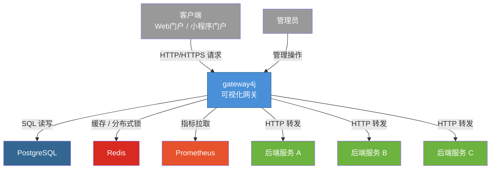
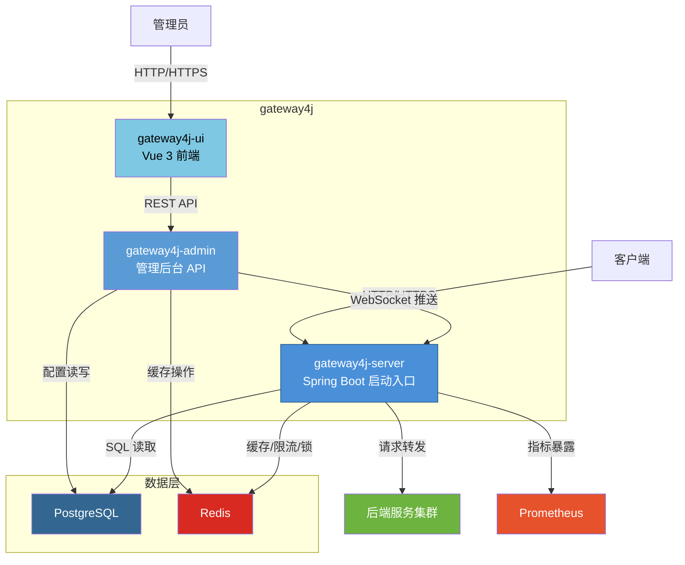
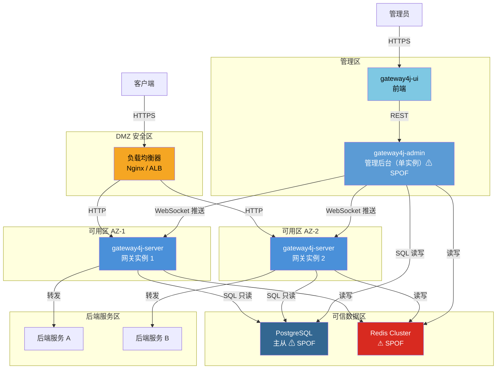

# 可视化网关 - 技术方案 V1.0.0

## 1. 基础信息

| 项 | 值 |
|---|---|
| 项目名称 | 可视化网关（gateway4j） |
| 文档状态 | 草稿 |
| 创建日期 | 2026-07-14 |
| 关联文档 | PRODUCT.md（PRD V1.0.0） |

### 1.1 修订历史

| 版本 | 日期 | 作者 | 变更说明 |
|---|---|---|---|
| V1.0.0 | 2026-07-14 | — | 初稿 |

---

## 2. 架构原则

| # | 原则 | 理由 |
|---|---|---|
| 1 | **响应式非阻塞优先** | 网关作为流量入口，必须以最小线程开销承载高并发；Spring Cloud Gateway 基于 Netty + Reactor，全链路 Mono/Flux 避免线程阻塞，单实例即可支撑万级 RPS |
| 2 | **插件隔离与沙箱化** | 第三方/用户自定义插件不可信任，必须通过独立 ClassLoader（JAR）或沙箱（Groovy）隔离，防止恶意或缺陷代码影响网关主进程稳定性 |
| 3 | **配置驱动路由** | 路由规则、插件绑定、条件表达式均由数据库配置驱动，运行时热加载，避免硬编码和重启，实现运维零接触变更 |
| 4 | **快速失败与优雅降级** | 上游异常、插件错误、配置缺失时立即短路返回明确错误码，而非静默吞错；同时通过降级策略保证核心转发能力不中断 |
| 5 | **零停机配置更新** | 配置变更通过 Copy-on-Write 机制原子切换，旧请求走旧链、新请求走新链，确保更新期间无请求丢失或异常 |

---

## 3. 系统架构

### 3.1 C4 L1 系统上下图



> 数据流方向：客户端 → 网关 → 后端服务（请求流）；后端服务 → 网关 → 客户端（响应流）；网关 ↔ PostgreSQL/Redis（双向读写）；Prometheus ← 网关（单向拉取）

### 3.2 C4 L2 容器图



> 数据流方向：客户端 → server → 后端（请求流）；admin → PostgreSQL/Redis（配置写入流）；admin → server（WebSocket 推送流，单向）；server → PostgreSQL（只读配置流）；server ↔ Redis（双向读写）

### 3.3 部署架构



> 安全域边界：DMZ（仅暴露负载均衡器）→ 应用区（网关实例跨 AZ 部署）→ 管理区（独立网络段，仅管理员可访问）→ 可信数据区（仅允许应用区和管理区访问）。标注 ⚠ SPOF 的组件需在后续迭代中引入高可用方案。

### 3.4 技术选型

| 层次 | 技术 | 版本 | 说明 |
|---|---|---|---|
| 网关引擎 | Spring Cloud Gateway | 4.2.0 | 响应式非阻塞，基于 Netty |
| Web 框架 | Spring Boot | 3.4.1 | 管理后台 API |
| 基础框架 | framework4j | v1.10.1 | 鉴权/签名/限流/缓存/审计/脱敏/幂等/ID/多Redis/多DataSource |
| 数据库 | PostgreSQL | 16+ | 配置持久化 |
| 连接池 | Druid | 1.2.24 | 阿里数据库连接池 |
| ORM | MyBatis-Plus | 3.5.x | 简化 CRUD |
| 缓存 | framework4j-cache (Caffeine + Redis) | v1.10.1 | 多级缓存（路由/插件配置） |
| 脚本引擎 | Groovy | 4.0.x | 脚本插件 + 脚本条件 |
| 监控 | Micrometer + Prometheus | - | 指标采集与展示 |
| 日志 | Log4j2 | - | 结构化 JSON 日志 |
| 前端 | Vue 3 + Element Plus | - | 管理后台 UI |
| 画布 | Vue Flow / AntV X6 | - | 路由编排画布 |

---

## 4. 模块划分

### 4.1 Maven 模块结构

```
gateway4j                          (pom, 父工程)
├── gateway4j-server               (jar, 启动模块)
├── gateway4j-engine               (jar, 网关引擎核心)
│   ├── 路由决策引擎
│   ├── 插件链执行器
│   └── 配置加载/热更新
├── gateway4j-plugin-api           (jar, 插件 SDK 接口)
├── gateway4j-plugin-builtins      (jar, 内置插件集合)
├── gateway4j-admin                (jar, 管理后台 API)
├── gateway4j-common               (jar, 公共工具/DTO)
└── gateway4j-ui                   (npm, 前端管理界面)
```

### 4.2 模块职责

| 模块 | 职责 | 依赖 |
|---|---|---|
| gateway4j-server | Spring Boot 启动入口，组装所有模块 | engine, admin, builtins |
| gateway4j-engine | 网关核心：路由决策、插件链执行、请求转发 | plugin-api, common |
| gateway4j-plugin-api | 插件 SDK：接口定义、基类、注解 | common |
| gateway4j-plugin-builtins | 6 个内置插件实现 | plugin-api |
| gateway4j-admin | 管理后台 REST API：路由/插件/监控 CRUD | common, engine |
| gateway4j-common | DTO、工具类、常量、异常定义 | 无内部依赖 |
| gateway4j-ui | Vue 3 前端：路由编排画布、插件管理、监控大盘 | admin API |

---

## 5. 核心设计

### 5.1 路由决策引擎

#### 5.1.1 路由模型

```
RouteConfig（路由配置）
├── id: Long
├── routeName: String
├── routeType: RouteType (DISPATCH / BACKEND)
├── path: String          (后置路由的匹配路径)
├── upstreamUrl: String   (后置路由的后端地址)
├── status: RouteStatus
├── conditions: List<Condition>  (分发路由的条件列表)
└── plugins: List<PluginBinding> (挂载的插件)

Condition（分发条件）
├── id: Long
├── conditionType: ConditionType (HEADER/PATH/QUERY/BODY/GROOVY)
├── operator: String       (eq/ne/contains/regex/...)
├── key: String            (条件键，如 header name)
├── value: String          (条件值)
├── priority: Integer      (优先级，小值优先)
└── targetRouteId: Long    (匹配后跳转的路由 ID)
```

#### 5.1.2 请求处理流程

```
请求进入
  │
  ▼
全局前置插件链 ──→ 插件异常 → 返回错误响应
  │
  ▼
路径匹配 → 找到入口分发路由
  │
  ▼
分发路由决策循环 ─────────────────────┐
  │                                   │
  ├─ 评估条件（按 priority 排序）       │
  │   ├─ 匹配 → 跳转目标路由           │
  │   │   ├─ 目标是分发路由 → 回到循环 ─┘
  │   │   └─ 目标是后置路由 → 继续
  │   └─ 无匹配 → 返回 404
  │
  ▼
后置路由处理
  │
  ├─ 路由前置插件链
  │
  ▼
转发至后端服务（Spring Cloud Gateway 原生转发）
  │
  ▼
路由后置插件链
  │
  ▼
全局后置插件链
  │
  ▼
返回响应
```

#### 5.1.3 嵌套深度与循环检测

- 最大嵌套深度 5 层，超过返回错误码 10604 (DEPTH_EXCEEDED)
- 配置保存时通过有向图 DFS 检测循环引用，存在则拒绝
- 运行时增加深度计数器，防止配置错误导致无限循环

### 5.2 插件体系

> 插件体系设计借鉴 Apache ShenYu 的 ShenyuPlugin + ShenyuPluginChain 模式（详见 PRODUCT.md §7.1），但解耦了 ShenYu 的 BaseDataCache 单例和 ShenyuContext 共享常量，采用 PluginContext 类型安全封装和数据库配置驱动。

#### 5.2.1 插件接口设计

```java
/**
 * 插件 SDK 核心接口
 * 所有插件（内置/JAR/Groovy/分组）均实现此接口
 */
public interface GatewayPlugin {

    /** 插件唯一标识 */
    String pluginId();

    /** 插件名称 */
    String pluginName();

    /** 执行阶段 */
    PluginPhase phase();

    /** 执行顺序（同阶段内，小值优先） */
    int order();

    /** 是否跳过 */
    boolean skip(ServerWebExchange exchange);

    /** 执行插件逻辑 */
    Mono<Void> execute(ServerWebExchange exchange, PluginChain chain);

    /** 插件配置变更回调 */
    void onConfigChange(PluginConfig config);

    /** 插件销毁回调 */
    void onDestroy();
}

/** 插件执行阶段 */
public enum PluginPhase {
    PRE,   // 前置：请求进入后端前
    POST   // 后置：后端响应返回后
}

/** 插件链 */
public interface PluginChain {
    Mono<Void> execute(ServerWebExchange exchange);
}

/** 插件上下文：ServerWebExchange attributes 的类型安全封装 */
public interface PluginContext {
    <T> T get(String key, Class<T> type);
    void set(String key, Object value);
    ServerWebExchange exchange();
}
```

#### 5.2.2 插件链执行

```
请求
  │
  ▼
全局前置插件链（按 order 排序）
  Plugin-A.pre → Plugin-B.pre → ... → chain.execute()
  │
  ▼
路由前置插件链（按 order 排序）
  Plugin-X.pre → Plugin-Y.pre → ... → chain.execute()
  │
  ▼
Spring Cloud Gateway 原生转发
  │
  ▼
路由后置插件链（按 order 倒序）
  Plugin-Y.post → Plugin-X.post → ... → chain.execute()
  │
  ▼
全局后置插件链（按 order 倒序）
  Plugin-B.post → Plugin-A.post → ... → chain.execute()
  │
  ▼
响应返回
```

#### 5.2.3 插件类型实现

| 类型 | 实现方式 | 加载方式 |
|---|---|---|
| 内置插件 | 实现 `GatewayPlugin`，Spring Bean | 启动时自动注册 |
| JAR 插件 | 实现 `GatewayPlugin`，独立 ClassLoader | 上传后动态加载 |
| Groovy 插件 | 实现 `GatewayPlugin`，Groovy 编译 | 配置后热编译 |
| 分组插件 | `GroupPlugin` 持有 `List<GatewayPlugin>` | 组合已有插件 |

#### 5.2.4 JAR 插件动态加载

```
上传 JAR
  │
  ▼
校验 JAR 结构
  ├─ 检查 META-INF/gateway4j-plugin.properties
  ├─ 检查是否实现 GatewayPlugin 接口
  └─ 校验失败 → 返回具体原因
  │
  ▼
创建独立 ClassLoader（父类加载器 = 插件 API ClassLoader）
  │
  ▼
实例化插件 → 注册到插件链
  │
  ▼
启用/禁用 → 动态增删插件链
```

#### 5.2.5 Groovy 脚本插件

```java
/**
 * Groovy 插件包装器
 * 将 Groovy 脚本编译为 GatewayPlugin 实现
 */
public class GroovyPluginWrapper implements GatewayPlugin {

    private final String scriptContent;
    private volatile GatewayPlugin compiled;

    /** 编译脚本，语法错误抛出 GroovyCompilationException */
    public void compile() { ... }

    /** 热更新：重新编译并替换 */
    public void recompile(String newScript) { ... }

    /** 沙箱限制：禁用 Runtime.exec、ProcessBuilder、FileIO、反射等 */
    private void applySandbox() { ... }
}
```

#### 5.2.6 分组插件

```java
public class GroupPlugin implements GatewayPlugin {

    private final String groupId;
    private final List<GatewayPlugin> plugins;  // 按 order 排序

    @Override
    public Mono<Void> execute(ServerWebExchange exchange, PluginChain chain) {
        // 创建子链，依次执行分组内插件
        return new GroupPluginChain(plugins).execute(exchange)
            .then(chain.execute(exchange));
    }
}
```

### 5.3 配置中心

#### 5.3.1 配置加载

```
网关启动
  │
  ▼
从数据库加载全量配置
  ├─ 路由配置（含条件、插件绑定）
  ├─ 插件配置（含 JAR/Groovy/分组）
  └─ 全局插件排序
  │
  ▼
写入 Caffeine 本地缓存
  │
  ▼
构建路由匹配树（Trie + 条件索引）
  │
  ▼
构建插件链（全局 + 每条路由）
  │
  ▼
网关就绪，开始接收请求
```

#### 5.3.2 配置热更新

```
管理后台修改配置
  │
  ▼
写入数据库
  │
  ▼
发布 Spring ApplicationEvent（ConfigChangeEvent）
  │
  ├─→ 本实例：更新缓存 + 重建路由树/插件链
  │
  └─→ WebSocket 推送至其他实例
        │
        ▼
      其他实例收到推送
        │
        ▼
      更新缓存 + 重建路由树/插件链
        │
        ▼
      回执确认
```

#### 5.3.3 推送可靠性

- 推送方式：WebSocket 长连接
- 确认机制：接收方回执 configVersion
- 重试：未确认 3s 后重试，最多 3 次
- 失败告警：3 次失败后大盘标红 + 日志告警
- 兜底：网关实例每 30s 轮询数据库比对版本号，防止推送丢失

### 5.4 监控指标

基于 Micrometer 采集，Prometheus 拉取：

| 指标名 | 类型 | 标签 | 说明 |
|---|---|---|---|
| `gateway_request_total` | Counter | route_id, status | 请求总数 |
| `gateway_request_duration` | Timer | route_id, plugin_id | 请求延迟分布 |
| `gateway_plugin_duration` | Timer | plugin_id, phase, success | 插件执行耗时 |
| `gateway_route_active` | Gauge | route_id | 当前活跃连接数 |
| `gateway_config_push` | Counter | status (success/fail) | 配置推送次数 |
| `gateway_error_rate` | Gauge | route_id | 错误率（5xx / 总请求） |
| `gateway_availability` | Gauge | — | 可用性（1 - 错误率） |
| `gateway_saturation` | Gauge | — | 饱和度（活跃连接 / 最大连接） |
| `gateway_upstream_health` | Gauge | upstream_id, status | 上游健康状态（1=健康 / 0=异常） |
| `gateway_config_staleness` | Gauge | instance_id | 配置过期时间（秒，当前版本与数据库最新版本的时间差） |

---

## 6. 关键类设计

### 6.1 包结构

```
fun.commons.gateway4j
├── engine                          # 网关引擎
│   ├── config                      # 引擎配置
│   ├── handler                     # WebHandler（入口）
│   ├── route                       # 路由决策
│   │   ├── model                   # 路由模型
│   │   ├── matcher                 # 路径匹配（Trie）
│   │   ├── dispatcher              # 分发路由决策
│   │   └── validator               # 循环检测/深度校验
│   ├── plugin                      # 插件体系
│   │   ├── chain                   # 插件链
│   │   ├── loader                  # 插件加载器（JAR/Groovy）
│   │   ├── sandbox                 # Groovy 沙箱
│   │   └── group                   # 分组插件
│   ├── config                      # 配置中心
│   │   ├── cache                   # Caffeine 缓存
│   │   ├── sync                    # 配置同步/推送
│   │   └── event                   # 配置变更事件
│   └── monitor                     # 监控指标
├── plugin-api                      # 插件 SDK
│   ├── GatewayPlugin               # 插件接口
│   ├── PluginChain                 # 插件链接口
│   ├── PluginContext               # 插件上下文（Exchange attributes 类型安全封装）
│   ├── PluginConfig                # 插件配置
│   ├── PluginPhase                 # 执行阶段枚举
│   └── AbstractGatewayPlugin       # 插件基类
├── plugin-builtins                 # 内置插件
│   ├── security                    # 安全插件
│   ├── cache                       # 缓存插件
│   ├── ratelimit                   # 限流插件
│   ├── sharing                     # 共享插件
│   ├── logging                     # 日志插件
│   └── tracing                     # 跟踪插件
├── admin                           # 管理后台
│   ├── controller                  # REST API
│   ├── service                     # 业务逻辑
│   ├── mapper                      # MyBatis Mapper
│   └── dto                         # 请求/响应 DTO
└── common                          # 公共模块
    ├── model                       # 数据库实体
    ├── constant                    # 常量/字典
    ├── exception                   # 异常定义
    └── util                        # 工具类
```

### 6.2 核心类

| 类 | 职责 |
|---|---|
| `GatewayWebHandler` | 实现 `WebHandler`，网关请求入口，编排全局插件→路由决策→路由插件→转发 |
| `RouteDispatcher` | 分发路由决策引擎，评估条件、处理嵌套、深度控制 |
| `RouteMatcher` | 路径匹配，基于 Trie 树快速定位入口分发路由 |
| `PluginChainFactory` | 根据配置构建插件链（全局+路由级） |
| `DefaultPluginChain` | 插件链默认实现，按序执行插件 |
| `JarPluginLoader` | JAR 插件动态加载器，独立 ClassLoader |
| `GroovyPluginFactory` | Groovy 脚本编译为 GatewayPlugin |
| `GroovySandbox` | Groovy 沙箱，限制危险操作 |
| `GroupPlugin` | 分组插件，组合多个插件 |
| `ConfigService` | 配置加载、缓存、变更推送 |
| `ConfigPushService` | WebSocket 推送配置变更至其他实例 |

---

## 7. 与 Spring Cloud Gateway 的集成

### 7.1 集成方式

不替换 Spring Cloud Gateway 的核心转发能力，在其上层封装路由决策和插件体系：

```
请求 → GatewayWebHandler（自定义）
         │
         ├─ 全局前置插件链
         ├─ RouteDispatcher（分发路由决策）
         ├─ 路由前置插件链
         │
         ▼
       Spring Cloud Gateway 原生 RouteLocator
         │（设置目标 URI，由 SCG 完成实际转发）
         ▼
       SCG 原生转发（Netty HttpClient）
         │
         ▼
       路由后置插件链 → 全局后置插件链 → 响应返回
```

**与 SCG 内部机制的协作说明**：

- `GatewayWebHandler` 替代了 SCG 默认的 `DispatcherHandler` 作为主 `WebHandler`，在 SCG 的请求处理链最前端接管请求，执行自定义的插件链和路由决策。
- `DynamicRouteLocator` 注册后置路由时使用 `predicate(exchange -> true)`，因为实际的请求-路由匹配由 `RouteDispatcher` 完成；SCG 的 RoutePredicate 仅用于让 SCG 框架识别到这些路由的存在。
- SCG 的 `FilteringWebHandler` 仍被使用，负责实际的代理转发（执行 SCG 内置的 GlobalFilter 链，如 `ForwardRoutingFilter`、`ReactiveLoadBalancerClientFilter` 等）。
- 完整请求流：`GatewayWebHandler`（插件链 + RouteDispatcher）→ SCG `RouteLocator` → SCG `FilteringWebHandler` → Netty 代理转发。

### 7.2 RouteLocator 适配

自定义 `DynamicRouteLocator` 实现 `RouteLocator`，从数据库加载路由配置，动态生成 Spring Cloud Gateway 的 `Route` 对象：

```java
public class DynamicRouteLocator implements RouteLocator {

    private final ConfigService configService;

    @Override
    public Flux<Route> getRoutes() {
        // 从缓存获取所有后置路由，转为 SCG Route
        return Flux.fromIterable(configService.getBackendRoutes())
            .map(this::toScgRoute);
    }

    private Route toScgRoute(BackendRouteConfig config) {
        return Route.builder()
            .id(config.getId().toString())
            .uri(URI.create(config.getUpstreamUrl()))
            .predicate(exchange -> true)  // 路由匹配由 RouteDispatcher 完成
            .build();
    }
}
```

---

## 8. 安全设计

### 8.1 插件隔离

- JAR 插件使用独立 `URLClassLoader`，父类加载器仅加载 `plugin-api` 和 `common`
- 插件间不可直接引用，仅通过 `ServerWebExchange` attributes 传递数据
- 插件卸载时关闭 ClassLoader，释放资源

### 8.2 Groovy 沙箱

```java
// 禁止的操作黑名单
Set<String> DENIED_PACKAGES = Set.of(
    "java.lang.Runtime", "java.lang.ProcessBuilder",
    "java.io.File", "java.io.FileInputStream", "java.io.FileOutputStream",
    "java.lang.reflect.AccessibleObject",
    "java.net.Socket", "java.net.ServerSocket",
    "java.lang.Thread", "java.lang.ThreadGroup",
    "java.lang.System"
);

// 禁止的方法调用
Set<String> DENIED_METHODS = Set.of(
    "exit", "halt", "exec", "start", "stop"
);

// CompilerConfiguration 设置
CompilerConfiguration config = new CompilerConfiguration();
config.addCompilationCustomizers(new SandboxVisitor());
```

### 8.3 管理后台安全

- JWT 认证，RBAC 权限控制
- 写操作幂等（Idempotency-Key）
- 敏感配置（密钥、Token）AES 加密存储

---

## 9. 性能设计

### 9.1 路由匹配

- 路径匹配：Trie 树，O(k) 复杂度（k = 路径长度）
- 条件匹配：按 priority 排序，首个匹配即返回
- 缓存：Caffeine 缓存路由配置，避免每次请求查库

### 9.2 插件执行

- 插件链基于 Reactor（Mono/Flux），全链路非阻塞
- 插件内禁止阻塞操作（如 JDBC 查询），需用 R2DBC 或异步封装
- 插件执行耗时通过 Micrometer Timer 采集，P99 > 10ms 告警

### 9.3 配置更新

- 增量更新：仅重建受影响的路由/插件链，非全量
- Copy-on-Write：插件链更新时创建新链，旧请求走旧链，新请求走新链

### 9.4 非功能性需求（NFR）

| 指标 | 目标值 | 说明 |
|---|---|---|
| SLA 可用性 | 99.95% | 月度不可用时间 ≤ 22 分钟 |
| RTO | < 5 分钟 | 故障发生后恢复服务的时间 |
| RPO | < 1 分钟 | 故障发生时最大可接受数据丢失窗口 |
| 端到端 P99 延迟 | < 50 ms | 客户端请求到响应的 P99 延迟（不含上游耗时） |
| 吞吐量 | 10,000 RPS | 单实例稳态吞吐，集群可水平扩展 |
| 错误率预算 | < 0.1% | 5xx 错误占总请求比例 |

### 9.5 容量规划（6 个月预测）

| 维度 | 当前基线 | 6 个月预测 | 扩容策略 |
|---|---|---|---|
| 峰值 QPS | 2,000 | 8,000 | 网关实例从 2 扩至 4，负载均衡器水平扩展 |
| 平均 QPS | 500 | 2,000 | Caffeine 缓存命中率 > 95%，Redis 缓存分担读压力 |
| 路由数量 | 50 | 200 | Trie 树内存占用线性增长，单实例可支撑千级路由 |
| 插件数量 | 20 | 80 | 插件链构建为不可变对象，Copy-on-Write 无锁开销 |
| 配置数据量 | 10 MB | 50 MB | PostgreSQL 配置表数据量小，Caffeine 本地缓存覆盖热数据 |
| 内存占用 | 512 MB | 1.5 GB | JVM 堆设置 2 GB，预留 30% 余量应对突发流量 |
| 连接数 | 5,000 | 20,000 | Netty 基于 EventLoop，单实例可支撑万级长连接 |

### 9.6 降级与熔断策略

#### 9.6.1 上游熔断

- 基于 Resilience4j CircuitBreaker，配置阈值：失败率 > 50%（10 秒窗口）触发熔断
- 熔断后返回 503 + 自定义降级响应（可配置降级内容）
- 半开状态：每 5 秒放行 1 个探测请求，成功则恢复

#### 9.6.2 Redis 不可用策略

- Redis 连接失败时，限流插件降级为本地令牌桶（Guava RateLimiter）
- 缓存插件降级为仅 Caffeine 本地缓存，跳过 Redis 读写
- 分布式锁降级为本地锁，仅保证单实例互斥
- 监控指标 `gateway_redis_health` 标记为 0，触发告警

#### 9.6.3 PostgreSQL 不可用策略

- 网关启动时已将全量配置加载至 Caffeine 缓存，PG 不可用不影响请求转发
- 管理后台写操作返回 503，提示数据库不可用
- 配置热更新暂停，WebSocket 推送暂停，等待 PG 恢复后自动重连
- 监控指标 `gateway_pg_health` 标记为 0，触发告警

#### 9.6.4 WebSocket 推送失败策略

- 推送失败 3 次后标记该实例为推送异常，大盘标红
- 兜底轮询：每 30s 比对数据库版本号，自动补偿丢失的配置变更
- 推送源（Admin 实例）不可用时，网关实例仍可独立运行，仅配置更新延迟

### 9.7 单点故障（SPOF）标注

| 组件 | SPOF 风险 | 当前状态 | 缓解措施 | 后续计划 |
|---|---|---|---|---|
| Admin 管理后台实例 | 高 | 单实例部署 | 管理后台不可用不影响网关转发 | Phase 4 引入 Admin 多实例 + 选举 |
| PostgreSQL | 高 | 主从部署，写入单点 | 网关运行时仅读 Caffeine 缓存，PG 故障不影响转发 | 引入 PG 高可用集群（Patroni / 流复制自动切换） |
| Redis | 中 | 单实例 / Cluster | 降级为本地缓存 + 本地限流 | Phase 4 引入 Redis Cluster + 跨 AZ 副本 |
| WebSocket 推送源 | 中 | Admin 实例单点推送 | 30s 轮询兜底 | 引入消息队列（MQ）替代 WebSocket 推送 |

PostgreSQL 备份：V1 采用 pg_basebackup 每日全量备份 + WAL 归档，RPO < 1min（PITR）；后续接入 Patroni 流复制实现 HA。

### 9.8 灰度与回滚

V1 灰度发布能力有限，主要依赖以下运维手段实现灰度验证和故障回滚：

| 场景 | 回滚方式 | 说明 |
|---|---|---|
| 路由配置变更 | 路由下线 → 验证 → 重新发布 | 修改路由后先下线（status=OFFLINE），验证无误后重新上线（status=PUBLISHED） |
| 插件异常 | 插件禁用 | 通过管理后台将插件状态设为 DISABLED，立即从插件链中移除，无需重启 |
| 配置版本回退 | config_version 回滚 | 每次配置变更生成新 config_version，回滚时指定目标版本号，重建路由树和插件链 |

> 详细的回滚操作步骤参见 PRD §4.6 回滚表。完整的金丝雀发布（按比例分流）和蓝绿发布能力在 Phase 4 迭代计划中规划。

---

## 10. framework4j SDK 集成

### 10.1 模块映射

| gateway4j 需求 | framework4j 模块 | 用法 |
|---|---|---|
| 管理后台 JWT 认证 | framework4j-accesstoken | `@RequiresToken` 保护 Admin API |
| Token 刷新/续期 | framework4j-accesstoken | `RefreshTokenService.generateTokenPair()` / `X-Token-Expire-At` |
| 开放 API 签名 | framework4j-signature | `@RequiresSignature` 保护开放接口 |
| 限流插件 | framework4j-rate-limit | `@RateLimit` 注解，Lua 滑动窗口 |
| 路由/插件配置缓存 | framework4j-cache | `CacheService` / `@CacheableGet`，Caffeine + Redis 多级缓存 |
| 操作审计日志 | framework4j-audit | `@Auditable` 记录路由/插件变更操作 |
| 插件配置脱敏/加密 | framework4j-sensitive | `@Sensitive` 脱敏 + `EncryptedFieldTypeHandler` DB 加密 |
| 写操作幂等 | framework4j-idempotency | `Idempotency-Key` Header 自动防重 |
| 分布式 ID | framework4j-id | `SnowflakeDistributor.nextId()` 生成路由/插件 ID |
| 统一响应格式 | framework4j-web + framework4j-api | `ApiResponse` 信封 + `ApiCode` 错误码 |
| 多 Redis | framework4j-redis | `@RedisOn` 切换数据源 |
| 多 DataSource | framework4j-datasource | `@DataSourceOn` 切换数据源 |

### 10.2 内置插件与 framework4j 对接

| 内置插件 | framework4j 能力 | 对接方式 |
|---|---|---|
| 安全插件 | framework4j-accesstoken + framework4j-signature | 插件内调用 `AccessTokenGenerator` / `SignatureValidator` |
| 限流插件 | framework4j-rate-limit | 插件内调用 `RateLimitService`，按 IP/user/global 维度限流 |
| 缓存插件 | framework4j-cache | 插件内调用 `CacheService`，响应缓存 + 黑名单缓存 |
| 日志插件 | framework4j-audit | 插件内调用 `AuditService`，请求响应日志采集 |
| 跟踪插件 | — | 插件内注入 trace_id（W3C Trace Context），传递至下游；V1 通过日志关联，后续集成 OpenTelemetry + Jaeger |
| 共享插件 | framework4j-accesstoken | 插件内调用 `AccessTokenGenerator`，统一 Token 管理 |

### 10.3 管理后台 framework4j 使用

```java
// Admin Controller 示例
@RequiresToken("WEB")                    // JWT 认证
@RateLimit(limit = 100, window = "1m")   // 限流
@Auditable(action = "UPDATE_ROUTE", targetType = "route", targetIdSpel = "#id")
@PutMapping("/v1/routes/{id}")
public ApiResponse<RouteVO> updateRoute(@PathVariable Long id,
                                         @RequestBody RouteUpdateRequest req) {
    Route route = routeService.update(id, req);
    return ApiResponse.success(toVO(route));
}
```

---

## 11. 迭代计划

### Phase 1 - 核心引擎（MVP）

- 路由决策引擎（分发路由 + 后置路由）
- 插件 SDK + 插件链执行
- 内置插件（安全、限流、日志）
- 管理后台 API（路由/插件 CRUD）
- 配置数据库持久化 + 本地缓存

### Phase 2 - 可视化编排

- Vue 前端管理界面
- 路由编排画布（Vue Flow）
- 插件管理界面
- Groovy 脚本编辑器

### Phase 3 - 高级特性

- JAR 插件动态加载
- 分组插件
- 配置 WebSocket 推送
- 监控大盘
- 内置插件补全（缓存、共享、跟踪）

### Phase 4 - 生产增强

- 集群部署支持
- Nacos/Consul 服务发现
- 灰度发布
- 告警通知
- 性能调优

---

## 12. 架构决策记录（ADR）

详细 ADR 文档存放于 `docs/adr/` 目录，以下为摘要索引。

### ADR-001：选择 Spring Cloud Gateway 作为网关基础

| 项 | 内容 |
|---|---|
| **背景** | 需要选择 HTTP 网关的基础框架，候选方案包括：自研 Netty Server、Spring Cloud Gateway、Kong、APISIX |
| **决策** | 采用 Spring Cloud Gateway 4.2.0 作为网关基础，在其上层封装路由决策和插件体系 |
| **理由** | (1) 基于 Reactor + Netty，天然非阻塞，满足高并发需求；(2) 与 Spring Boot 生态无缝集成，降低运维复杂度；(3) 内置路由转发、过滤器链等能力，减少重复造轮子；(4) 社区活跃，长期维护有保障 |
| **后果** | 正面：快速交付、生态丰富、非阻塞性能优异。负面：与 Spring 生态强绑定，迁移成本高；SCG 的 RouteLocator 抽象需适配自定义路由模型 |
| **状态** | 已采纳 |

### ADR-002：使用 WebSocket 进行配置同步推送

| 项 | 内容 |
|---|---|
| **背景** | 集群部署时，管理后台配置变更需实时同步至所有网关实例，候选方案包括：WebSocket 推送、消息队列（MQ）、定时轮询 |
| **决策** | 采用 WebSocket 长连接推送 + 30s 轮询兜底 |
| **理由** | (1) WebSocket 实时性好，延迟 < 100ms；(2) 实现简单，无需引入 MQ 中间件；(3) 30s 轮询兜底保证最终一致性 |
| **后果** | 正面：实时性高、架构简单。负面：WebSocket 非保证投递，存在消息丢失风险（由轮询兜底）；推送源（Admin）为单点，需额外高可用方案；集群规模 > 50 实例时 WebSocket 连接数可能成为瓶颈 |
| **状态** | 已采纳，待评估 MQ 替代方案 |

### ADR-003：JAR 插件使用独立 ClassLoader

| 项 | 内容 |
|---|---|
| **背景** | JAR 插件由用户上传，需在网关进程中安全运行，候选方案包括：独立 ClassLoader、OSGi 容器、独立进程 + IPC |
| **决策** | 为每个 JAR 插件创建独立 URLClassLoader，父类加载器仅加载 plugin-api 和 common |
| **理由** | (1) ClassLoader 隔离防止类冲突和依赖污染；(2) 支持插件热卸载（关闭 ClassLoader 释放资源）；(3) 实现简单，无需引入 OSGi 复杂度 |
| **后果** | 正面：隔离性好、支持热加载/卸载。负面：ClassLoader 泄漏风险（未关闭的资源引用导致 Metaspace OOM）；每个 ClassLoader 独立加载依赖类，内存开销增大；需严格管理插件生命周期 |
| **状态** | 已采纳 |

---

## 13. 风险与权衡

| # | 风险/权衡 | 影响 | 缓解措施 |
|---|---|---|---|
| 1 | **WebSocket 配置同步非保证投递 vs 消息队列** | WebSocket 推送可能丢失，导致实例间配置短暂不一致 | 30s 轮询兜底保证最终一致性；Phase 4 评估引入 MQ（Kafka/RabbitMQ）替代 WebSocket，实现保证投递 |
| 2 | **Groovy 沙箱逃逸风险** | 恶意脚本可能绕过沙箱限制，访问系统资源（文件、网络、进程） | 持续更新黑名单；运行时 SecurityManager 二次拦截；Groovy 插件仅限管理员上传，审计日志记录 |
| 3 | **JAR ClassLoader 内存泄漏** | 插件卸载时若存在未关闭的资源引用（线程、静态变量），ClassLoader 无法回收，导致 Metaspace OOM | 插件必须实现 `onDestroy()` 清理资源；卸载前检测 ClassLoader 引用计数；定期监控 Metaspace 使用率，超阈值告警 |
| 4 | **Admin 实例集群内单点故障** | Admin 实例宕机后无法进行配置变更和 WebSocket 推送 | 网关转发不受影响（Caffeine 缓存独立运行）；30s 轮询兜底；Phase 4 引入 Admin 多实例 + Leader 选举 |
| 5 | **路由嵌套深度限制（5 层）的权衡** | 深度限制过严可能无法满足复杂业务场景，过松则增加循环风险和调试难度 | 5 层覆盖绝大多数业务场景；配置保存时 DFS 检测循环；运行时深度计数器硬限制；超限返回错误码 10604 (DEPTH_EXCEEDED) + 明确错误信息 |

V1 超出范围：多区域部署、蓝绿发布、DR 演练。这些在 Phase 4 迭代计划中规划。
