# Gateway4j 管理后台 —— 全量回归测试报告

| 项 | 内容 |
|---|---|
| **报告编号** | 2026-10-27-01 |
| **报告日期** | 2026-10-27 |
| **被测系统** | gateway4j 可视化网关管理后台（gateway4j-admin-ui） |
| **后端** | gateway4j-admin-boot（Tomcat/9301）、gateway4j-gateway-boot（Netty/9300） |
| **数据库** | PostgreSQL 17（容器 `pg-17`，库 `gateway4j`） |
| **测试方式** | Playwright 1.60 + Chromium（1600×1000），真实后端 + 真实数据库，黑盒 UI 回归 |
| **业务线** | 9 条（BL-01 ~ BL-09） |
| **用例总数** | **106** |
| **执行结果** | **✅ 通过 76 / ❌ 失败 30**（通过率 71.7%） |
| **缺陷总数** | **21**（P0 × 8、P1 × 7、P2 × 6） |
| **证据** | 139 张界面截图 + 123 份诊断日志（控制台错误 / 失败请求 / HTTP≥400 / 后端 API 调用序列） |
| **代码改动** | **无**（本次仅新增测试资产，未改动任何产品代码） |

---

## 1. 结论摘要

### 1.1 总体判断

本轮回归覆盖了后台的 **9 条业务线、106 条用例**。核心业务能力（路由增删改查、发布/删除、插件 CRUD、Groovy 脚本校验、全局插件编排、内置插件动态配置、看板三 Tab、导入导出全链路）**大部分可用**，未发现崩溃、阻塞或数据丢失以外的系统性事故。

但回归暴露了一个**贯穿全站的结构性缺陷**：

> **管理后台的侧边栏与顶栏从未被渲染。**
> `MainLayout.vue` 通过 `<template #sidebar>` / `<template #header>` 向 `FcMain` 注入导航外壳，而 `FcMain.vue` 只声明了默认插槽 —— Vue 3 会**静默丢弃**没有出口的具名插槽（不报错、不告警）。结果是 `.fc-sidebar`、`.fc-header` 在整个 DOM 中**完全不存在**。
>
> 连带后果：**用户没有任何可见的导航入口，没有任何可见的退出登录入口，无法切换主题与语言。**
> 这不是"某个按钮少了一个"，而是"整个后台的操作外壳没装上"。

同一族的第二个缺陷：**`FcFilterBar` 也没有 `actions` 具名插槽**，导致路由列表、用户列表、插件列表上写在 `#actions` 里的 **「新建 / 导入」主操作按钮全部不渲染** —— 所有**创建类入口**在界面上消失。

再叠加第三个缺陷：**前后端权限码词表不一致**（前端用 `user:edit` / `system:edit` / `user:read`，后端种子数据里根本没有这些码），导致**用户管理模块整体只读**、**系统设置无保存按钮**。

> **一句话结论：当前版本的后台不是一个"操作效率偏低的工具"，而是一个"必须知道 URL 才能用的半成品"。**
> 所有业务功能本身可用，但用户无法通过界面抵达它们。

### 1.2 风险最高的三条（建议立即修复）

| 缺陷 | 一句话描述 | 影响面 | 证据 |
|---|---|---|---|
| **D11** | `useFcConfirm` 命令式确认弹窗**永远 resolve(false)** | 路由**发布/下线**、插件禁用（列表/全局/内置 3 处）、用户禁用 —— **6 类写操作 100% 失效**，点击「确认」后**连请求都没发出** | [03-routes/03-14](screenshots/03-routes/03-14_草稿路由可发布_确认弹窗_状态真的变为已发布___FAIL.png) |
| **D19** | 画布保存接口**前后端契约不匹配**，返回 200 但数据从不落库 | 核心卖点「可视化编排」**保存后刷新即丢失**，且界面仍提示「已自动保存」 | [04-canvas/04-09](screenshots/04-canvas/04-09_保存画布后刷新页面节点持久化__FAIL.png) |
| **D12** | 路由表单校验**返回值被忽略**，非法路由名/路径/上游地址**直接入库** | 数据质量事故；脏路由会进入网关生效链路 | [03-routes/03-08](screenshots/03-routes/03-08_新建路由_非法名称_路径格式被前端拦截__FAIL.png) |

此外还有 **D21**（内置插件配置动态表单整体失效）、**D18**（所有列表分页控件整体不渲染）两条"功能静默失效"类缺陷，详见第 5 章。

### 1.3 缺陷级别分布

| 级别 | 数量 | 编号 |
|---|---|---|
| **P0 阻塞** | 8 | D1、D2、D3、D4、D5、D11、D12、D19 |
| **P1 严重** | 7 | D6、D7、D9、D10、D16、D18、D21 |
| **P2 轻微** | 6 | D8、D13、D14、D15、D17、D20 |

> 完整清单与逐条修复意见见 [第 5 章 缺陷清单与修复意见](#5-缺陷清单与修复意见)。

---

## 2. 业务线拆分

依据产品路由表（`src/router/index.ts`）与侧边栏导航配置（`MainLayout.vue` 的 `navItems`），把后台拆成 **9 条业务线**。每条业务线独立成 spec 文件、独立截图目录、独立缺陷归口：

| 编号 | 业务线 | 覆盖页面 | 用例数 | 截图目录 | 涉及缺陷 |
|---|---|---|---|---|---|
| BL-01 | 认证与登录 + 全局外壳 | `/login`、路由守卫、应用外壳（侧边栏/顶栏） | 15 | `screenshots/01-auth/` | D1、D15 |
| BL-02 | 监控大盘 | `/dashboard`（路由状态 / 指标 / 拓扑 三 Tab） | 12 | `screenshots/02-dashboard/` | — |
| BL-03 | 路由管理 | `/routes`、`/routes/new`、`/routes/:id` | 18 | `screenshots/03-routes/` | D2、D3、D9、D11、D12 |
| BL-04 | 路由编排画布 | `/routes/:id/canvas` | 14 | `screenshots/04-canvas/` | D7、D19 |
| BL-05 | 导入导出 | `/import-export` | 10 | `screenshots/05-import-export/` | D2、D14 |
| BL-06 | 插件管理 | `/plugins`、`/plugins/new`、`/plugins/:id/edit`、`/plugins/global`、`/plugins/builtin` | 14 | `screenshots/06-plugins/` | D2、D6、D21 |
| BL-07 | 用户管理 | `/users` | 8 | `screenshots/07-users/` | D2、D5、D17、D18 |
| BL-08 | 角色与权限 | `/roles` | 6 | `screenshots/08-roles/` | D16 |
| BL-09 | 系统设置 | `/settings`（通用/安全/字典/主题） | 9 | `screenshots/09-settings/` | D1、D4、D5、D10、D13 |

### 测试资产

| 资产 | 路径 |
|---|---|
| 用例代码 | `gateway4j-admin-ui/e2e-regression/01-auth.spec.ts` … `09-settings.spec.ts` |
| 公共 helper（登录、截图、诊断、API 直调） | `gateway4j-admin-ui/e2e-regression/helpers.ts` |
| 独立 Playwright 配置 | `gateway4j-admin-ui/playwright.regression.config.ts` |
| 结果表生成脚本 | `gateway4j-admin-ui/e2e-regression/gen-results.py` |
| 原始执行日志 | `/tmp/regression-final2.log`（11.7 分钟，106 条用例，权威一轮） |

### 测试方法说明（重要）

为避免"UI 缺陷"和"后端缺陷"混淆，每条可疑用例都**成对设计**：

- **UI 层用例**：模拟真实用户操作界面，断言界面应当提供的能力 —— 失败即为 **UI 缺陷**；
- **API 层基线用例**：在同一个已登录的浏览器上下文里直连同源后端接口，断言后端能力 —— 通过即证明 **后端正常，问题只在 UI 层**。

例如 `03-12`（编辑已有路由加载失败）与 `03-13`（`PATCH /v1/routes/{id}` 直调成功）配对 ⇒ 根因精确锁定为"**缺 GET 详情接口**"，而不是"路由编辑整体不可用"。

---

## 3. 用例执行结果

### 3.1 业务线汇总

| 业务线 | 用例 | 结论 | 缺陷 | 说明 |
|---|---|---|---|---|
| **BL-01 认证与登录** | 15 | 10 通过 / 5 失败 | — | 截图目录 `screenshots/01-auth/` |
| **BL-02 监控大盘** | 12 | 12 通过 / 0 失败 | — | 截图目录 `screenshots/02-dashboard/` |
| **BL-03 路由管理** | 18 | 13 通过 / 5 失败 | — | 截图目录 `screenshots/03-routes/` |
| **BL-04 路由编排画布** | 14 | 11 通过 / 3 失败 | — | 截图目录 `screenshots/04-canvas/` |
| **BL-05 导入导出** | 10 | 7 通过 / 3 失败 | — | 截图目录 `screenshots/05-import-export/` |
| **BL-06 插件管理** | 14 | 11 通过 / 3 失败 | — | 截图目录 `screenshots/06-plugins/` |
| **BL-07 用户管理** | 8 | 3 通过 / 5 失败 | — | 截图目录 `screenshots/07-users/` |
| **BL-08 角色与权限** | 6 | 5 通过 / 1 失败 | — | 截图目录 `screenshots/08-roles/` |
| **BL-09 系统设置** | 9 | 4 通过 / 5 失败 | — | 截图目录 `screenshots/09-settings/` |

### 3.2 逐条用例明细

> 图例：✅ PASS = 通过；❌ FAIL = 失败（括号内为缺陷编号，详见第 5 章）
> 标注「缺陷复现」「后端基线」的用例，其 **PASS 恰恰代表缺陷存在 / 后端正常**，已在说明列写明。

| 01-01 | 登录页正常渲染（品牌标题/用户名/密码/记住我/登录按钮） | ✅ PASS | — | 登录页完整渲染（标题/用户名/密码/记住我/登录按钮） |
| 01-02 | 空用户名/空密码提交被前端拦截并提示 | ✅ PASS | — | 空表单提交被前端拦截并提示 |
| 01-03 | 错误口令给出可见错误提示且不跳转 | ✅ PASS | — | 错误口令给出可见错误提示且不跳转 |
| 01-04 | 正确凭证登录成功并进入路由列表 | ✅ PASS | — | 正确凭证登录成功进入路由列表 |
| 01-05 | 未登录直接访问受保护路由被守卫拦截并跳登录页 | ✅ PASS | — | 未登录访问受保护路由被守卫拦截 |
| 01-06 | 登录后刷新页面保持登录态（会话持久化） | ✅ PASS | — | 刷新后保持登录态 |
| 01-07 | 顶栏登出按钮存在且可点击退出登录 | ❌ FAIL | **D1** | 顶栏登出按钮缺失 → 无法退出登录 |
| 01-08 | 退出登录后无法再访问受保护路由 | ✅ PASS | — | 登出后受保护路由不可达 |
| 01-09 | 全局侧边栏渲染出各业务线导航入口 | ❌ FAIL | **D1** | 全局侧边栏（9 个业务线入口）未渲染 |
| 01-10 | 顶栏渲染标题/主题切换/用户信息区 | ❌ FAIL | **D1** | 全局顶栏未渲染 |
| 01-11 | 主题/品牌/语言切换器可达（位于顶栏 actions 区） | ❌ FAIL | **D1** | 主题 / 品牌 / 语言切换器不可达 |
| 01-12 | 登录失败时不残留无效 Token | ✅ PASS | — | 登录失败不残留无效 Token |
| 01-13 | "记住我"勾选状态决定 refresh token 的存储位置 | ✅ PASS | — | “记住我”决定 refresh token 存储位置 |
| 01-14 | 未知路由应展示 404 页面而不是静默跳回路由列表 | ❌ FAIL | **D15** | 未知路由静默跳回列表，无 404 页 |
| 01-15 | 直接访问 /login 已登录时不再重复登录 | ✅ PASS | — | 已登录再访问 /login 的行为 |
| 02-01 | 大盘页面加载：顶部统计卡片渲染 | ✅ PASS | — | 大盘统计卡片渲染 |
| 02-02 | 路由状态 Tab：可切换并展示状态表格 | ✅ PASS | — | 路由状态 Tab 切换与状态表 |
| 02-03 | 路由状态 Tab：关键词搜索过滤生效 | ✅ PASS | — | 路由状态关键词搜索过滤 |
| 02-04 | 路由状态 Tab：分段筛选切换（全部/健康） | ✅ PASS | — | 路由状态分段筛选 |
| 02-05 | 指标 Tab：路由选择器 + 时间范围 + 粒度 + 自动刷新开关 | ✅ PASS | — | 指标 Tab 工具件（路由/时间范围/粒度/自动刷新） |
| 02-06 | 指标 Tab：趋势图表 canvas 渲染 | ✅ PASS | — | ECharts 趋势图渲染 |
| 02-07 | 拓扑 Tab：关系图（VueFlow）渲染出节点 | ✅ PASS | — | 拓扑 Tab VueFlow 关系图渲染 |
| 02-08 | 路由状态行点击可跳转到路由详情 | ✅ PASS | — | 状态行点击跳转 |
| 02-09 | 指标 Tab：时间范围与粒度切换后图表重新渲染 | ✅ PASS | — | 时间范围 / 粒度切换后图表重绘 |
| 02-10 | 自动刷新开关打开后展示"最近刷新时间" | ✅ PASS | — | 自动刷新开关与“最近刷新”时间 |
| 02-11 | 拓扑 Tab：节点数量与后端 /v1/monitor/topology 返回一致 | ✅ PASS | — | 拓扑节点数与后端接口一致 |
| 02-12 | 指标 Tab：未选择路由时应给出明确空态 | ✅ PASS | — | 指标 Tab 空态 |
| 03-01 | 路由列表加载：树形表格渲染且含分发型父路由 | ✅ PASS | — | 路由列表树形表格渲染 |
| 03-02 | 状态过滤标签切换生效（全部/草稿/已发布/变更中/已下线） | ✅ PASS | — | 状态过滤标签（全部/草稿/已发布/变更中/已下线） |
| 03-03 | 搜索框按路由名过滤（大小写不敏感） | ✅ PASS | — | 按路由名搜索过滤 |
| 03-04 | 搜索无结果时展示空态而非报错 | ✅ PASS | — | 搜索无结果空态 |
| 03-05 | 树形展开/收起按钮可用 | ✅ PASS | — | 树形展开 / 全部折叠 |
| 03-06 | 路由列表应提供「新建」主操作入口 | ❌ FAIL | **D2** | 「新建」主操作按钮不渲染 |
| 03-07 | 新建路由：必填项校验（名称/路径/后端地址） | ✅ PASS | — | 新建路由必填项校验 |
| 03-08 | 新建路由：非法名称/路径格式被前端拦截 | ❌ FAIL | **D12** | 非法名称/路径未被拦截，脏数据入库 |
| 03-09 | 后端应拒绝非法格式的路由（与前端校验对齐） | ✅ PASS | **D9** | 缺陷复现：后端接受非法格式路由（PASS=缺陷存在） |
| 03-10 | 新建路由：合法输入保存成功并跳转编辑页 | ✅ PASS | — | 合法输入新建成功 |
| 03-11 | 编辑器：四个 Tab（基本信息/分发条件/插件绑定/插件链）均可打开 | ✅ PASS | — | 编辑器四个 Tab 可切换 |
| 03-12 | 编辑已有路由：应能加载出基本信息表单 | ❌ FAIL | **D3** | 编辑已有路由页加载失败（GET /v1/routes/{id} 405） |
| 03-13 | 编辑已有路由：后端更新能力（PATCH）正常 | ✅ PASS | — | 后端 PATCH 更新能力基线（PASS=后端正常） |
| 03-14 | 草稿路由可发布（确认弹窗 + 状态真的变为已发布） | ❌ FAIL | **D11** | 发布路由：确认后未发出 publish 请求，状态未变 |
| 03-15 | 已发布路由可下线（状态真的变为已下线） | ❌ FAIL | **D11** | 下线路由：同样因确认弹窗失效而无法执行 |
| 03-16 | 已发布路由不可删除（删除按钮按状态收敛） | ✅ PASS | — | 已发布路由不出现删除按钮 |
| 03-17 | 草稿路由可删除（删除后列表中消失） | ✅ PASS | — | 草稿路由删除后从列表消失 |
| 03-18 | 新建分发路由：类型切换后展示父路由选择 | ✅ PASS | — | 新建分发路由时出现父路由选择 |
| 04-01 | 画布页加载：工具栏 + 组件面板 + 属性面板 + VueFlow 画布 | ✅ PASS | — | 画布页三区布局渲染 |
| 04-02 | 组件面板列出可拖拽的节点类型 | ✅ PASS | — | 组件面板节点类型（分发/后置/插件） |
| 04-03 | 空画布应给出引导空态文案 | ❌ FAIL | **D7** | 空画布无任何引导文案 |
| 04-04 | 从组件面板拖拽可创建节点并渲染在画布上 | ✅ PASS | — | 拖拽创建节点 |
| 04-05 | 选中节点后右侧属性面板显示可编辑字段 | ✅ PASS | — | 选中节点显示属性面板 |
| 04-06 | 属性面板可编辑节点标签并回写画布 | ✅ PASS | — | 属性面板改标签回写画布 |
| 04-07 | 未选中时属性面板显示空态提示 | ✅ PASS | — | 未选中时属性面板空态 |
| 04-08 | 组件面板可折叠/展开 | ✅ PASS | — | 组件面板折叠 / 展开 |
| 04-09 | 保存画布后刷新页面节点持久化 | ❌ FAIL | **D19** | 保存画布返回 200 但数据未落库，刷新即丢失 |
| 04-10 | 撤销/重做按钮状态随操作变化 | ✅ PASS | — | 撤销 / 重做按钮状态随操作变化 |
| 04-11 | 自动保存开关可用 | ✅ PASS | — | 自动保存开关 |
| 04-12 | 路径预览区展示当前路由路径 | ✅ PASS | — | 路径预览区 |
| 04-13 | 属性面板可删除节点 | ✅ PASS | — | 属性面板删除节点 |
| 04-14 | 画布应与路由树保持数据一致 | ❌ FAIL | **D7** | 画布与路由树数据不同源 |
| 05-01 | 导入导出页加载：导出/导入两个 Tab 均存在 | ✅ PASS | — | 导出 / 导入双 Tab |
| 05-02 | 导出 Tab：路由表格加载并支持多选 | ✅ PASS | — | 导出 Tab 路由多选 |
| 05-03 | 导出：下载路由包触发浏览器下载 | ✅ PASS | — | 下载路由包触发浏览器下载 |
| 05-04 | 导出：不勾选任何路由时应给出提示而非静默失败 | ✅ PASS | — | 未选路由导出给出提示 |
| 05-05 | 导入 Tab：非法 JSON 预检应给出可定位的错误原因 | ❌ FAIL | **D14** | 非法 JSON 预检只给“可导入：否”，无原因 |
| 05-06 | 导入 Tab：合法路由包预检通过并展示报告 | ✅ PASS | — | 合法路由包预检通过并出报告 |
| 05-07 | 导入 Tab：冲突策略（跳过/覆盖/报错）可切换 | ✅ PASS | — | 冲突策略（跳过/覆盖/报错）切换 |
| 05-08 | 导入：正式导入后新路由出现在路由列表 | ✅ PASS | — | 正式导入后新路由出现在列表 |
| 05-09 | 导入：JSON 结构非法（缺 routes 数组）应给出原因 | ❌ FAIL | **D14** | 结构非法（缺 routes）无原因说明 |
| 05-10 | 导入导出页应提供可达的"导入"主操作入口 | ❌ FAIL | **D2** | 路由列表的「导入」入口按钮不渲染 |
| 06-01 | 插件列表加载：表格渲染且含类型/阶段/状态列 | ✅ PASS | — | 插件列表与列头渲染 |
| 06-02 | 列表/分组视图切换按钮可用 | ✅ PASS | — | 列表 / 分组视图切换 |
| 06-03 | 按插件名搜索应过滤结果 | ❌ FAIL | **D6** | 按插件名搜索无效（后端忽略 keyword） |
| 06-04 | 类型筛选应生效 | ✅ PASS | — | 类型筛选生效 |
| 06-05 | 状态筛选应生效 | ✅ PASS | — | 状态筛选生效 |
| 06-06 | 插件列表应提供「新建插件」主操作入口 | ❌ FAIL | **D2** | 「新建插件」按钮不渲染 |
| 06-07 | 新建插件：后端创建能力（POST /v1/plugins）正常 | ✅ PASS | — | 后端创建插件能力基线（PASS=后端正常） |
| 06-08 | 新建插件：必填与格式校验提示 | ✅ PASS | — | 新建插件必填校验 |
| 06-09 | Groovy 插件：脚本校验按钮返回校验结果 | ✅ PASS | — | Groovy 脚本校验反馈 |
| 06-10 | 插件启用/禁用：状态真的变更 | ✅ PASS | — | 插件启用后状态真的变更 |
| 06-11 | 插件删除：确认后从列表消失 | ✅ PASS | — | 插件删除后从列表消失 |
| 06-12 | 全局插件：PRE/POST 两个阶段 Tab 与插件开关 | ✅ PASS | — | 全局插件 PRE/POST 阶段 Tab |
| 06-13 | 内置插件：分类卡片渲染并可打开配置表单 | ❌ FAIL | **D21** | 内置插件配置弹窗恒显示「暂无 schema」（schema 类型不匹配） |
| 06-14 | 内置插件：搜索过滤生效 | ✅ PASS | — | 内置插件搜索过滤 |
| 07-01 | 用户列表加载：表格 + 分页 + 关键列渲染 | ❌ FAIL | **D18** | 用户列表分页控件整体不渲染（total 类型为字符串） |
| 07-02 | 用户搜索过滤生效 | ✅ PASS | — | 用户搜索过滤生效 |
| 07-03 | 用户列表应提供「新建用户」主操作入口 | ❌ FAIL | **D2** | 「新建用户」按钮不渲染 |
| 07-04 | 用户行应提供 编辑/禁用/重置密码/删除 操作 | ❌ FAIL | **D5** | 行内 编辑/禁用/重置密码/删除 全部隐藏 |
| 07-05 | 无写权限时页面应给出只读说明 | ❌ FAIL | **D17** | 无写权限时静默隐藏按钮，无只读说明 |
| 07-06 | 后端用户 CRUD 能力正常（API 层） | ✅ PASS | — | 后端用户 CRUD 能力基线（PASS=后端正常） |
| 07-07 | 用户列表分页可翻页 | ✅ PASS | — | 用户列表翻页 |
| 07-08 | 用户管理页应有可写操作的可达入口（新建/编辑） | ❌ FAIL | **D2/D5** | 用户管理页可写操作按钮数为 0 |
| 08-01 | 角色权限页加载：角色 Tab 渲染角色表 | ✅ PASS | — | 角色 Tab 渲染角色表 |
| 08-02 | 4 个种子角色全部渲染（ROLE_ADMIN/ROLE_OPS/ROLE_DEV/ROLE_GUEST） | ✅ PASS | — | 4 个种子角色全部渲染 |
| 08-03 | 切换到"我的权限"Tab 渲染权限表 | ✅ PASS | — | 我的权限 Tab 渲染权限表 |
| 08-04 | 权限表渲染权限编码/名称/资源类型列 | ✅ PASS | — | 权限表列名（编码/名称/类型） |
| 08-05 | 角色权限页应提供角色授权/编辑能力入口 | ❌ FAIL | **D16** | 无角色新增/编辑/授权入口 |
| 08-06 | 非 admin 角色的权限绑定缺失应能被感知 | ✅ PASS | **D16** | 非 admin 角色空授权（数据缺口证据） |
| 09-01 | 系统设置页加载：四个 Tab 均存在 | ✅ PASS | — | 系统设置四个 Tab |
| 09-02 | 通用设置：站点名称与语言字段渲染 | ✅ PASS | — | 通用设置表单渲染 |
| 09-03 | 通用设置应提供「保存」按钮 | ❌ FAIL | **D5** | 「保存」按钮不渲染（system:edit 不存在） |
| 09-04 | 配置接口 GET /v1/config/system 应可用 | ❌ FAIL | **D4** | GET /v1/config/system 返回 404 |
| 09-05 | 通用设置页不应向用户暴露后端原始错误文案 | ❌ FAIL | **D13** | 界面直接暴露后端原始错误报文 |
| 09-06 | 安全设置：Token/Refresh 过期时间数字输入渲染 | ✅ PASS | — | 安全设置数字输入渲染 |
| 09-07 | 字典查询：已知 code 返回条目并渲染表格 | ✅ PASS | — | 字典查询（ROUTE_TYPE）返回条目 |
| 09-08 | 字典查询：不存在的 code 应给出友好提示且不崩溃 | ❌ FAIL | **D10** | 未知字典 code 返回 500「系统繁忙」 |
| 09-09 | 主题 Tab：指引的主题切换入口应可达 | ❌ FAIL | **D1** | 主题 Tab 指引的顶栏切换器不存在 |
---

## 4. 分业务线详述

### 4.1 BL-01 认证与登录（含全局外壳）

**通过 10 / 失败 5**

#### ❌ 失败项

**01-07 顶栏登出按钮存在且可点击退出登录 —— D1**

`MainLayout.vue` 在 `FcHeader` 的 `actions` 插槽里放了「退出」按钮，但顶栏整体未渲染（见 01-10），因此**页面上没有任何退出入口**。`auth.logout()` 这段代码逻辑本身是正确的（清 token、清 refresh token、跳 `/login`），只是**没有触发点**。


**01-09 全局侧边栏渲染出各业务线导航入口 —— D1**

页面 DOM 中 `.fc-sidebar` 元素数为 **0**。9 个业务线入口（监控大盘 / 路由列表 / 路由编排画布 / 导入导出 / 插件列表 / 全局插件 / 用户列表 / 角色权限 / 系统设置）全部不可见。


**01-10 顶栏渲染标题 / 主题切换 / 用户信息区 —— D1** &nbsp;·&nbsp; **01-11 主题 / 品牌 / 语言切换器可达 —— D1**

`.fc-header` 与 `.fc-theme-switcher` 均不存在。注意：`FcHeader` 组件本身定义了 `brand / search / actions / user` 四个插槽，**`search` 插槽同样闲置** —— 这意味着全局搜索（⌘K）这类大厂标配能力天然具备载体，只是没接上。


**01-14 未知路由应展示 404 页面 —— D15**

`src/router/index.ts` 的兜底路由名为 `NotFound`，但配置是 `redirect: '/routes'`。用户输错 URL 会被**静默跳回路由列表**，没有任何「页面不存在」提示。


#### ✅ 通过项（关键图）

| 用例 | 关键证据 |
|---|---|
| 01-01 登录页渲染 | 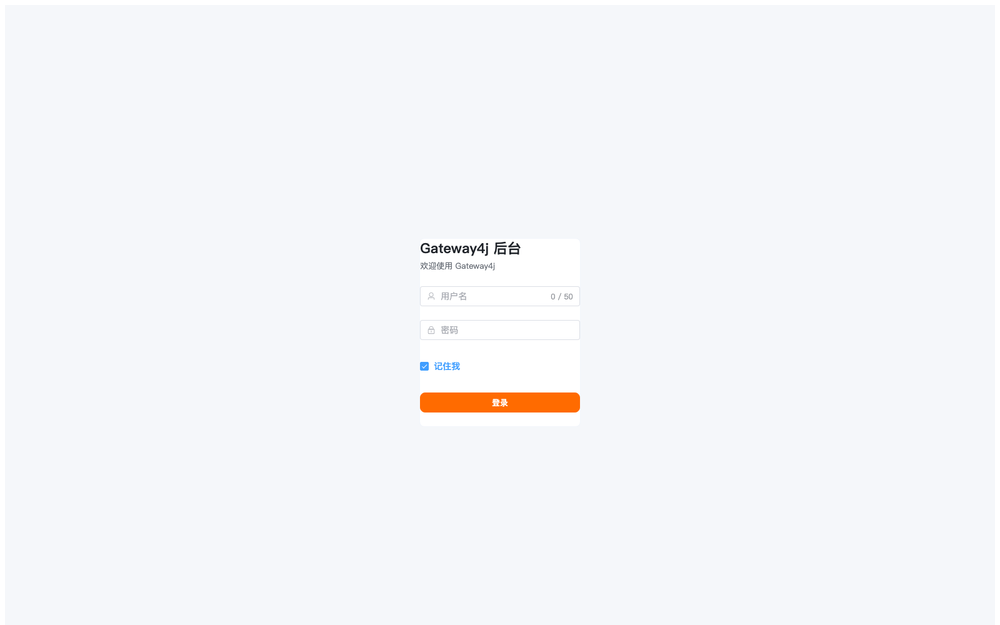 |
| 01-03 错误口令提示 | 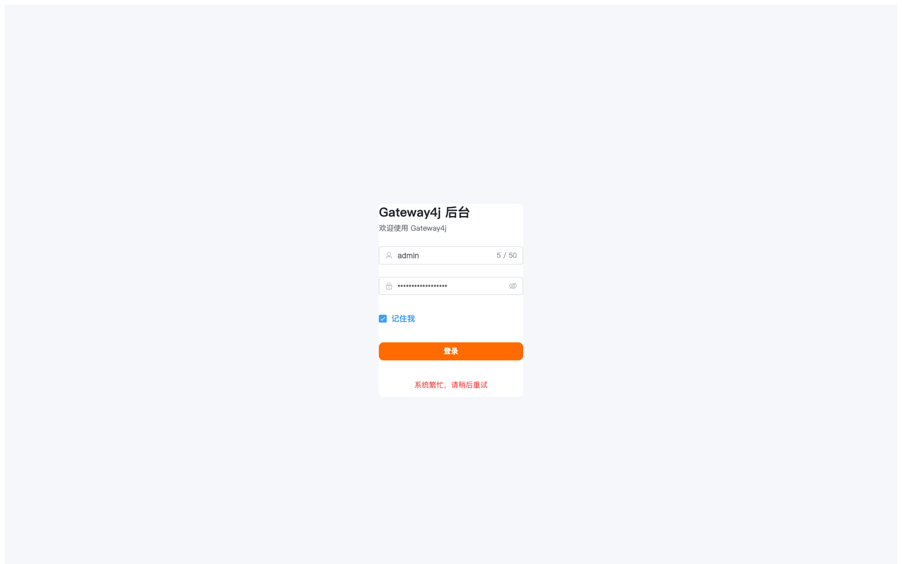 |
| 01-04 登录成功 |  |
| 01-05 未登录被守卫拦截 |  |
| 01-06 刷新保持登录态 | 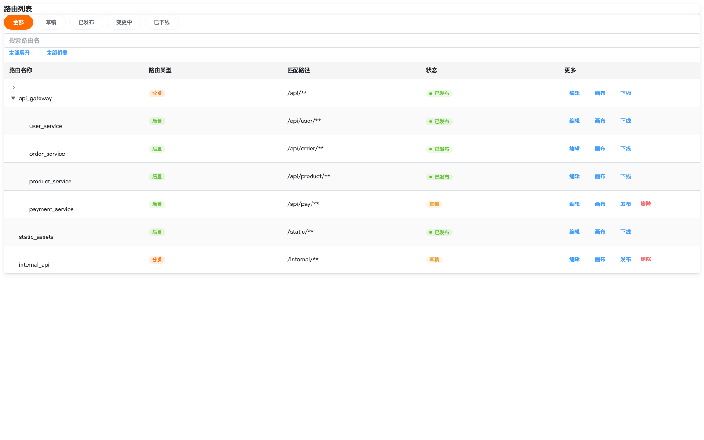 |
| 01-13「记住我」存储策略 |  |

> 认证链路本身（JWT + Redis 双验 + Refresh 轮转 + 幂等）**质量良好**：错误口令有明确提示、失败不残留 Token、记住我正确区分 `localStorage` / `sessionStorage`、守卫与登出后重定向均正确。

---

### 4.2 BL-02 监控大盘

**通过 12 / 失败 0** —— 本次唯一全绿的业务线。

三个 Tab（路由状态 / 指标 / 拓扑）全部可用；拓扑节点数与后端 `/v1/monitor/topology` 返回**完全一致**（02-11）；自动刷新开关生效并展示「最近刷新」时间（02-10）；时间范围与粒度切换后 ECharts 重绘（02-09）。

| 指标页 | 拓扑页 |
|---|---|
| 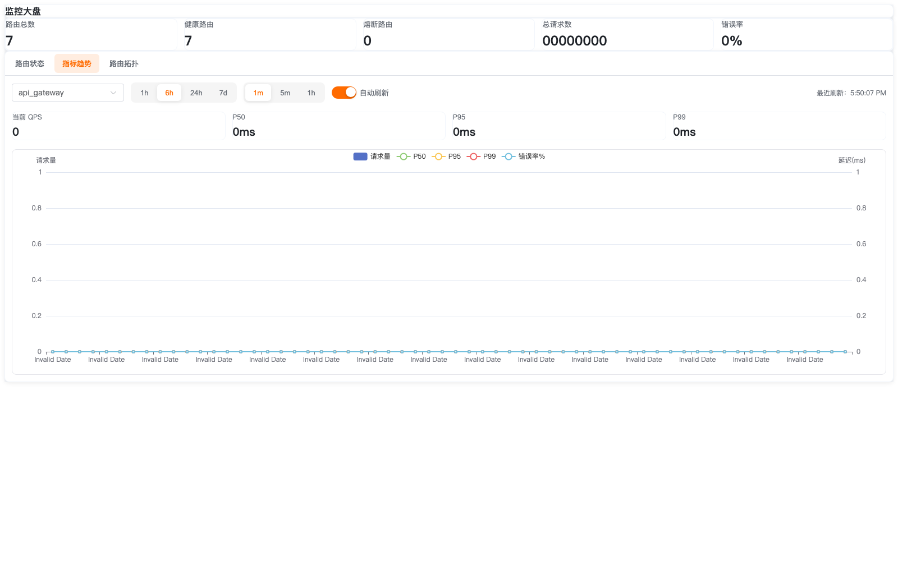 | 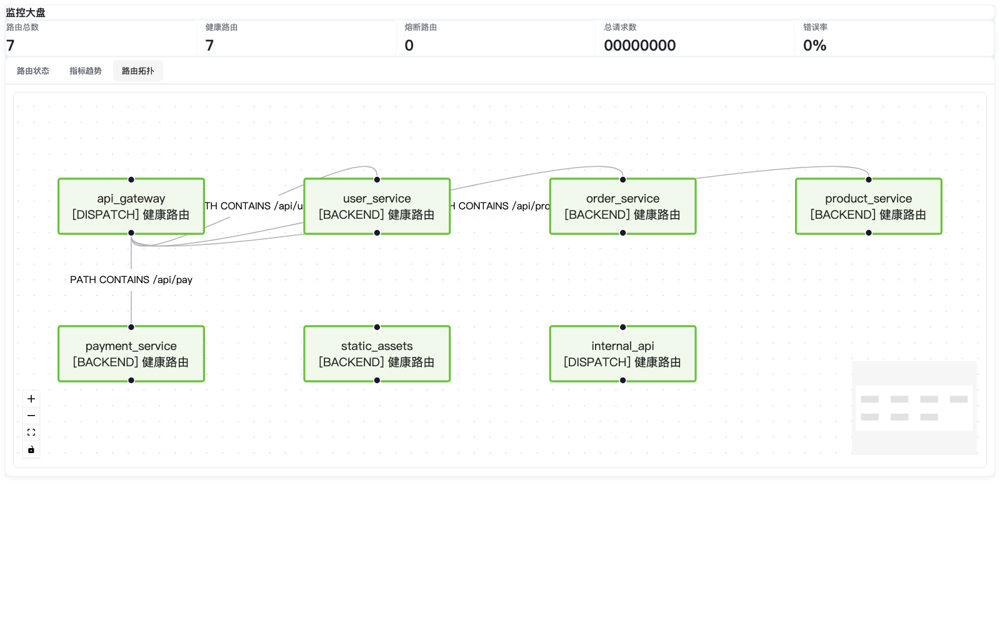 |

---

### 4.3 BL-03 路由管理

**通过 13 / 失败 5**

#### ❌ 失败项

**03-06 路由列表应提供「新建」主操作入口 —— D2**

`FcFilterBar` 没有 `actions` 插槽，`List.vue` 里写在 `<template #actions>` 中的「新建」「导入」按钮全部丢失。


**03-08 非法名称 / 路径未被拦截，脏数据入库 —— D12**

填入 `route_name="bad name!"`、`path="not-a-path"`、`upstream_url="ftp://xxx"` 后点击保存：

- 页面**没有任何校验错误提示**（`.el-form-item__error` 数量 = 0）；
- 弹出绿色 Toast **「保存成功」**；
- 数据库里**真的多了一条脏路由**（实测 `gw_route` 中存在 `bad name! | not-a-path | ftp://xxx`）。

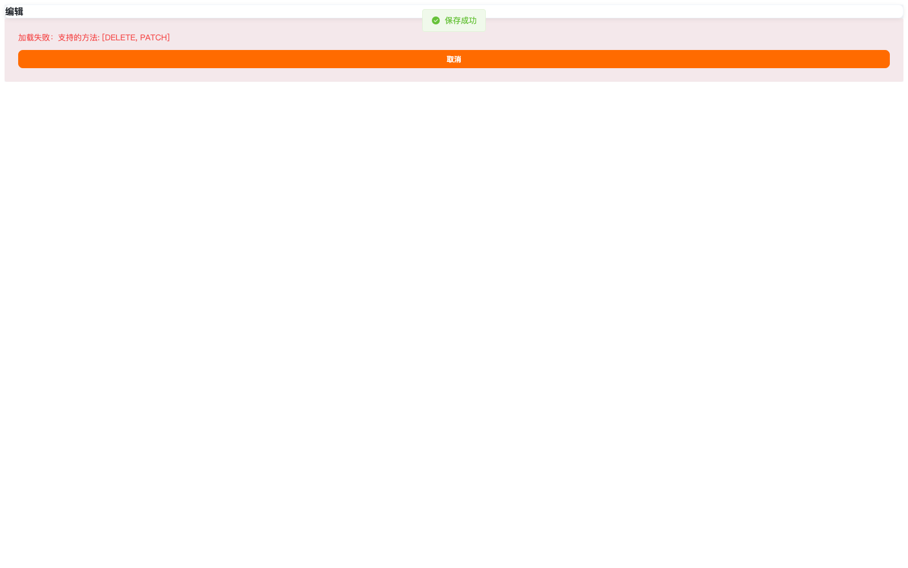

> **根因（两处叠加）**
> 1. `src/components/RouteBasicForm.vue` 的 `validate()` 把校验失败**吞成布尔值 `false`**：
>    ```ts
>    async function validate(): Promise<boolean> {
>      try { await formRef.value.validate(); return true }
>      catch { return false }          // ← 不抛错
>    }
>    ```
> 2. `src/views/routes/Editor.vue` 的 `save()` **忽略了这个返回值**：
>    ```ts
>    try { await basicFormRef.value.validate() } catch { return }   // ← catch 永远不会触发
>    ```
>    对比：插件编辑器、用户弹窗用的是原生 `el-form` 的 `validate()`（失败会 reject），所以它们**没有**这个问题。
> 3. **后端同样零校验**（见 03-09），前端被绕过后无人兜底。

**03-12 编辑已有路由：应能加载出基本信息表单 —— D3**

`GET /v1/routes/{id}` 返回 **405 Method Not Allowed**（后端 `RouteController` 只有 `@PatchMapping("/{id}")` 与 `@DeleteMapping("/{id}")`）。页面直接显示红色错误条：

> 加载失败：支持的方法: [DELETE, PATCH]

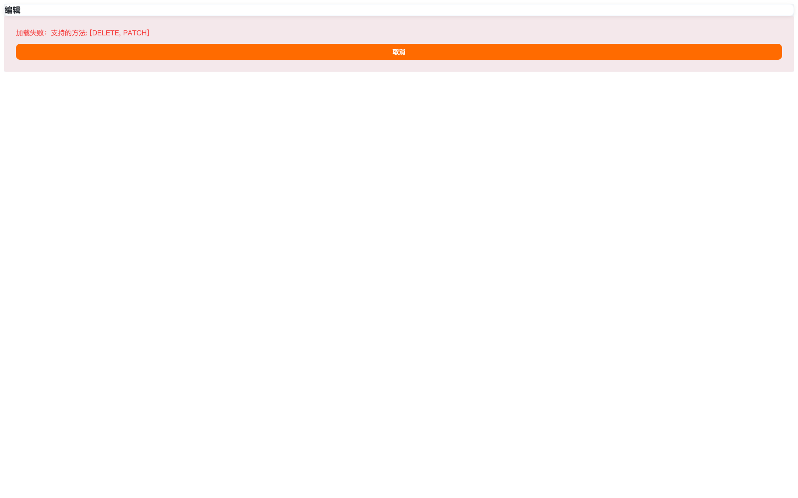

**03-14 发布路由 —— D11** &nbsp;·&nbsp; **03-15 下线路由 —— D11**

点击「发布」→ 确认弹窗正常弹出 → 点击「确认」→ **状态仍是「草稿」，且没有任何 `/publish` 请求发出**（API 调用序列证据见 `03-routes/03-14-publish-status-verified.log.txt`）。

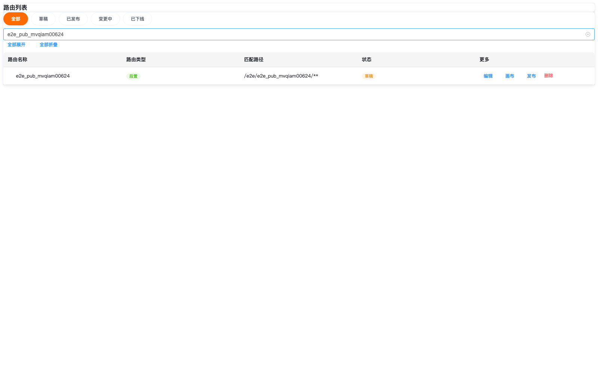

> **根因**：`src/composables/useFcConfirm.ts`
> ```ts
> 'onUpdate:open': (val) => { if (!val) { cleanup(); resolve(false) } },  // ← 先执行
> onConfirm,                                                              // ← 后执行，resolve(true) 无效
> ```
> 而 `FcConfirm.close('confirm')` 的发射顺序是 `emit('update:open', false)` → `emit('confirm')`。
> **Promise 只能 settle 一次**，于是 `confirm()` **永远返回 `false`**，所有 `if (!await confirm(...)) return` 的分支一律提前 return —— **写操作被静默吞掉**。
>
> 受影响调用点（源码级梳理，共 10 处）：
> | 文件 | 操作 |
> |---|---|
> | `views/routes/List.vue:212` | **发布路由** |
> | `views/routes/List.vue:224` | **下线路由** |
> | `views/plugins/List.vue:254` | 禁用插件 |
> | `views/plugins/Global.vue:122` | 禁用全局插件 |
> | `views/plugins/Builtin.vue:147` | 禁用内置插件 |
> | `views/users/List.vue:231` | 禁用用户 |
> | `views/routes/Editor.vue:412` | 未保存离开守卫 |
> | `views/routes/Canvas.vue:488` | 未保存离开守卫 |
> | `views/plugins/Editor.vue:365` | 未保存离开守卫 |
> | `views/Settings.vue:230` | 未保存离开守卫 |
>
> 注：**声明式**用法 `<FcConfirm @confirm="del(row)">`（路由/插件/用户的删除按钮）**不受影响**，因为它直接监听 `confirm` 事件而非 Promise —— 这解释了为什么 03-17「删除草稿路由」反而是通过的。
>
> 4 处「未保存离开守卫」的返回值语义同样被反转（确认 = 取消），属于**潜在风险**：一旦 dirty 标记被触发，用户将无法离开页面。本次因各页 dirty 标记未触发弹窗而未复现，建议一并回归。

#### ✅ 通过项（关键图）

| 用例 | 关键证据 |
|---|---|
| 03-01 路由列表树形 |  |
| 03-02 状态过滤 | 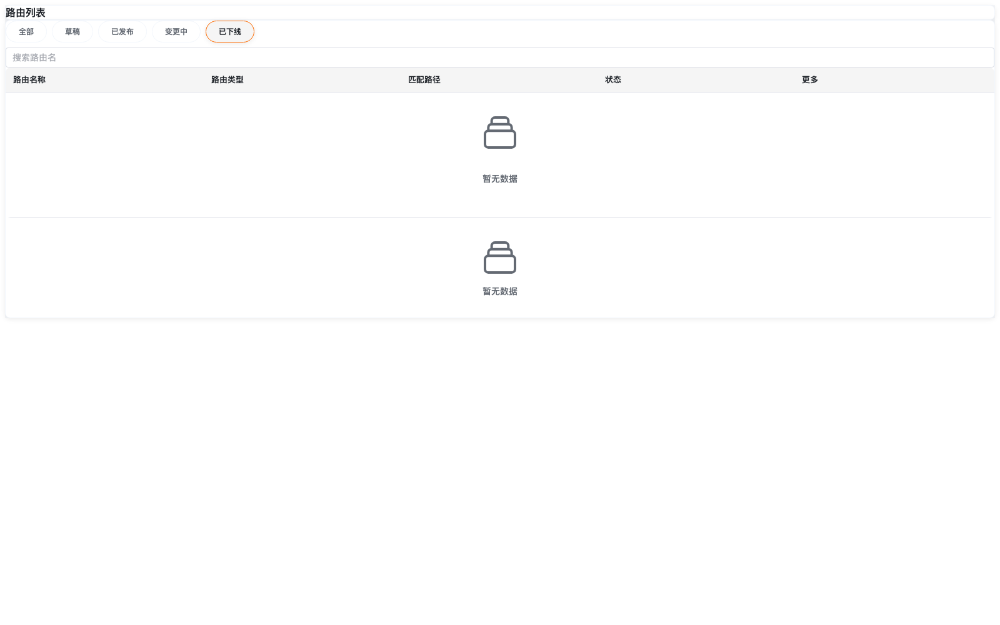 |
| 03-04 搜索空态 | 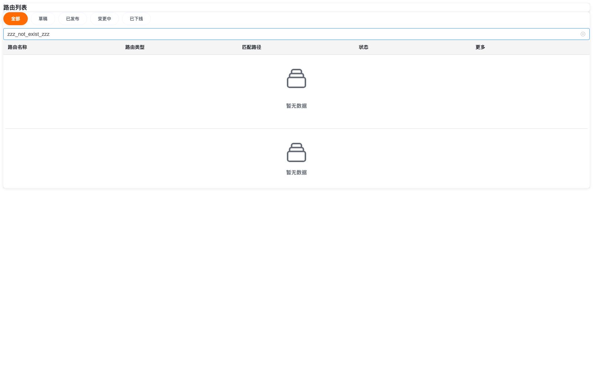 |
| 03-10 新建成功 |  |
| 03-17 删除后从列表消失 | 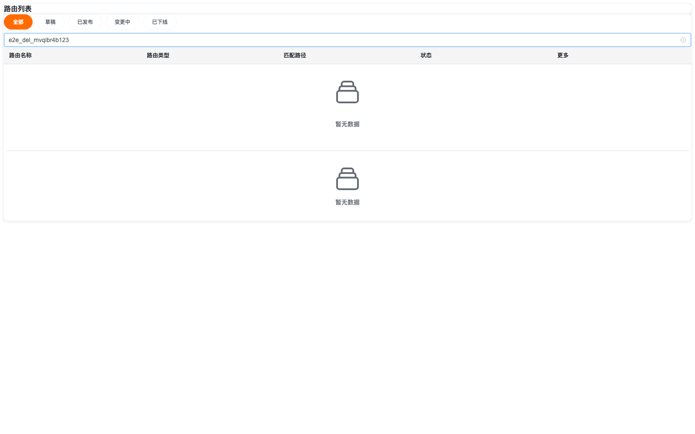 |
| 03-18 分发路由父级选择 | 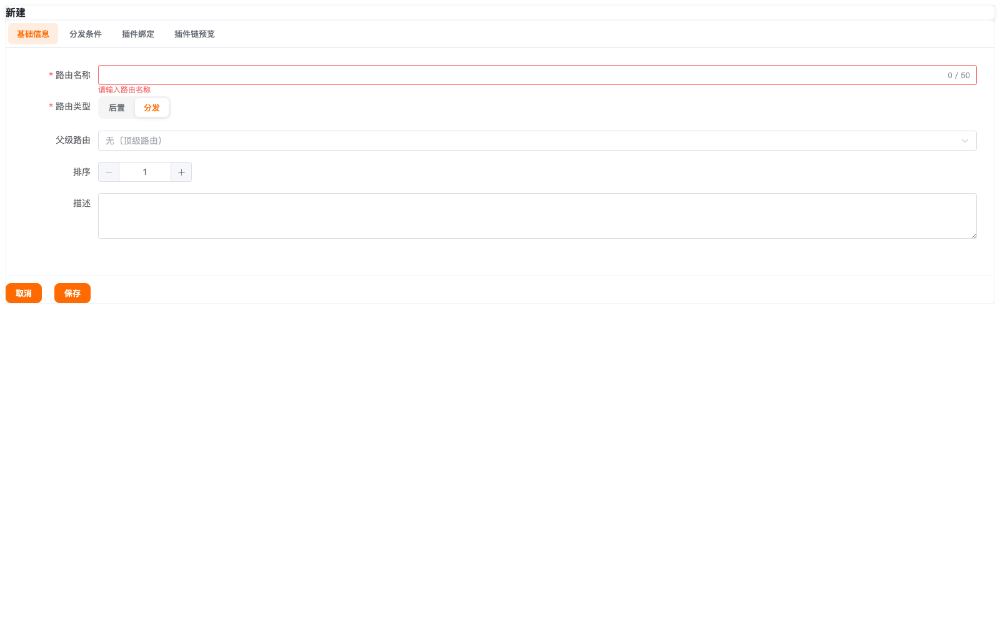 |

---

### 4.4 BL-04 路由编排画布

**通过 11 / 失败 3**

#### ❌ 失败项

**04-09 保存画布后刷新页面节点持久化 —— D19（最高风险）**

拖拽创建节点 → 改标签 → 点「保存画布」：

- `PUT /v1/routes/-100/canvas` 返回 **200**；
- 界面提示 **「已自动保存」**（绿色）；
- 但 `gw_route_canvas` 表 **一行都没有**；刷新后节点归零。


> **根因：接口契约不匹配。**
> | | 请求体 | 期望 |
> |---|---|---|
> | 前端 `api/routes.ts:120` | `{ canvas_data: { nodes:[…], edges:[…] } }` | —— |
> | 后端 `RouteController:257` | `record CanvasRequest(String canvasData)` | `canvas_data` 应为**字符串** |
>
> 实测对照：传**对象** → 200 且**不落库**；传**字符串** → 200 且**正确落库**（`{"edges": [], "nodes": [{"id": "n1"}]}`）。
> 也就是说，**前端永远传的是不落库的那一种**。这是"静默数据丢失"——用户以为保存成功，实际什么都没存。

**04-03 空画布无引导文案 —— D7** &nbsp;·&nbsp; **04-14 画布与路由树数据不同源 —— D7**

`api_gateway`（分发路由）在列表里有 **4 个子路由**，但画布上**一个节点都没有**，且画布区域**完全空白、没有任何引导文案**（`.canvas-shell` 文本长度 = 0）。

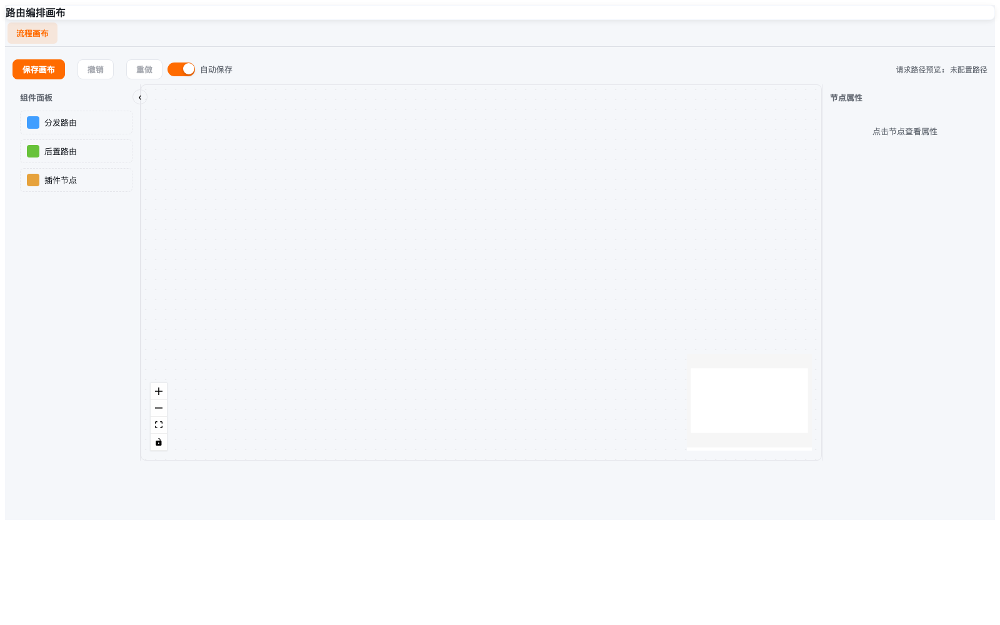

> **根因**：`RouteCanvasService.getCanvas()` 对没有画布记录的路由直接返回 `canvasData = "{}"`，**不会由路由树自动生成**。于是：
> - 画布与路由列表是**两套互不相干的数据**，可以各自编辑、各自漂移；
> - 而同一页面的「请求路径预览」又是**按路由树实时计算**的 —— 三个信息源互相矛盾；
> - 后端 `gw_route_canvas` 表有 `route_id` 外键语义，本可作为"路由 → 画布"的映射，却从未被用于自动生成。

#### ✅ 通过项（关键图）

拖拽建节点、属性面板编辑回写、撤销/重做、面板折叠、删除节点、路径预览**均正常**，画布交互本身完成度不错。

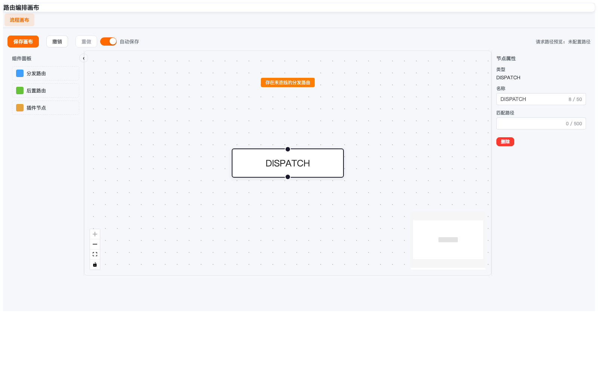

> 值得肯定：画布做了**业务规则校验**（分发路由必须至少有一条连线），见 04-09 截图中的橙色提示条「分发路由必须至少有一条连线」与「存在未连线的分发路由」徽标。

---

### 4.5 BL-05 导入导出

**通过 7 / 失败 3**

#### ❌ 失败项

**05-05 非法 JSON 预检无可定位原因 —— D14** &nbsp;·&nbsp; **05-09 结构非法（缺 routes）无原因 —— D14**

粘贴 `{ this is not valid json ` 后点「预检」，报告区只显示 **「可导入：否」** —— **没有任何原因说明**。用户既不知道是 JSON 解析失败，还是缺 `routes` 数组，还是字段类型不对。

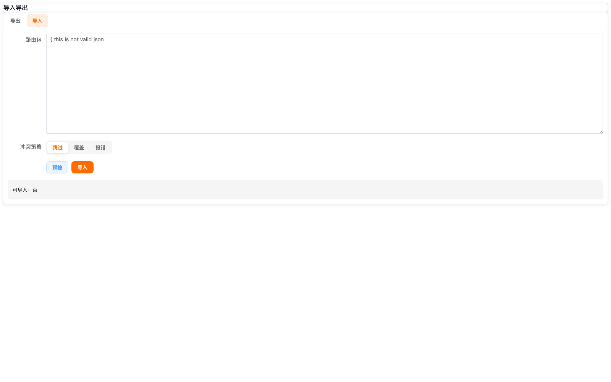

**05-10 路由列表的「导入」入口按钮不渲染 —— D2**

与 03-06 同根因。用户无法从路由列表跳到导入导出页。

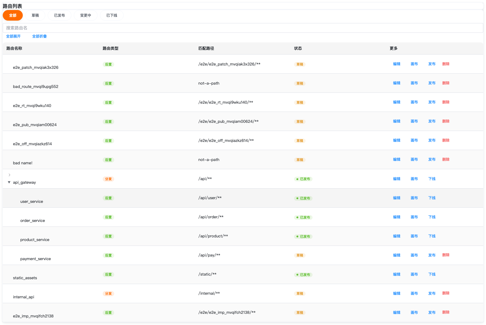

#### ✅ 通过项（关键图）

导出多选、下载路由包（真实触发浏览器下载）、冲突策略三选一切换、**正式导入后新路由确实出现在列表**（05-08）—— 导入导出的**主干链路是通的**。

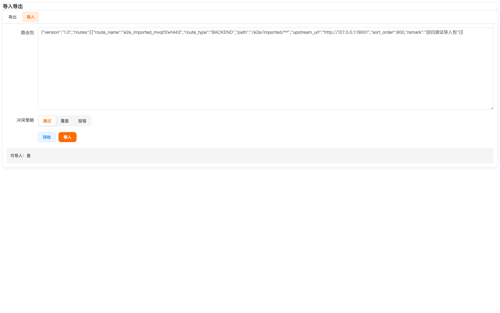

---

### 4.6 BL-06 插件管理

**通过 11 / 失败 3**

#### ❌ 失败项

**06-13 内置插件配置弹窗恒显示「暂无 schema」 —— D21**

点任一内置插件卡片的「插件配置」→ 弹窗正常打开，标题是「插件配置：安全插件」，但内容区只有一个**空态图标 + 「暂无 schema」**，**一个表单控件都没有**。

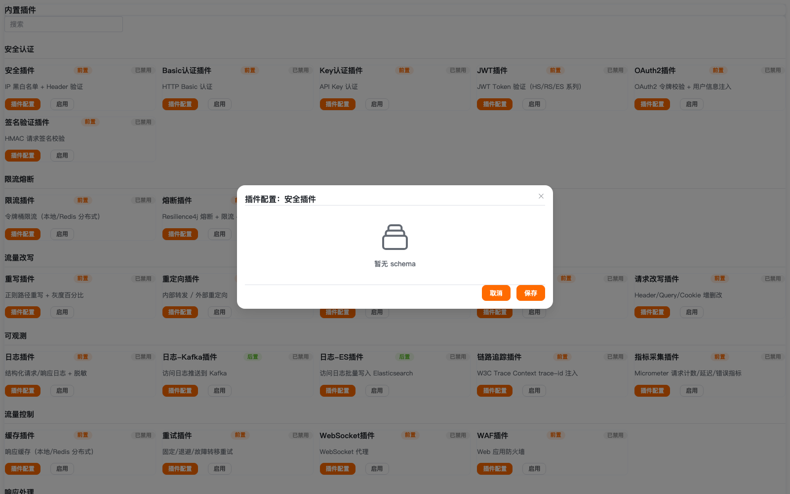

> **根因**：后端把 JSON Schema 以**字符串**返回，前端按**对象**取属性。
>
> | | 值 |
> |---|---|
> | 后端 `BuiltinPluginTypeRegistry` 的字段类型 | `String configSchema` |
> | 后端实际返回 | `"config_schema": "{\"type\":\"object\",\"properties\":{...}}"` ← **字符串** |
> | 前端 `PluginDynamicForm.vue` 的取法 | `schema?.config_schema?.properties` ← 按**对象**取 |
> | 实测 | 后端 schema 可解析出 **3 个属性**，但弹窗控件数 = **0** |
>
> 该组件是 **JSON Schema 驱动**的动态表单 —— 本应是本产品最强的一块能力，却因为**序列化形式差一层**而整体失效（详见 `06-plugins/06-13-builtin-config-dialog.log.txt`）。

**06-03 按插件名搜索无效 —— D6**

搜索 `__no_such_plugin__` 后，UI 仍显示 **10 行**。API 层实测：

| 请求 | 返回条数 |
|---|---|
| `GET /v1/plugins?page=1&page_size=20` | 11 |
| `GET /v1/plugins?page=1&page_size=20&keyword=__no_such_plugin__` | 11 |
| `GET /v1/plugins?page=1&page_size=20&keyword=security` | 11 |

后端**完全忽略了 `keyword` 参数**。前端 `List.vue` 确实把 `keyword` 传过去了（`useDebounce` 300ms），所以问题在后端查询条件。

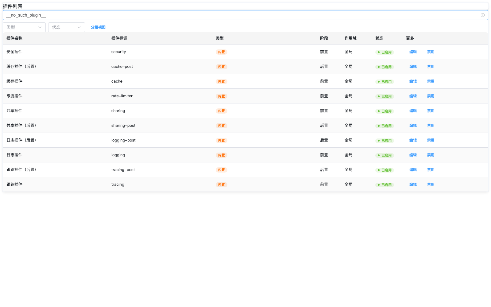

**06-06 插件列表应提供「新建插件」入口 —— D2**

同 03-06 同根因。

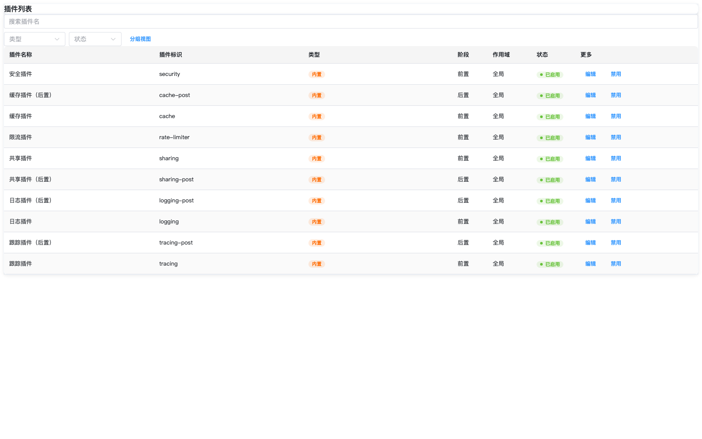

#### ✅ 通过项（关键图）

类型筛选、状态筛选、列表/分组视图切换、**启用后状态真的变更**、**删除后从列表消失**、Groovy 脚本校验反馈、内置插件分类卡片与**动态配置表单渲染并可保存** —— 插件模块除搜索外基本完整。


---

### 4.7 BL-07 用户管理

**通过 3 / 失败 5** —— **本次问题最集中的业务线**

#### ❌ 失败项

**07-03「新建用户」入口 —— D2** &nbsp;·&nbsp; **07-08 可写操作按钮数为 0 —— D2/D5**


**07-04 行内 编辑 / 禁用 / 重置密码 / 删除 全部隐藏 —— D5**

DOM 实测：**首行按钮数 = 0**，「更多」列整列为空。


**07-05 无写权限时无只读说明 —— D17**

按钮被静默隐藏，页面**没有任何**"只读 / 无权限 / 请联系管理员"提示，用户会以为页面坏了。


**07-01 用户列表分页控件整体不渲染 —— D18**

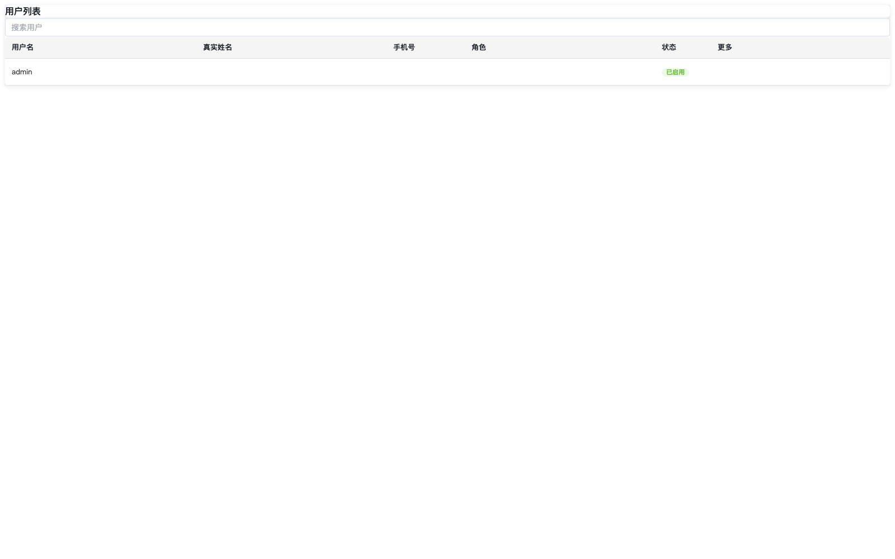

> **根因（很隐蔽）**：后端把 `Long` 序列化成**字符串**（framework4j 的"Long 转 String"约定，避免 JS 精度丢失）：
> ```json
> { "records": [...], "total": "1", "current": "1" }   // ← total 是字符串
> ```
> 前端直接把 `total` 透传给 `el-pagination`，触发 Element Plus 的 prop 类型校验失败：
> ```
> [Vue warn]: Invalid prop: type check failed for prop "total".
> Expected Number with value 1, got String with value "1".
> ```
> 而 `el-pagination` 内部 `assertValidUsage` 判定 `isAbsent(props.total) === true`（非 number）→ **直接 `return null`，整个分页控件不渲染**。
> 受影响页面：用户列表、插件列表（**所有带 `FcPagination` 的列表**）。

#### ✅ 通过项

**07-06 后端用户 CRUD 能力基线 —— 全通过**（创建 / 更新 / 按关键字搜索 / 删除，4 个 API 全绿）。这直接证明：**用户管理后端完全正常，问题 100% 在 UI 层**。

| 用例 | 关键证据 |
|---|---|
| 07-02 用户搜索过滤生效 | 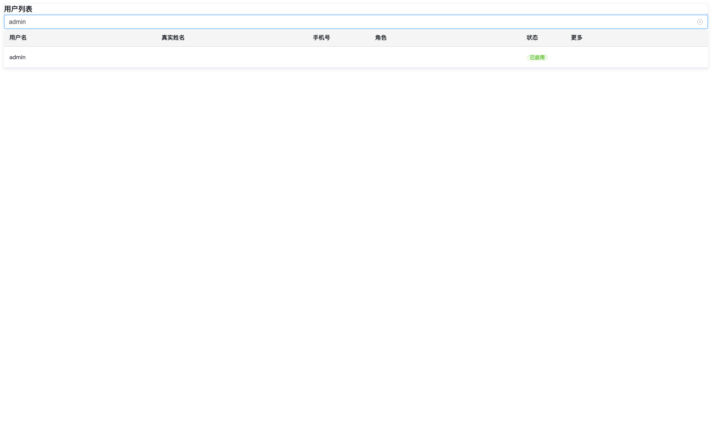 |
| 07-06 后端 CRUD 基线 |  |

---

### 4.8 BL-08 角色与权限

**通过 5 / 失败 1**

**08-05 无角色新增 / 编辑 / 授权入口 —— D16**

页面只有「角色」「我的权限」两个 Tab 按钮，**没有任何写操作入口**。后端 `RbacController` 也只有 `GET /v1/roles` 与 `GET /v1/permissions` 两个只读接口 —— **前后端一致地"没有这个功能"**。

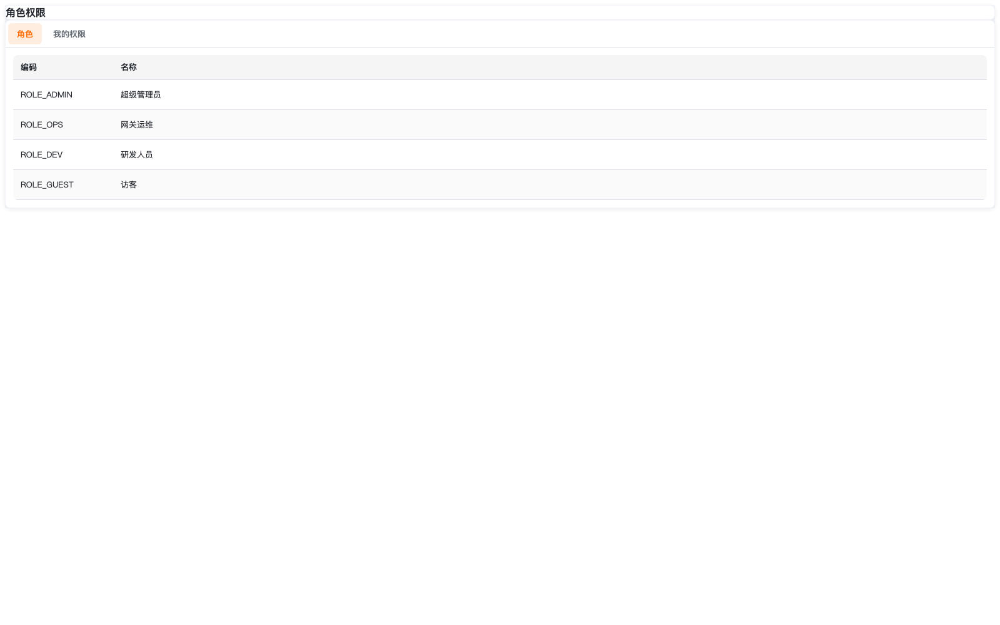

**08-06 附带发现的数据缺口**：`gw_role` 有 4 个角色，但 `gw_role_permission_rel` **只有 ROLE_ADMIN 有绑定**，`ROLE_OPS` / `ROLE_DEV` / `ROLE_GUEST` 是**空授权** —— 建了角色却什么都干不了。

#### ✅ 通过项

4 个种子角色完整渲染、11 条权限与 MENU/BUTTON 资源类型列正确。

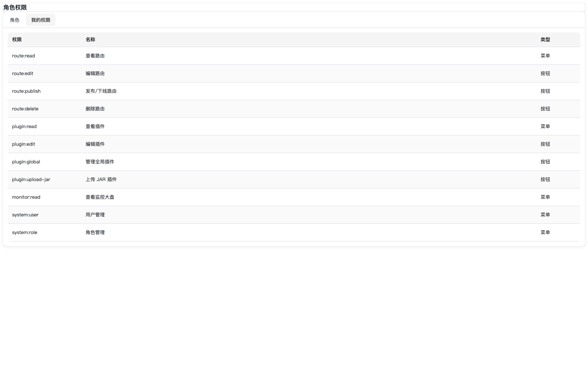

---

### 4.9 BL-09 系统设置

**通过 4 / 失败 5**

#### ❌ 失败项

**09-04 配置接口 `GET /v1/config/system` 返回 404 —— D4**

后端**根本没有 `/v1/config/**` 端点**。前端 `api/misc.ts` 调用 `GET/PUT /v1/config/{type}`，全部 404。


**09-03「保存」按钮不渲染 —— D5**（`canEdit('system')` → `system:edit` 后端没有）

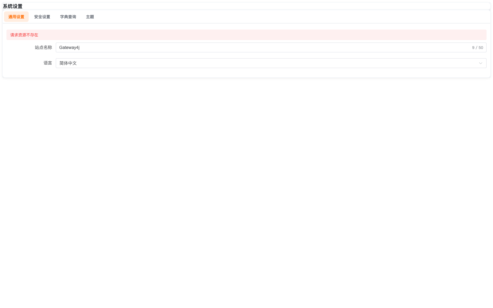

**09-05 界面直接暴露后端原始错误报文 —— D13**

通用设置页直接显示 **「请求资源不存在」**。


**09-08 未知字典 code 返回 500「系统繁忙」 —— D10**

查询 `NOT_EXIST_DICT_CODE` → HTTP **500**，文案 **「系统繁忙，请稍后重试」**。实际原因是"未知字典 code"，属于**业务参数错误**，却报成了服务器故障，且错误码（10001）与真实语义不符。


**09-09 主题 Tab 指引的顶栏切换器不存在 —— D1（交叉证据）**

主题页文案写着「通过顶栏的切换按钮调整主题与品牌」，而**顶栏根本没渲染** —— 页面在指一个不存在的入口。


#### ✅ 通过项

字典查询（`ROUTE_TYPE`）返回条目并正确渲染表格；安全设置的 Token / Refresh 过期时间数字输入正常；四个 Tab 齐备。

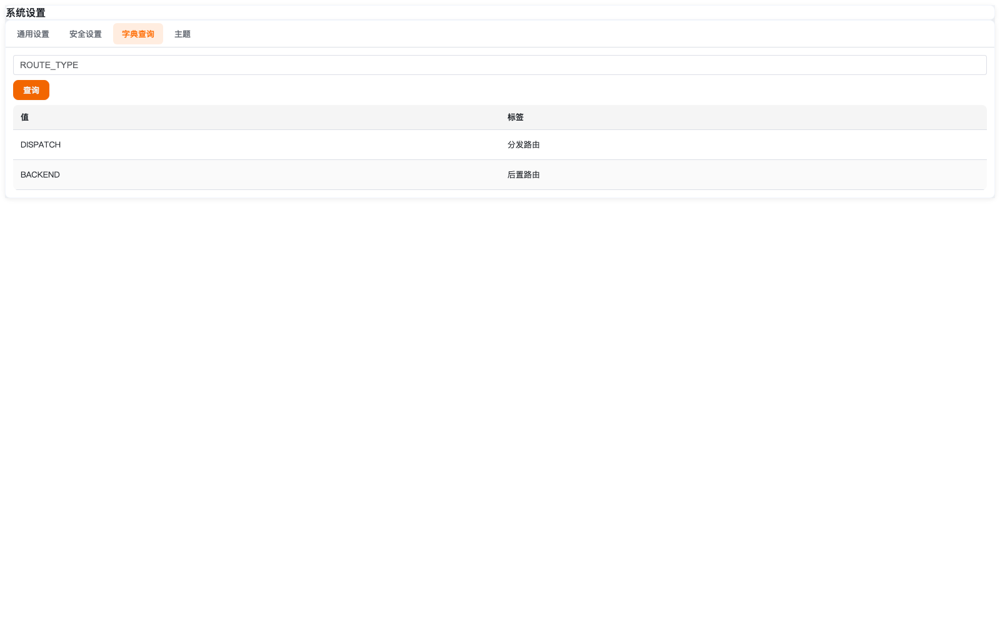

---

## 5. 缺陷清单与修复意见

### 5.1 P0 —— 阻塞级（建议立即修复）

#### D1 · 全局侧边栏与顶栏从未渲染

| | |
|---|---|
| **现象** | 页面上没有侧边栏、没有顶栏；无法在业务线之间切换、**无法退出登录**、无法切换主题与语言 |
| **根因** | `src/layouts/MainLayout.vue` 用 `<template #sidebar>` / `<template #header>` 向 `FcMain` 注入外壳，而 `src/components/layout/FcMain.vue` 只声明了默认插槽（`<slot />`）。Vue 3 **静默丢弃**无出口的具名插槽，既不报错也不告警 |
| **影响面** | 全站 9 条业务线的可达性；登录/登出闭环 |
| **修复意见** | 给 `FcMain` 增加 `sidebar` / `header` / `footer` 具名插槽并改为三段式 Shell；或 `MainLayout` 直接使用 `FcSidebar` + `FcHeader` + 内容区。**并补一条组件契约测试**：断言"页面使用的 slot 名 ⊆ SDK 组件声明的 slot 名" |
| **证据** | [01-09](screenshots/01-auth/01-09_全局侧边栏渲染出各业务线导航入口__FAIL.png) / [01-10](screenshots/01-auth/01-10_顶栏渲染标题_主题切换_用户信息区__FAIL.png) / [01-07](screenshots/01-auth/01-07_顶栏登出按钮存在且可点击退出登录__FAIL.png) |

#### D2 · 所有列表页的「新建 / 导入」主操作按钮不渲染

| | |
|---|---|
| **现象** | 路由列表、用户列表、插件列表上的「新建」「导入」按钮全部不存在 |
| **根因** | `src/components/navigation/FcFilterBar.vue` 模板只有 `<slot />`，没有 `actions` 插槽；而三处页面都把主按钮写在 `<template #actions>` 里 |
| **影响面** | 所有**资源创建入口**（路由、用户、插件） |
| **修复意见** | `FcFilterBar` 增加 `actions` 插槽，并按大厂范式**右对齐**（左侧筛选、右侧主操作）；`.fc-filter-bar__actions { margin-left: auto }` |
| **证据** | [03-06](screenshots/03-routes/03-06_路由列表应提供_新建_主操作入口__FAIL.png) / [07-03](screenshots/07-users/07-03_用户列表应提供_新建用户_主操作入口__FAIL.png) / [06-06](screenshots/06-plugins/06-06_插件列表应提供_新建插件_主操作入口__FAIL.png) |

#### D3 · `GET /v1/routes/{id}` 未实现，路由详情页 405

| | |
|---|---|
| **现象** | 点「编辑」打开任一已有路由 → 页面显示「加载失败：支持的方法: [DELETE, PATCH]」，**任何已有路由都无法编辑** |
| **根因** | `gateway4j-admin/.../RouteController.java` 有 `@PatchMapping("/{id}")`、`@DeleteMapping("/{id}")`，**唯独缺 `@GetMapping("/{id}")`**；前端 `api/routes.ts` 的 `getRoute()` 用 GET |
| **影响面** | 路由编辑、路由详情、画布的路由信息加载 |
| **修复意见** | 补 `@GetMapping("/{id}")`，返回 `RouteDetail` + conditions + bindings + plugin-chain 的聚合视图（前端编辑器 4 个 Tab 都需要） |
| **证据** | [03-12](screenshots/03-routes/03-12_编辑已有路由_应能加载出基本信息表单__FAIL.png) |

#### D4 · `/v1/config/**` 端点整体缺失，系统设置不可用

| | |
|---|---|
| **现象** | 通用设置 / 安全设置两个 Tab 直接显示「请求资源不存在」 |
| **根因** | 前端 `api/misc.ts` 调用 `GET/PUT /v1/config/{type}`，后端**没有任何 ConfigController** |
| **影响面** | 系统设置模块 100% 不可用；主题/品牌/语言偏好无法持久化 |
| **修复意见** | 新增 `ConfigController` + `gw_config` 表；写入后复用 `gw_config_push_log` 的推送通道做热更新 |
| **证据** | [09-04](screenshots/09-settings/09-04_配置接口_GET_v1_config_system_应可用__FAIL.png) / [09-05](screenshots/09-settings/09-05_通用设置页不应向用户暴露后端原始错误文案__FAIL.png) |

#### D5 · 前后端权限码词表不一致，用户管理与系统设置全面只读

| | |
|---|---|
| **现象** | 用户管理页**按钮数为 0**；系统设置无「保存」；侧边栏即便修好，用户/角色入口仍不显示 |
| **根因** | 前端 `canEdit('user')` → `user:edit`、`canEdit('system')` → `system:edit`、侧边栏 `hasPermission('user:read')`；而后端 `gw_permission` 实际只有 `route:*`、`plugin:*`、`monitor:read`、`system:user`、`system:role` —— **这三个码一条都没有** |
| **影响面** | 用户管理全部写操作；系统设置保存；菜单可见性 |
| **修复意见** | ① 权限码规范化为 `{资源}:{动作}`，动作收敛为 `read/create/update/delete/publish/operate/manage`；② 前端 `can(resource, action)` 取代 `canEdit(resource)`；③ 补齐种子权限（`user:read/create/update/delete/reset-password`、`system:read/update`、`role:read/manage`）；④ **加启动期差集检查**：前端引用的权限码与后端 `/v1/permissions` 求差，有差集即告警上报 |
| **证据** | [07-04](screenshots/07-users/07-04_用户行应提供_编辑_禁用_重置密码_删除_操作__FAIL.png) / [09-03](screenshots/09-settings/09-03_通用设置应提供_保存_按钮__FAIL.png) |

#### D11 · `useFcConfirm` 命令式确认弹窗永远返回 false，6 类写操作 100% 失效

| | |
|---|---|
| **现象** | 路由「发布」「下线」、插件「禁用」（列表/全局/内置）、用户「禁用」—— 点「确认」后**连请求都没发出**，界面毫无反馈 |
| **根因** | `src/composables/useFcConfirm.ts` 中 `'onUpdate:open'` 处理器先 `resolve(false)`，而 `FcConfirm.close('confirm')` 的发射顺序是 `emit('update:open', false)` → `emit('confirm')`；**Promise 只能 settle 一次**，故 `confirm()` 永远 resolve(false) |
| **影响面** | 10 处调用点（6 处业务写操作 + 4 处未保存离开守卫） |
| **修复意见** | 二选一：① `onUpdate:open` 处理器只在 `!val && !confirmed` 时 resolve(false)；② 更稳妥 —— 去掉 `onUpdate:open` 里的 resolve，只由 `onConfirm` / `onCancel` 决定结果，并加 `settled` 标志位防重复 resolve。**并补单测**：`await confirm()` 在点击确认后必须为 `true` |
| **证据** | [03-14](screenshots/03-routes/03-14_草稿路由可发布_确认弹窗_状态真的变为已发布___FAIL.png) / API 调用序列见 `03-routes/03-14-publish-status-verified.log.txt` |

#### D12 · 路由表单校验返回值被忽略，非法路由直接入库

| | |
|---|---|
| **现象** | 非法名称/路径/上游地址保存时**无任何校验提示**，还弹「保存成功」，脏数据真的进了库 |
| **根因** | `RouteBasicForm.vue` 的 `validate()` 把失败吞成 `false`（不抛错），`Editor.vue` 的 `try { await validate() } catch { return }` 因此永远不触发 |
| **影响面** | 所有路由创建/编辑；脏路由可能进入网关生效链路 |
| **修复意见** | ① `RouteBasicForm.validate()` 失败时**抛出**异常，或父组件改为 `if (!(await basicFormRef.value.validate())) return`；② 后端同步补 Bean Validation（见 D9），形成双保险 |
| **证据** | [03-08](screenshots/03-routes/03-08_新建路由_非法名称_路径格式被前端拦截__FAIL.png) |

#### D19 · 画布保存接口契约不匹配，编排结果静默丢失

| | |
|---|---|
| **现象** | 保存画布返回 200、界面提示「已自动保存」，但 `gw_route_canvas` 表无任何记录，刷新后节点归零 |
| **根因** | 前端发 `{ canvas_data: { nodes, edges } }`（对象），后端 `record CanvasRequest(String canvasData)` 期望字符串。实测：传对象 → 200 不落库；传字符串 → 200 正确落库 |
| **影响面** | 核心卖点「可视化编排」的数据持久化 |
| **修复意见** | ① 后端 `CanvasRequest` 改 `record CanvasRequest(JsonNode canvasData)` 并序列化入库；或 ② 前端 `saveCanvas(id, JSON.stringify({nodes, edges}))` 发送字符串。**推荐 ①**（结构化更安全）；③ 补充"保存后回读校验"，落库失败必须报错而非静默成功 |
| **证据** | [04-09](screenshots/04-canvas/04-09_保存画布后刷新页面节点持久化__FAIL.png) |

---

### 5.2 P1 —— 严重（建议下个迭代修复）

| 编号 | 缺陷 | 根因 | 修复意见 | 证据 |
|---|---|---|---|---|
| **D6** | 插件列表关键词过滤无效 | 后端 `GET /v1/plugins` 忽略 `keyword` 查询参数 | 在 `PluginService`/Mapper 的查询条件中补 `keyword` 模糊匹配（插件名 + 插件标识）；补接口级测试 | [06-03](screenshots/06-plugins/06-03_按插件名搜索应过滤结果__FAIL.png) |
| **D7** | 画布与路由树数据不同源 + 空画布无引导 | `RouteCanvasService.getCanvas()` 直接返回 `{}`；UI 无空态 | 确立**路由树为唯一事实源**：画布为空时自动从路由树生成节点与连线；空画布给居中引导卡 + 「从路由树生成」按钮 | [04-03](screenshots/04-canvas/04-03_空画布应给出引导空态文案__FAIL.png) / [04-14](screenshots/04-canvas/04-14_画布应与路由树保持数据一致__FAIL.png) |
| **D9** | 后端路由创建接口零校验 | `RouteService` 未加 Bean Validation | 在写方法入口加 `@Pattern`/`@NotBlank`/`@Size`，错误走 `ApiCode.PARAM_ERROR` 并下发**字段级错误**（前端 `mapFieldErrors` 已就绪但从未收到过后端字段错误） | 证据见 `03-routes/03-09-backend-format-validation.log.txt` |
| **D10** | 未知字典 code 返回 500「系统繁忙」 | `DictService` 抛 `BusinessException(CONFIG_SYNC_FAILED)` 被映射为 500 | 未知 code 属于**参数错误**，应返回 404 / `PARAM_ERROR`，文案「字典不存在：xxx」；不要复用「系统繁忙」 | [09-08](screenshots/09-settings/09-08_字典查询_不存在的_code_应给出友好提示且不崩溃__FAIL.png) |
| **D16** | 角色权限模块纯只读 + 非 admin 角色空授权 | `RbacController` 只有 2 个 GET；`gw_role_permission_rel` 只有 ROLE_ADMIN 有绑定 | 补角色 CRUD + `PUT /v1/roles/{id}/permissions`；前端补**权限树勾选 UI**（资源→动作两级、父节点半选）+ 角色成员管理 + 「复制角色」；并为 4 个种子角色补齐默认授权 | [08-05](screenshots/08-roles/08-05_角色权限页应提供角色授权_编辑能力入口__FAIL.png) |
| **D18** | 所有带 `FcPagination` 的列表**分页控件整体不渲染** | 后端 `Long` 序列化为字符串 → `el-pagination` 的 `assertValidUsage` 判定失败 → `return null` | 前端做类型归一：`total: Number(r.total)`、`current: Number(r.current)`；建议在 `http.ts` 的信封解析层统一把分页元数据转数字。**同时**：`Page<T>` 类型声明与运行时不一致，TS 无法发现此类问题 | [07-01](screenshots/07-users/07-01_用户列表加载_表格_分页_关键列渲染__FAIL.png) |
| **D21** | 内置插件「插件配置」动态表单**恒显示「暂无 schema」** | 后端 `config_schema` 以 JSON **字符串**返回，前端按**对象**访问 `.properties` | ① 推荐后端改结构化返回（`Map<String,Object> configSchema` 或直接放 `JsonNode`）；② 或前端兼容：`typeof raw === 'string' ? JSON.parse(raw) : raw`。**并补测试**：schema 有属性 ⇒ 必须渲染出表单控件 | [06-13](screenshots/06-plugins/06-13-builtin-config-dialog.png) |

---

### 5.3 P2 —— 轻微（体验问题，建议排期）

| 编号 | 缺陷 | 根因 | 修复意见 | 证据 |
|---|---|---|---|---|
| **D8** | 插件列表接口返回裸 `IPage`，与其他接口的 `ApiResponse` 信封不一致 | `PluginController` 直接返回 MyBatis-Plus `IPage` | 统一为 `ApiResponse<Page<T>>`；前端 `envelope()` 兼容两种形状只是权宜之计 | `06-plugins/06-01-plugin-list.log.txt` |
| **D13** | 后端原始报文直接透出界面 | 前端 `http.ts` 无错误码 → 用户文案映射 | 建立 `ApiCode → 用户可读文案 + 可重试 + 建议动作` 映射表；未知码兜底为「操作失败，请稍后重试」并把 `trace_id` 放进"复制详情"，不直接展示 | [09-05](screenshots/09-settings/09-05_通用设置页不应向用户暴露后端原始错误文案__FAIL.png) |
| **D14** | 导入预检只给「可导入：否」，无任何原因 | `ImportExport.vue` 未渲染解析错误详情 | 预检报告改为 **Diff 视图**：逐条列出「路由名 / 操作 / 原因」（新增 / 覆盖 / 跳过 / 冲突 / 缺失插件 / 缺失目标 / 循环警告），非法 JSON 明确提示「JSON 解析失败：<位置>」 | [05-05](screenshots/05-import-export/05-05_导入_Tab_非法_JSON_预检应给出可定位的错误原因__FAIL.png) / [05-09](screenshots/05-import-export/05-09_导入_JSON_结构非法_缺_routes_数组_应给出原因__FAIL.png) |
| **D15** | 未知路由静默跳回列表，无 404 页 | `router/index.ts` 兜底路由 `name: 'NotFound'` 却配 `redirect: '/routes'` | 新增 `views/error/NotFound.vue`，提供「返回首页 / 返回上一页 / 重新登录」三个动作；兜底路由指向它而非列表 | [01-14](screenshots/01-auth/01-14_未知路由应展示_404_页面而不是静默跳回路由列表__FAIL.png) |
| **D17** | 无写权限时静默隐藏按钮，无只读说明 | `v-if="canEdit(...)"` 无兜底提示 | 按钮隐藏时给一行灰底提示「当前账号为只读权限，如需操作请联系管理员」；或禁用 + tooltip 说明原因 | [07-05](screenshots/07-users/07-05_无写权限时页面应给出只读说明__FAIL.png) |
| **D20** | 画布的 `loadError` 与 `saveError` 共用同一 `data-testid="save-error"` | `Canvas.vue` 两个 `<span>` 用了相同 testid | 拆成 `load-error` / `save-error` 两个 testid（也便于自动化断言精准定位） | `04-canvas/04-09-save-canvas.log.txt` |

---

## 6. 修复优先级与建议排期

| 阶段 | 内容 | 覆盖缺陷 | 建议 |
|---|---|---|---|
| **阶段一 · 立即** | 装回外壳 + 补主操作入口 + 统一权限码 + 补 2 个缺失接口 + 修 `useFcConfirm` + 修路由校验 + 修画布契约 + 修 schema 契约 + 修分页类型 | D1 D2 D3 D4 D5 D9 D11 D12 D18 D19 D21 | 这一批修完，产品才从"半成品"变成"可用后台"。其中 **D11 与 D19 优先级最高** —— 一个让写操作静默失效，一个让数据静默丢失。 |
| **阶段二 · 下迭代** | 角色授权闭环 + 画布与路由树同源 + 导入导出 Diff + 插件搜索 + 错误码体系 + 内置插件配置表单 | D6 D7 D10 D14 D16 D13 D21 | 补齐"可配置、可授权、可迁移"的产品闭环 |
| **阶段三 · 持续** | 404 页、只读提示、空态文案、testid 规范化、接口信封统一 | D8 D15 D17 D20 | 细节打磨，可随迭代滚动 |

### 必须同步补齐的测试护栏

本轮所有 P0 缺陷**都能被自动化测试拦截**，但现有测试全部放行了：

| 层 | 现状 | 建议 |
|---|---|---|
| 组件单测 | `MainLayout.test.ts` 只断言 `vm.navItems`（组件状态），**不言渲染结果** → 侧边栏丢失 100% 逃逸 | 增加 DOM 断言；引入 **slot 契约测试**（页面用到的 slot ⊆ SDK 声明的 slot） |
| 接口契约 | 前端 `api/*.ts` 与后端 Controller 无一致性校验 → D3/D4/D19 全部逃逸 | 用 OpenAPI 快照 diff；或前端 build 时校验 URL 是否存在于后端路由表 |
| 权限码 | 无 | 前端引用码 vs `/v1/permissions` 差集检查，启动即告警 |
| E2E | 原有 `e2e/` 仅"页面能打开"级别 | 升级为本报告的 **9 业务线 / 106 用例矩阵**，纳入 CI 每日回归 |

---

## 7. 附录

### 7.1 复现步骤（关键缺陷）

**D11 · 发布路由无效**
1. 登录 `admin/admin123`
2. `/routes` → 搜索任一草稿路由 → 点「发布」
3. 确认弹窗弹出 → 点「确认」
4. **观察**：弹窗关闭，状态仍是「草稿」，Network 面板**无 `/publish` 请求**

**D19 · 画布保存丢失**
1. `/routes/-100/canvas` → 从左侧拖入「后置路由」→ 选中 → 填「名称」
2. 点「保存画布」→ 提示「已自动保存」
3. **观察**：Network 显示 `200 PUT /v1/routes/-100/canvas`，但 `gw_route_canvas` 表无记录；刷新页面节点消失

**D12 · 非法路由入库**
1. `/routes/new` → 路由名称填 `bad name!`、匹配路径填 `not-a-path`、后端地址填 `ftp://xxx`
2. 点「保存」
3. **观察**：无校验错误，Toast「保存成功」，列表出现该脏路由

**D1 / D2 · 外壳与主操作缺失**
1. 任意已登录页面
2. **观察**：页面上方无顶栏、左侧无侧边栏；路由列表页无「新建」「导入」按钮；用户列表页无任何按钮

### 7.2 测试环境与数据

- 数据库在每轮回归前清理至种子基线（7 条路由 / 10 个插件 / 1 个用户），测试产生的 `e2e_*` 数据在轮次间删除
- 回归期间后端日志确认：`PUBLISH_ROUTE` 审计记录 `result=SUCCESS actor=anonymous` —— 说明**审计链路本身正常**，失效的只是 UI 触发
- 前端 dev server 代理 `/v1 → http://localhost:9301`

### 7.3 证据文件索引

```
test-report/2026-10-27-01/
├── 测试报告.md                 ← 本文件
├── 优化建议.md                 ← 体验优化建议书（独立文档）
└── screenshots/
    ├── 01-auth/               17 张 PNG + 15 份日志
    ├── 02-dashboard/          12 张 PNG + 12 份日志
    ├── 03-routes/             26 张 PNG + 20 份日志
    ├── 04-canvas/             19 张 PNG + 17 份日志
    ├── 05-import-export/      13 张 PNG + 12 份日志
    ├── 06-plugins/            20 张 PNG + 17 份日志
    ├── 07-users/              12 张 PNG + 11 份日志
    ├── 08-roles/               7 张 PNG +  7 份日志
    └── 09-settings/           13 张 PNG + 13 份日志
```

每份 `.log.txt` 证据包含四段信息：**控制台错误 / 未捕获异常 / 网络失败请求 / HTTP≥400 / 后端 API 调用序列（status + METHOD + path）** —— 最后一段是判定 D11「请求根本没发出」的关键依据。

---

*报告生成时间：2026-10-27 · 回归执行时长 11.7 分钟 · 未改动任何产品代码*
