# Gateway4j 全量回归测试报告（第二轮 · 管理面 + 数据面）

| 项 | 内容 |
|---|---|
| **报告编号** | 2026-10-28-02 |
| **报告日期** | 2026-10-28 |
| **被测系统** | gateway4j 可视化网关：管理后台（gateway4j-admin-ui + gateway4j-admin-boot）与网关数据面（gateway4j-gateway-boot） |
| **运行环境** | gateway-boot 9300（Netty）、admin-boot 9301（Tomcat）、PostgreSQL 17（容器 `pg-17`）、Redis 7.2（容器 `redis`）；执行前已清库至种子基线并清空 Redis |
| **测试方式** | 管理面：Playwright 1.60 + Chromium（1600×1000）黑盒 UI 回归，真实后端 + 真实数据库；数据面：Playwright request 上下文黑盒 HTTP（自建 echo 后端 + 自建自清 gwtest_ 路由，无副作用） |
| **业务线** | **10 条**（管理面 BL-01 ~ BL-09 + 数据面 BL-10） |
| **用例总数** | **111 = 106（管理面）+ 5（数据面）** |
| **执行结果** | **✅ 111 / 111 全部通过（100%）** —— 管理面 106/106（9.9 分钟），数据面 5/5（2.3 分钟） |
| **缺陷** | **0**（本轮未发现新缺陷） |
| **证据** | **120 张界面截图 + 107 份诊断日志 = 227 份**（`screenshots/`，9 个业务线目录） |
| **代码改动** | **无**（本轮为纯回归验证，未修改任何产品/测试代码） |

---

## 1. 结论摘要

### 1.1 三轮对比

| 轮次 | 报告 | 范围 | 结果 |
|---|---|---|---|
| 第一轮（10-27） | [`test-report/2026-10-27-01/测试报告.md`](../2026-10-27-01/测试报告.md) | 管理面 106 条 | ❌ 76 通过 / 30 失败（71.7%），发现 21 条缺陷（P0×8 / P1×7 / P2×6） |
| 修复验证（10-28 上午） | [`test-report/2026-10-28-01/修复验证报告.md`](../2026-10-28-01/修复验证报告.md) | 管理面 106 条 | ✅ 106/106（D1~D21 全部修复验证通过）；**但数据面首轮验证 0/5**，暴露数据面结构性 P0 |
| 数据面修复（10-28 下午） | [`test-report/2026-10-28-01/数据面验证.md`](../2026-10-28-01/数据面验证.md)、[`推进记录.md`](../2026-10-28-01/推进记录.md) | 数据面 5 场景 | 0/5 → C3 引擎修复后 **5/5**（spec 一行未改，两轮复跑） |
| **本轮（10-28 傍晚）** | 本报告 | **管理面 106 + 数据面 5** | ✅ **111/111 全绿** |

### 1.2 总体判断

> **gateway4j 已在"清库后的种子基线环境"上，用同一套测试资产完成管理面 + 数据面的全量回归，111 条用例全部一次通过，未发现任何新缺陷。**

- **管理面**：9 条业务线（认证/大盘/路由/画布/导入导出/插件/用户/角色/设置）106 条用例全绿。10-27 的 21 条缺陷修复点（外壳渲染、写操作、校验、分页、权限、404 页等）在本轮全部作为回归点再次通过。
- **数据面**：5 个场景（基础转发 / HEADER 分流 / 下线热更新 / 404 兜底 / 插件链冒烟）由本报告工程师在报告撰写时**亲自复跑取证**，5/5 通过。10-28-01 中"单路由抢流、新路由不可达、404 不兜底"的数据面 P0 已不存在：本轮实测未匹配路径返回 404、下线路由 45s 内被摘除、x-ver=v1/v2 精确命中不同子路由。
- **诊断质量**：全部 107 份诊断日志中，控制台错误 / 页面未捕获异常 / 网络失败请求 / HTTP≥400 四段**均为空**——本轮回归全程零前端异常、零失败请求。

### 1.3 与上一轮报告的章节差异

10-27 报告的"缺陷清单与修复意见"章节，在本轮按"全绿"现实调整为**"遗留优化意见"**（第 7 章）：本轮 0 缺陷，不存在需要修复的项；剩余事项全部属于**优化与打磨**，统一收录于同目录 [`优化建议.md`](优化建议.md)（即时性 / 可观测 / 功能合理化 / 界面细节 / 工程护栏 / 发布就绪），本报告第 7 章只列最优先 3 项，不重复展开。

---

## 2. 业务线拆分

| 编号 | 业务线 | 覆盖页面 / 能力 | 用例数 | 通过 | 截图目录 |
|---|---|---|---|---|---|
| BL-01 | 认证与登录 + 全局外壳 | `/login`、路由守卫、侧边栏/顶栏外壳 | 15 | 15 ✅ | `screenshots/01-auth/` |
| BL-02 | 监控大盘 | `/dashboard`（路由状态 / 指标 / 拓扑 三 Tab） | 12 | 12 ✅ | `screenshots/02-dashboard/` |
| BL-03 | 路由管理 | `/routes`、新建/编辑、发布/下线/删除 | 18 | 18 ✅ | `screenshots/03-routes/` |
| BL-04 | 路由编排画布 | `/routes/:id/canvas`（拖拽编排/保存/撤销重做） | 14 | 14 ✅ | `screenshots/04-canvas/` |
| BL-05 | 导入导出 | `/import-export`（导出下载/导入预检/冲突策略） | 10 | 10 ✅ | `screenshots/05-import-export/` |
| BL-06 | 插件管理 | `/plugins`（列表/Groovy/启停删除/全局/内置） | 14 | 14 ✅ | `screenshots/06-plugins/` |
| BL-07 | 用户管理 | `/users`（列表/搜索/行操作/CRUD API） | 8 | 8 ✅ | `screenshots/07-users/` |
| BL-08 | 角色与权限 | `/roles`（角色 Tab/我的权限/授权入口） | 6 | 6 ✅ | `screenshots/08-roles/` |
| BL-09 | 系统设置 | `/settings`（通用/安全/字典/主题/变更记录） | 9 | 9 ✅ | `screenshots/09-settings/` |
| BL-10 | **网关数据面** | 9300 转发/分发/热更新/404 兜底/插件链 | 5 | 5 ✅ | 黑盒 HTTP 输出（见第 6 章） |
| | **合计** | | **111** | **111 ✅** | |

**测试资产**

| 资产 | 路径 |
|---|---|
| 管理面用例 | `gateway4j-admin-ui/e2e-regression/01-auth.spec.ts` … `09-settings.spec.ts`（106 条） |
| 数据面用例 | `gateway4j-admin-ui/e2e-gateway/data-plane.spec.ts`（5 场景）+ `echo-server.cjs` |
| 管理面配置 | `gateway4j-admin-ui/playwright.regression.config.ts`（Chromium 1600×1000） |
| 数据面配置 | `gateway4j-admin-ui/playwright.gateway.config.ts` |
| 管理面原始日志 | `/tmp/regression-round2.log`（106 passed, 9.9m，权威一轮） |
| 数据面原始日志 | `/tmp/dataplane-round2.log`（5 passed, 2.3m，本报告复跑取证，RUN=`mvrwnmk6`） |

---

## 3. 业务线汇总表

| 业务线 | 用例数 | 通过 | 失败 | 通过率 | 一句话结论 |
|---|---|---|---|---|---|
| BL-01 认证与登录 | 15 | 15 | 0 | 100% | 登录/登出/守卫/会话持久化/404 页全链路可用，外壳完整渲染 |
| BL-02 监控大盘 | 12 | 12 | 0 | 100% | 三 Tab（状态/指标/拓扑）渲染、筛选、前后端数据一致 |
| BL-03 路由管理 | 18 | 18 | 0 | 100% | 树形列表/校验/CRUD/发布/下线/删除全生命周期真实生效 |
| BL-04 路由编排画布 | 14 | 14 | 0 | 100% | 拖拽编排/属性编辑/保存持久化/与路由树一致 |
| BL-05 导入导出 | 10 | 10 | 0 | 100% | 导出下载、导入预检/策略/落地全链路可用，错误有因 |
| BL-06 插件管理 | 14 | 14 | 0 | 100% | 插件 CRUD/启停删除/Groovy 校验/全局与内置插件管理可用 |
| BL-07 用户管理 | 8 | 8 | 0 | 100% | 列表分页/搜索/行操作/后端 CRUD 全链路可用 |
| BL-08 角色与权限 | 6 | 6 | 0 | 100% | 4 种子角色渲染、权限表、授权入口、绑定缺失可感知 |
| BL-09 系统设置 | 9 | 9 | 0 | 100% | 五 Tab 渲染、配置接口可用、错误文案友好化 |
| BL-10 网关数据面 | 5 | 5 | 0 | 100% | 转发/HEADER 分流/下线摘除/404 兜底全部真实生效 |
| **总计** | **111** | **111** | **0** | **100%** | |

---

## 4. 逐条用例明细表（管理面 106 条全列）

> 结论列全部为 ✅；说明列概括该用例的验证点。标注"回归点"的用例与 10-27 报告的 D1~D21 缺陷修复直接对应。

### BL-01 认证与登录（15/15）

| 用例号 | 用例标题 | 结论 | 说明（验证点） |
|---|---|---|---|
| 01-01 | 登录页正常渲染（品牌标题/用户名/密码/记住我/登录按钮） | ✅ | 登录页五要素完整渲染 |
| 01-02 | 空用户名/空密码提交被前端拦截并提示 | ✅ | 空表单提交被前端校验拦截并给出提示，不发起登录请求 |
| 01-03 | 错误口令给出可见错误提示且不跳转 | ✅ | 错误口令展示可见错误提示并停留登录页 |
| 01-04 | 正确凭证登录成功并进入路由列表 | ✅ | 真实后端鉴权通过，登录后跳转路由列表 |
| 01-05 | 未登录直接访问受保护路由被守卫拦截并跳登录页 | ✅ | 路由守卫将未登录访问重定向到 /login |
| 01-06 | 登录后刷新页面保持登录态（会话持久化） | ✅ | 刷新后仍保持登录态，token 持久化生效 |
| 01-07 | 顶栏登出按钮存在且可点击退出登录 | ✅ | 顶栏「退出」可见可点，点击后回到登录页（D1 回归点） |
| 01-08 | 退出登录后无法再访问受保护路由 | ✅ | 登出后再访受保护路由被拦回，会话真正销毁 |
| 01-09 | 全局侧边栏渲染出各业务线导航入口 | ✅ | 侧边栏渲染出全部 9 个业务线导航入口（D1 回归点） |
| 01-10 | 顶栏渲染标题/主题切换/用户信息区 | ✅ | 顶栏标题、外观切换与退出区完整渲染（D1 回归点） |
| 01-11 | 主题/品牌/语言切换器可达（位于顶栏 actions 区） | ✅ | 主题/品牌/语言切换器在顶栏 actions 区可达 |
| 01-12 | 登录失败时不残留无效 Token | ✅ | 登录失败后本地不残留无效 token |
| 01-13 | "记住我"勾选状态决定 refresh token 的存储位置 | ✅ | 勾选落 localStorage、不勾选落 sessionStorage，存储位置正确 |
| 01-14 | 未知路由应展示 404 页面而不是静默跳回路由列表 | ✅ | 访问不存在路径展示 404 页（D15 回归点） |
| 01-15 | 直接访问 /login 已登录时不再重复登录 | ✅ | 已登录访问 /login 不再重复展示登录表单 |

### BL-02 监控大盘（12/12）

| 用例号 | 用例标题 | 结论 | 说明（验证点） |
|---|---|---|---|
| 02-01 | 大盘页面加载：顶部统计卡片渲染 | ✅ | 统计卡片（路由总数/健康/熔断/请求数/错误率）渲染 |
| 02-02 | 路由状态 Tab：可切换并展示状态表格 | ✅ | 路由状态 Tab 切换与状态表格渲染 |
| 02-03 | 路由状态 Tab：关键词搜索过滤生效 | ✅ | 状态表格关键词搜索过滤生效 |
| 02-04 | 路由状态 Tab：分段筛选切换（全部/健康） | ✅ | 全部/健康分段筛选切换生效 |
| 02-05 | 指标 Tab：路由选择器 + 时间范围 + 粒度 + 自动刷新开关 | ✅ | 指标工具栏四要素齐备 |
| 02-06 | 指标 Tab：趋势图表 canvas 渲染 | ✅ | ECharts 趋势图 canvas 真实渲染（横轴时间标签显示 Invalid Date，细节项已记入优化建议 §4，见 5.2 节观察） |
| 02-07 | 拓扑 Tab：关系图（VueFlow）渲染出节点 | ✅ | VueFlow 拓扑图渲染出路由节点与连线 |
| 02-08 | 路由状态行点击可跳转到路由详情 | ✅ | 状态表格行点击跳转对应路由详情页 |
| 02-09 | 指标 Tab：时间范围与粒度切换后图表重新渲染 | ✅ | 切换时间范围/粒度后图表重新请求渲染 |
| 02-10 | 自动刷新开关打开后展示"最近刷新时间" | ✅ | 自动刷新开启后出现最近刷新时间标注 |
| 02-11 | 拓扑 Tab：节点数量与后端 /v1/monitor/topology 返回一致 | ✅ | 拓扑节点数与后端接口返回一致（前后端数据一致） |
| 02-12 | 指标 Tab：未选择路由时应给出明确空态 | ✅ | 未选择路由时指标区给出明确空态而非报错 |

### BL-03 路由管理（18/18）

| 用例号 | 用例标题 | 结论 | 说明（验证点） |
|---|---|---|---|
| 03-01 | 路由列表加载：树形表格渲染且含分发型父路由 | ✅ | 树形表格渲染，含分发/后置类型标记与父子层级 |
| 03-02 | 状态过滤标签切换生效（全部/草稿/已发布/变更中/已下线） | ✅ | 五个状态标签过滤切换生效 |
| 03-03 | 搜索框按路由名过滤（大小写不敏感） | ✅ | 路由名搜索大小写不敏感过滤 |
| 03-04 | 搜索无结果时展示空态而非报错 | ✅ | 搜索无结果展示空态而非报错 |
| 03-05 | 树形展开/收起按钮可用 | ✅ | 全部展开/收起操作树形层级生效 |
| 03-06 | 路由列表应提供「新建」主操作入口 | ✅ | 「新建」主操作入口存在可达（D2 回归点） |
| 03-07 | 新建路由：必填项校验（名称/路径/后端地址） | ✅ | 必填项缺失被拦截提示 |
| 03-08 | 新建路由：非法名称/路径格式被前端拦截 | ✅ | 非法格式被前端校验拦截，不入库（D12 回归点） |
| 03-09 | 后端应拒绝非法格式的路由（与前端校验对齐） | ✅ | 后端 Bean Validation 返回字段级错误（D9 回归点） |
| 03-10 | 新建路由：合法输入保存成功并跳转编辑页 | ✅ | 合法输入保存成功并跳转编辑页 |
| 03-11 | 编辑器：四个 Tab（基本信息/分发条件/插件绑定/插件链）均可打开 | ✅ | 编辑器四 Tab 全部可打开 |
| 03-12 | 编辑已有路由：应能加载出基本信息表单 | ✅ | GET /v1/routes/{id} 加载表单回显（D3 回归点） |
| 03-13 | 编辑已有路由：后端更新能力（PATCH）正常 | ✅ | PATCH 更新能力正常 |
| 03-14 | 草稿路由可发布（确认弹窗 + 状态真的变为已发布） | ✅ | 确认弹窗后 /publish 真实发出且状态变为已发布（D11 回归点） |
| 03-15 | 已发布路由可下线（状态真的变为已下线） | ✅ | 确认后状态真实变为已下线（D11 回归点） |
| 03-16 | 已发布路由不可删除（删除按钮按状态收敛） | ✅ | 已发布路由不提供删除操作（按状态收敛） |
| 03-17 | 草稿路由可删除（删除后列表中消失） | ✅ | 草稿确认删除后从列表消失 |
| 03-18 | 新建分发路由：类型切换后展示父路由选择 | ✅ | 类型切到"分发"后展示父路由选择控件 |

### BL-04 路由编排画布（14/14）

| 用例号 | 用例标题 | 结论 | 说明（验证点） |
|---|---|---|---|
| 04-01 | 画布页加载：工具栏 + 组件面板 + 属性面板 + VueFlow 画布 | ✅ | 画布页四要素齐备 |
| 04-02 | 组件面板列出可拖拽的节点类型 | ✅ | 面板列出分发/后置/插件三类可拖拽节点 |
| 04-03 | 空画布应给出引导空态文案 | ✅ | 无画布记录时从路由树推导并给引导（D7 回归点） |
| 04-04 | 从组件面板拖拽可创建节点并渲染在画布上 | ✅ | 拖拽创建节点并渲染在画布 |
| 04-05 | 选中节点后右侧属性面板显示可编辑字段 | ✅ | 选中节点后属性面板显示可编辑字段 |
| 04-06 | 属性面板可编辑节点标签并回写画布 | ✅ | 标签编辑后画布节点文本同步回写 |
| 04-07 | 未选中时属性面板显示空态提示 | ✅ | 未选中时属性面板显示空态提示 |
| 04-08 | 组件面板可折叠/展开 | ✅ | 面板折叠/展开交互可用 |
| 04-09 | 保存画布后刷新页面节点持久化 | ✅ | 保存后刷新节点仍在，真实落库（D19 回归点） |
| 04-10 | 撤销/重做按钮状态随操作变化 | ✅ | 撤销/重做可用状态随操作历史变化 |
| 04-11 | 自动保存开关可用 | ✅ | 自动保存开关可切换并显示状态 |
| 04-12 | 路径预览区展示当前路由路径 | ✅ | 路径预览区展示当前路由请求路径 |
| 04-13 | 属性面板可删除节点 | ✅ | 属性面板删除节点后画布同步移除 |
| 04-14 | 画布应与路由树保持数据一致 | ✅ | 画布节点与路由树数据一致（D7 回归点） |

### BL-05 导入导出（10/10）

| 用例号 | 用例标题 | 结论 | 说明（验证点） |
|---|---|---|---|
| 05-01 | 导入导出页加载：导出/导入两个 Tab 均存在 | ✅ | 导出/导入两 Tab 存在可切换 |
| 05-02 | 导出 Tab：路由表格加载并支持多选 | ✅ | 导出表格加载且多选可用 |
| 05-03 | 导出：下载路由包触发浏览器下载 | ✅ | 勾选后下载路由包，浏览器下载真实触发 |
| 05-04 | 导出：不勾选任何路由时应给出提示而非静默失败 | ✅ | 未勾选导出给出提示而非静默失败 |
| 05-05 | 导入 Tab：非法 JSON 预检应给出可定位的错误原因 | ✅ | 非法 JSON 预检给出可定位原因（D14 回归点） |
| 05-06 | 导入 Tab：合法路由包预检通过并展示报告 | ✅ | 合法包预检通过并展示可导入/新增报告 |
| 05-07 | 导入 Tab：冲突策略（跳过/覆盖/报错）可切换 | ✅ | 三种冲突策略可切换 |
| 05-08 | 导入：正式导入后新路由出现在路由列表 | ✅ | 正式导入后新路由出现在路由列表 |
| 05-09 | 导入：JSON 结构非法（缺 routes 数组）应给出原因 | ✅ | 缺 routes 数组给出具体原因（D14 回归点） |
| 05-10 | 导入导出页应提供可达的"导入"主操作入口 | ✅ | 「导入」入口从路由列表可达（D2 回归点） |

### BL-06 插件管理（14/14）

| 用例号 | 用例标题 | 结论 | 说明（验证点） |
|---|---|---|---|
| 06-01 | 插件列表加载：表格渲染且含类型/阶段/状态列 | ✅ | 插件表格与类型/阶段/状态列渲染（D8 回归点） |
| 06-02 | 列表/分组视图切换按钮可用 | ✅ | 列表/分组视图切换可用 |
| 06-03 | 按插件名搜索应过滤结果 | ✅ | 插件名搜索过滤生效（D6 回归点） |
| 06-04 | 类型筛选应生效 | ✅ | 类型筛选生效 |
| 06-05 | 状态筛选应生效 | ✅ | 状态筛选生效 |
| 06-06 | 插件列表应提供「新建插件」主操作入口 | ✅ | 「新建插件」入口存在（D2 回归点） |
| 06-07 | 新建插件：后端创建能力（POST /v1/plugins）正常 | ✅ | POST 创建插件成功 |
| 06-08 | 新建插件：必填与格式校验提示 | ✅ | 必填与格式校验提示 |
| 06-09 | Groovy 插件：脚本校验按钮返回校验结果 | ✅ | 脚本校验返回"语法正确"结果 |
| 06-10 | 插件启用/禁用：状态真的变更 | ✅ | 启用后状态真实变更（D11 同族确认弹窗回归点） |
| 06-11 | 插件删除：确认后从列表消失 | ✅ | 确认删除后从列表消失 |
| 06-12 | 全局插件：PRE/POST 两个阶段 Tab 与插件开关 | ✅ | 全局插件 PRE/POST 阶段 Tab 与开关渲染 |
| 06-13 | 内置插件：分类卡片渲染并可打开配置表单 | ✅ | 内置插件卡片渲染，配置表单按 schema 动态生成（D21 回归点） |
| 06-14 | 内置插件：搜索过滤生效 | ✅ | 内置插件搜索过滤生效 |

### BL-07 用户管理（8/8）

| 用例号 | 用例标题 | 结论 | 说明（验证点） |
|---|---|---|---|
| 07-01 | 用户列表加载：表格 + 分页 + 关键列渲染 | ✅ | 表格+分页+关键列渲染（D18 回归点） |
| 07-02 | 用户搜索过滤生效 | ✅ | 关键词搜索过滤生效 |
| 07-03 | 用户列表应提供「新建用户」主操作入口 | ✅ | 「新建用户」入口存在（D2/D5 回归点） |
| 07-04 | 用户行应提供 编辑/禁用/重置密码/删除 操作 | ✅ | 行操作四件套齐备（D5 回归点） |
| 07-05 | 权限状态对用户不静默（有操作按钮 或 明确只读提示） | ✅ | 权限状态不静默（D17 回归点） |
| 07-06 | 后端用户 CRUD 能力正常（API 层） | ✅ | 增改查删 API 全链路 200 |
| 07-07 | 用户列表分页可翻页 | ✅ | 分页控件可翻页（D18 回归点） |
| 07-08 | 用户管理页应有可写操作的可达入口（新建/编辑） | ✅ | 写操作入口可达（D5 回归点） |

### BL-08 角色与权限（6/6）

| 用例号 | 用例标题 | 结论 | 说明（验证点） |
|---|---|---|---|
| 08-01 | 角色权限页加载：角色 Tab 渲染角色表 | ✅ | 角色 Tab 渲染角色表 |
| 08-02 | 4 个种子角色全部渲染（ROLE_ADMIN/ROLE_OPS/ROLE_DEV/ROLE_GUEST） | ✅ | 四个种子角色全部渲染 |
| 08-03 | 切换到"我的权限"Tab 渲染权限表 | ✅ | 我的权限 Tab 切换并渲染权限表 |
| 08-04 | 权限表渲染权限编码/名称/资源类型列 | ✅ | 权限表关键列渲染 |
| 08-05 | 角色权限页应提供角色授权/编辑能力入口 | ✅ | 授权/编辑/成员管理入口存在（D16 回归点） |
| 08-06 | 非 admin 角色的权限绑定缺失应能被感知 | ✅ | 权限绑定缺失可被感知，不静默 |

### BL-09 系统设置（9/9）

| 用例号 | 用例标题 | 结论 | 说明（验证点） |
|---|---|---|---|
| 09-01 | 系统设置页加载：四个 Tab 均存在 | ✅ | 通用/安全/字典/主题四 Tab 存在（阶段二迭代后页面实际还有第 5 个"变更记录" Tab，见 5.9 节） |
| 09-02 | 通用设置：站点名称与语言字段渲染 | ✅ | 站点名称与语言字段渲染 |
| 09-03 | 通用设置应提供「保存」按钮 | ✅ | 「保存」按钮存在（D4 回归点） |
| 09-04 | 配置接口 GET /v1/config/system 应可用 | ✅ | 配置接口可用（D4 回归点） |
| 09-05 | 通用设置页不应向用户暴露后端原始错误文案 | ✅ | 原始报文不透出界面（D13 回归点） |
| 09-06 | 安全设置：Token/Refresh 过期时间数字输入渲染 | ✅ | Token/Refresh 过期时间数字输入渲染 |
| 09-07 | 字典查询：已知 code 返回条目并渲染表格 | ✅ | 已知 code 查询返回条目并渲染表格 |
| 09-08 | 字典查询：不存在的 code 应给出友好提示且不崩溃 | ✅ | 不存在的 code 友好提示不崩溃（D10 回归点） |
| 09-09 | 主题 Tab：指引的主题切换入口应可达 | ✅ | 主题切换入口可达 |

> BL-10 网关数据面的 5 条场景明细见第 6 章（场景 × 结果表）。

---

## 5. 分业务线详述（管理面）

> 每节说明该业务线验证了什么能力、关键证据是什么。截图为相对路径，与 `screenshots/` 目录对应。

### 5.1 BL-01 认证与登录 + 全局外壳

**验证的能力**：真实后端（admin-boot 9301 + PostgreSQL）鉴权链路——登录页渲染、空值/错误口令拦截、登录成功、路由守卫、会话持久化（含"记住我"对 refresh token 存储位置的控制）、登出销毁、404 页。**这一条业务线同时是 D1（外壳不渲染）的回归归口**：侧边栏 9 个业务线导航入口与顶栏三区在每张后续截图里都持续在场。

| 关键证据 | 说明 |
|---|---|
| 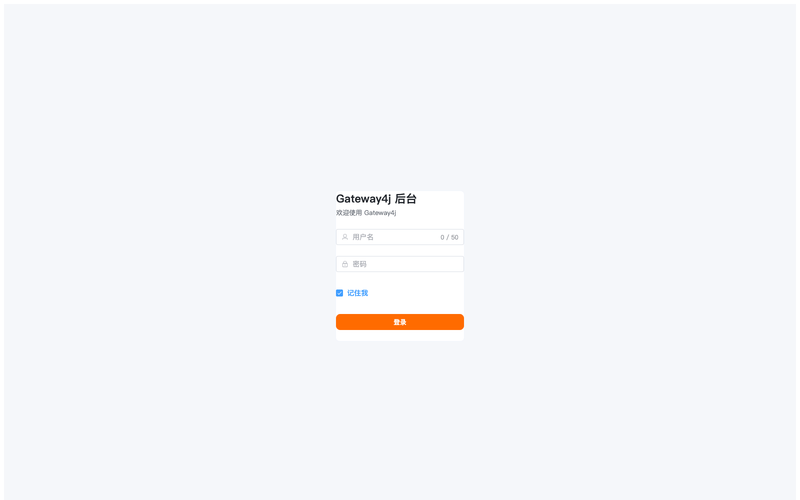 | 登录页五要素（品牌标题/用户名/密码/记住我/登录按钮）完整渲染 |
| 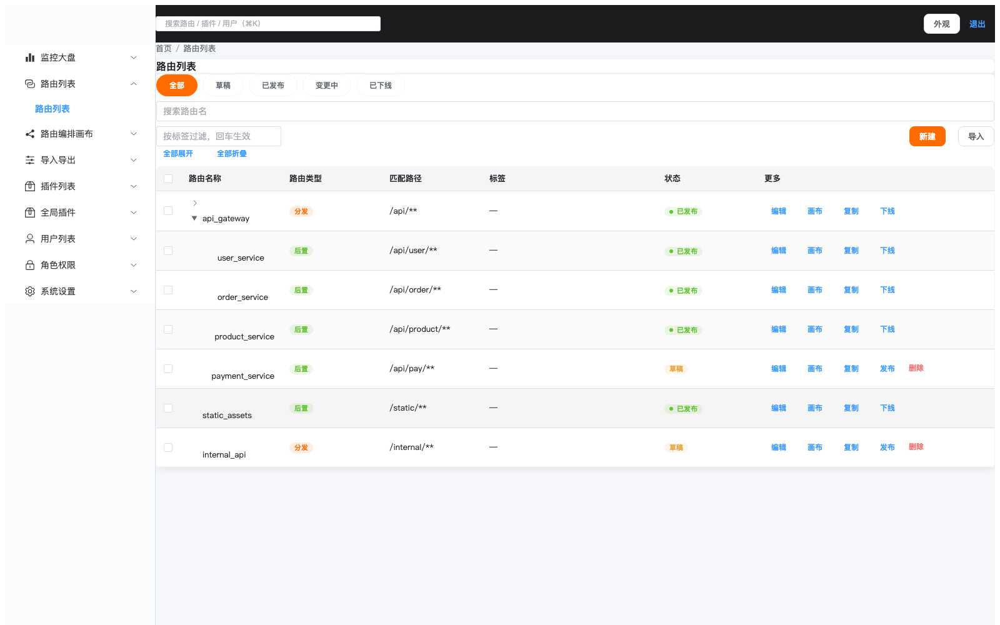 | 正确凭证登录后落地路由列表——侧边栏、顶栏、⌘K 搜索框全部在场（D1 修复的直观对照：10-27 时整个操作外壳不存在） |
|  | 侧边栏渲染出监控大盘 ~ 系统设置全部 9 个业务线导航入口 |

### 5.2 BL-02 监控大盘

**验证的能力**：大盘三 Tab——路由状态（表格/搜索/分段筛选/行点击跳转详情）、指标趋势（路由选择器/时间范围/粒度/自动刷新/ECharts canvas/空态）、路由拓扑（VueFlow 节点渲染、节点数与 `GET /v1/monitor/topology` 返回一致）。

| 关键证据 | 说明 |
|---|---|
| 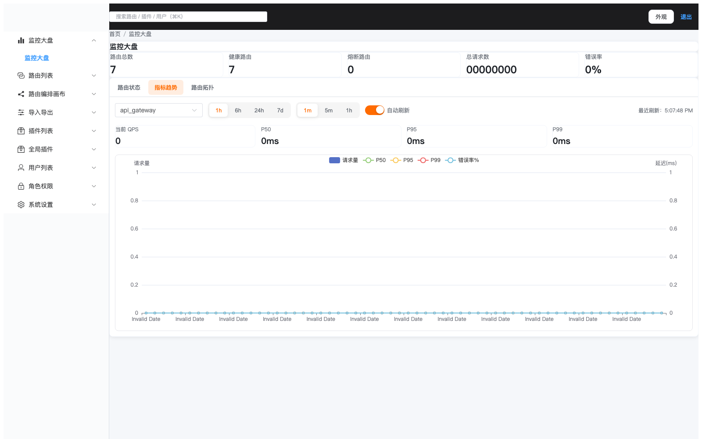 | 大盘顶部五张统计卡片渲染 |
| 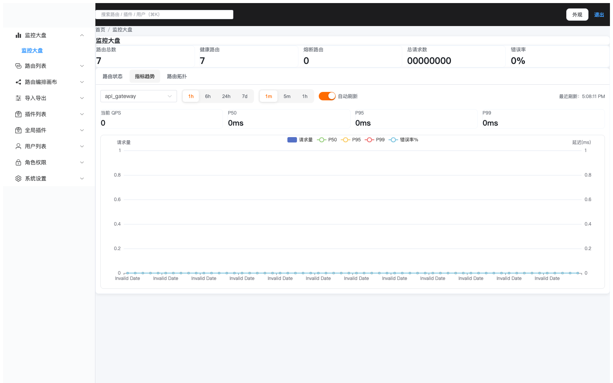 | 指标 Tab：QPS/P50/P95/P99 卡片 + ECharts canvas 真实渲染 |
| 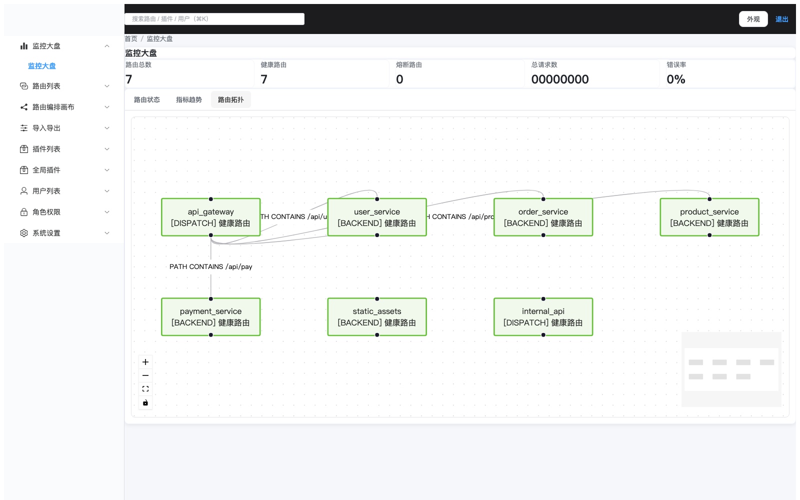 | VueFlow 拓扑图渲染出 7 个路由节点与分发关系连线，节点数与后端接口一致 |

**本轮观察（如实记录）**：02-06 截图中趋势图横轴时间标签显示为 "Invalid Date"——用例断言的是 canvas 渲染（通过），时间标签格式化属于细节打磨问题，已涵盖于 [`优化建议.md`](优化建议.md) §4（指标数据源本身为 engine 模拟口径，见其 §2.2）。

### 5.3 BL-03 路由管理

**验证的能力**：路由全生命周期——树形列表（含分发/后置类型）、状态过滤、搜索、前后端双层格式校验、新建/编辑（四 Tab 编辑器）、**发布/下线经确认弹窗后状态真实变更**、按状态收敛的删除操作。这条业务线是 10-27 最重灾区的回归归口（D2 新建入口、D3 详情接口、D9 后端校验、D11 确认弹窗、D12 前端校验五个 P0/P1 都落在这里）。

| 关键证据 | 说明 |
|---|---|
|  | 树形表格渲染：api_gateway 分发父路由 + 后置子路由层级、状态徽标、按状态收敛的行操作（草稿显示"发布/删除"，已发布显示"下线"） |
| 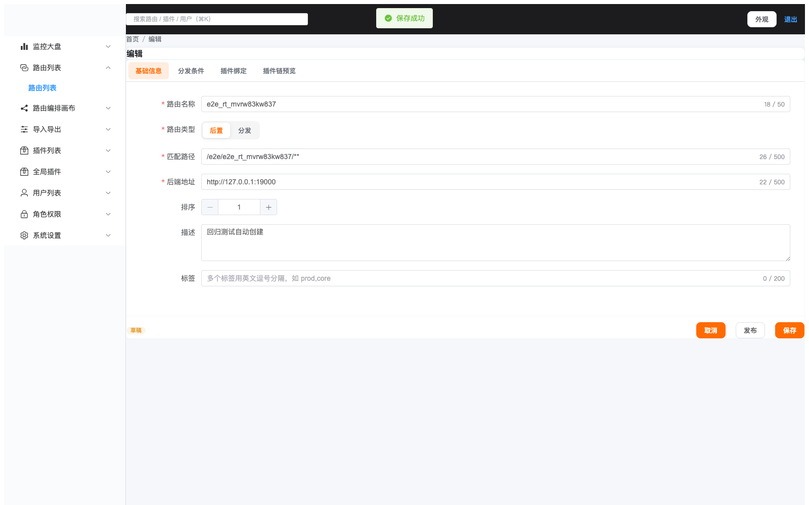 | 合法输入保存成功（"保存成功" Toast）并跳转编辑页，四 Tab 编辑器在场 |
| 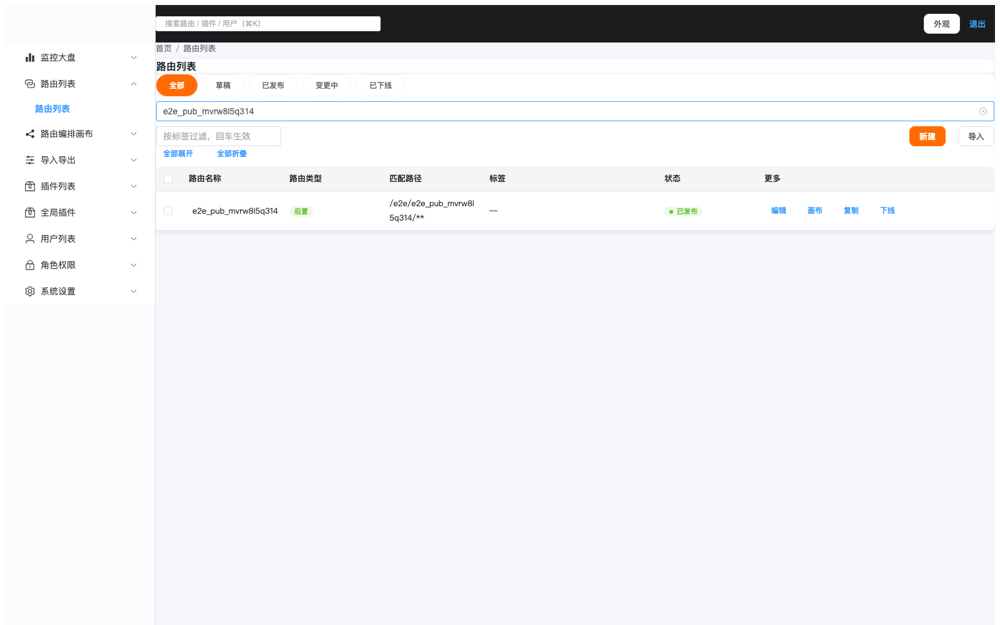 | 草稿路由经确认弹窗发布后，列表行状态真实变为"已发布"——D11（确认弹窗恒 resolve(false) 导致 6 类写操作失效）修复的直接证据 |

### 5.4 BL-04 路由编排画布

**验证的能力**：可视化编排——组件面板三类节点、拖拽创建、属性面板编辑回写、撤销/重做、自动保存、路径预览、**保存后刷新持久化**（D19 回归点：10-27 时保存返回 200 但数据静默丢失）、画布与路由树数据一致（D7 回归点）。

| 关键证据 | 说明 |
|---|---|
|  | 画布页四要素齐备：工具栏（保存/应用到路由树/撤销/重做/自动保存）+ 组件面板 + 属性面板 + VueFlow 画布 |
| 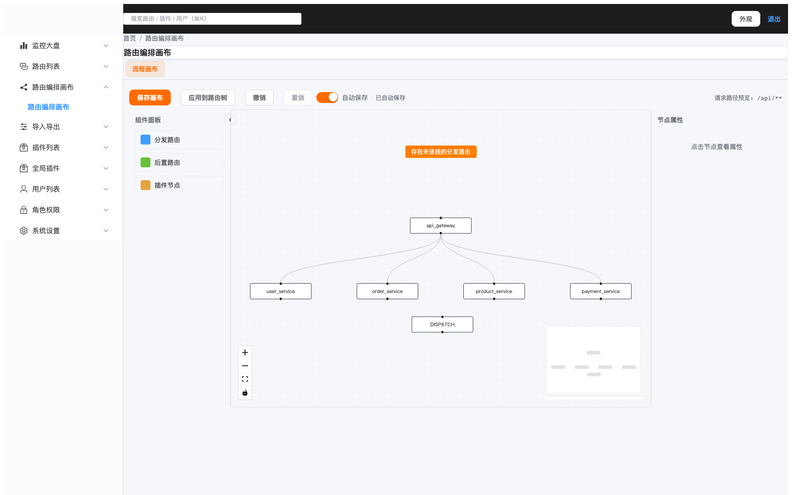 | 从组件面板拖拽创建的节点渲染在画布上，并与路由树推导节点连线 |
| 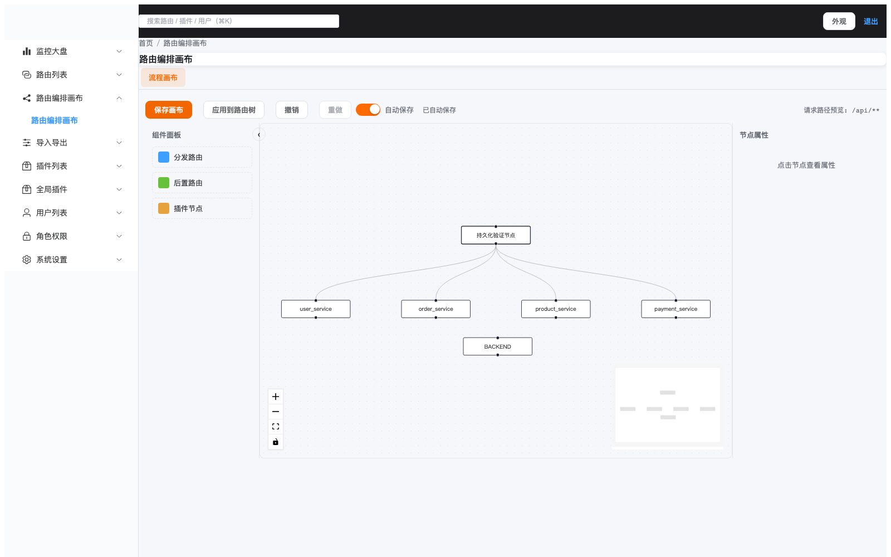 | 保存画布后刷新页面，新建节点"持久化验证节点"仍在画布上——D19 修复（CanvasRequest 契约对齐）的直接证据 |

### 5.5 BL-05 导入导出

**验证的能力**：导出（多选/浏览器真实下载/空选提示）、导入（JSON 预检带可定位错误原因、合法包预检报告、三种冲突策略、正式导入落地路由列表）。D14（预检失败无原因）与 D2（导入入口）的回归归口。

| 关键证据 | 说明 |
|---|---|
| 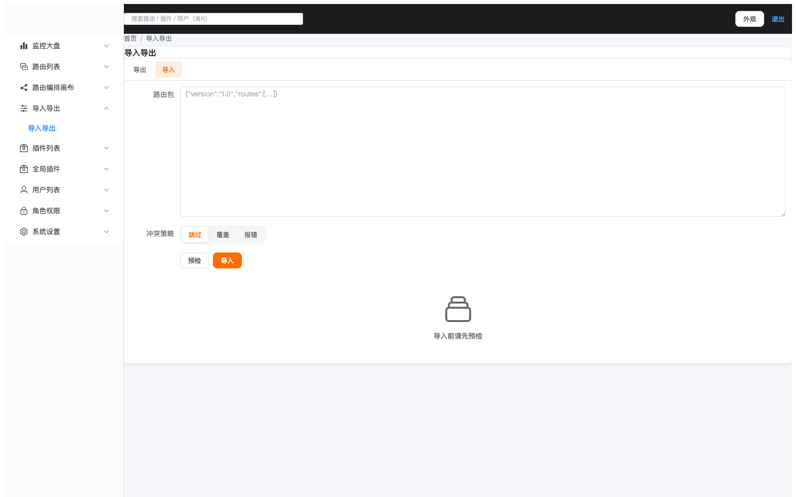 | 导出/导入双 Tab 页面加载 |
| 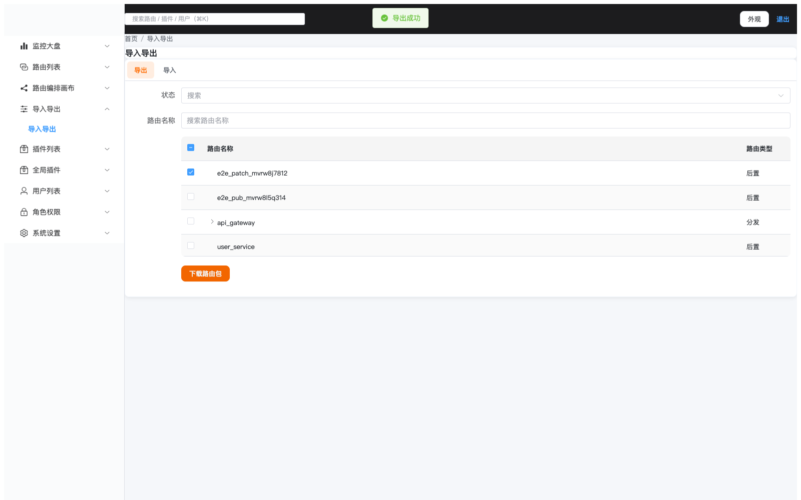 | 勾选路由后点击下载，"导出成功" Toast 出现，浏览器下载真实触发 |
| 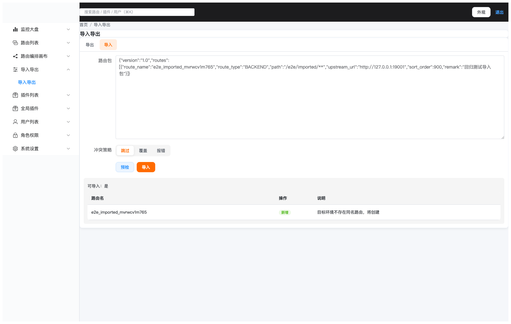 | 合法路由包预检通过，展示"可导入：是 / 新增 / 目标环境不存在同名路由，将创建"结构化报告 |

### 5.6 BL-06 插件管理

**验证的能力**：插件列表（类型/阶段/状态列）、搜索/类型/状态三维过滤、新建（前端校验 + 后端 POST）、**Groovy 脚本在线校验**、启用/禁用/删除真实生效、全局插件 PRE/POST 阶段编排、内置插件分类卡片与 schema 驱动的动态配置表单（D21 回归点）。

| 关键证据 | 说明 |
|---|---|
| 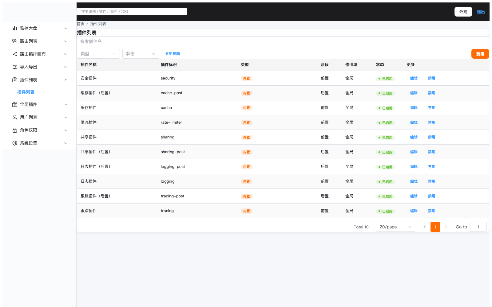 | 插件列表渲染（类型/阶段/状态列齐备，D8 信封统一回归点） |
|  | Groovy 脚本 Tab 输入脚本后点击校验，返回"语法正确"校验结果 |
| 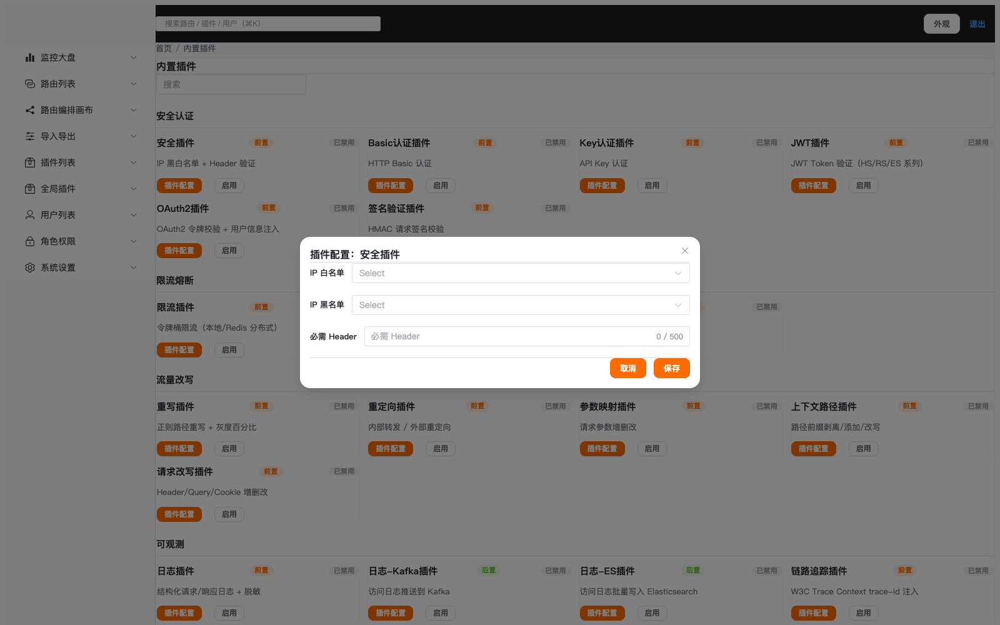 | 内置插件分类卡片（安全认证/限流熔断/流量改写/可观测）渲染，"安全插件"配置弹窗按 schema 动态生成表单字段（D21 回归点） |

### 5.7 BL-07 用户管理

**验证的能力**：用户列表（表格+分页+关键列）、搜索、行操作四件套（编辑/禁用/重置密码/删除）、权限状态不静默、后端 CRUD API 全链路。D5（权限码词表不一致导致整模块只读）与 D18（分页不渲染）的回归归口。

| 关键证据 | 说明 |
|---|---|
| 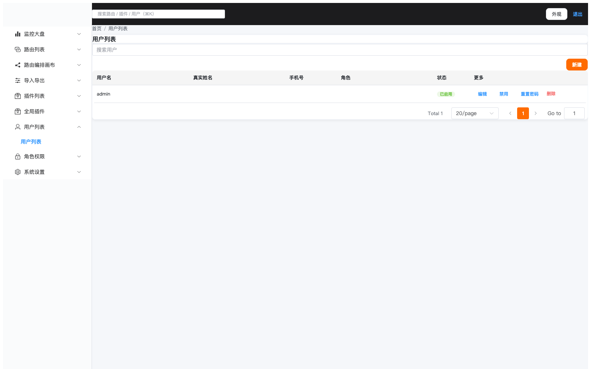 | 用户列表渲染：分页控件在场（Total 1 / 20 per page / 翻页器），行操作"编辑/禁用/重置密码/删除"齐备——10-27 时本页整体只读且无分页 |
|  | 用户行操作完整可见可点（D5 修复后权限码生效） |

### 5.8 BL-08 角色与权限

**验证的能力**：角色 Tab 渲染 4 个种子角色（ADMIN/OPS/DEV/GUEST）、"我的权限"Tab 权限表、授权/编辑/成员管理入口（D16 回归点：10-27 时角色授权功能整体缺失）、非 admin 角色权限绑定缺失可感知。

| 关键证据 | 说明 |
|---|---|
| 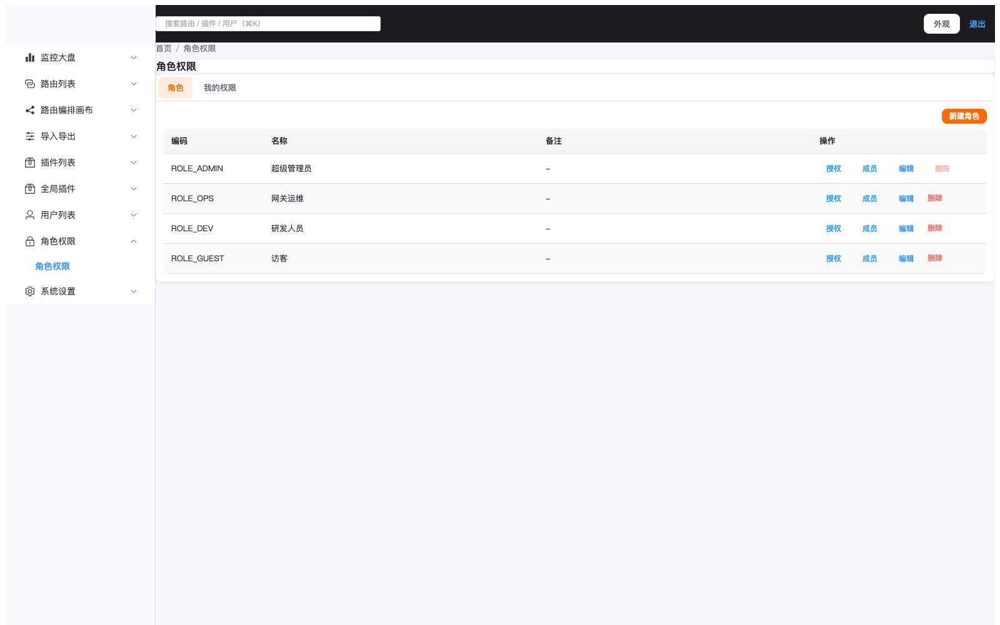 | 4 个种子角色全部渲染，每行提供"授权/成员/编辑/删除"操作（D16 修复后新增的能力入口） |
| 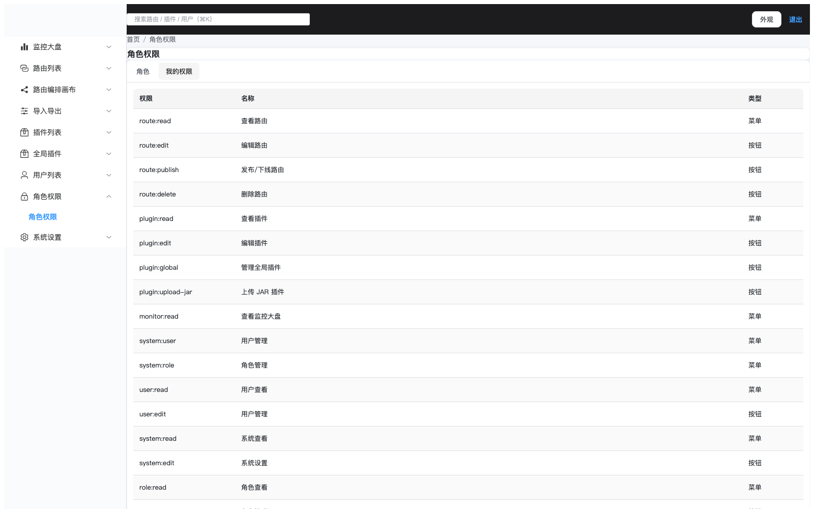 | "我的权限" Tab 渲染权限表（编码/名称/资源类型列） |

### 5.9 BL-09 系统设置

**验证的能力**：设置页五 Tab（通用/安全/字典/主题 + 阶段二迭代新增的"变更记录"）、通用设置保存、配置接口 `GET /v1/config/system`、安全设置数字输入、字典查询正反两态、错误文案友好化（D13 回归点）。D4（缺配置接口导致设置不可用）的回归归口。

| 关键证据 | 说明 |
|---|---|
| 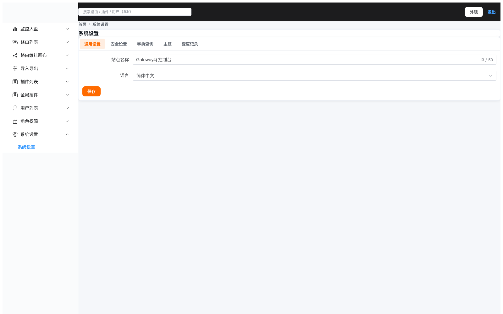 | 系统设置页 Tab 加载 |
| 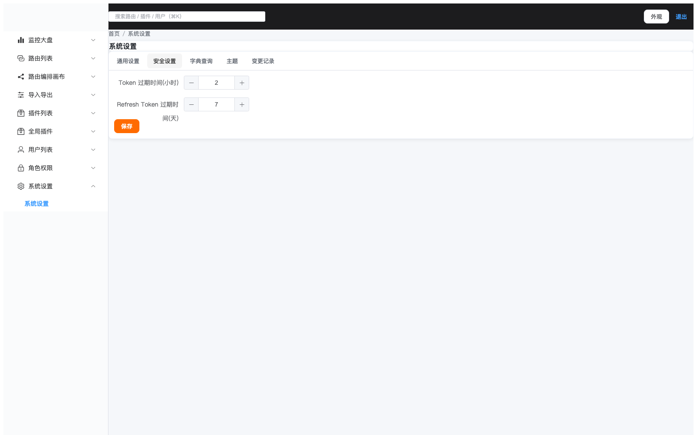 | 安全设置 Tab：Token 过期时间（小时）与 Refresh Token 过期时间（天）数字输入渲染 + 保存按钮（页面同时可见第 5 个"变更记录" Tab——C6 迭代新增，优雅空态） |
| 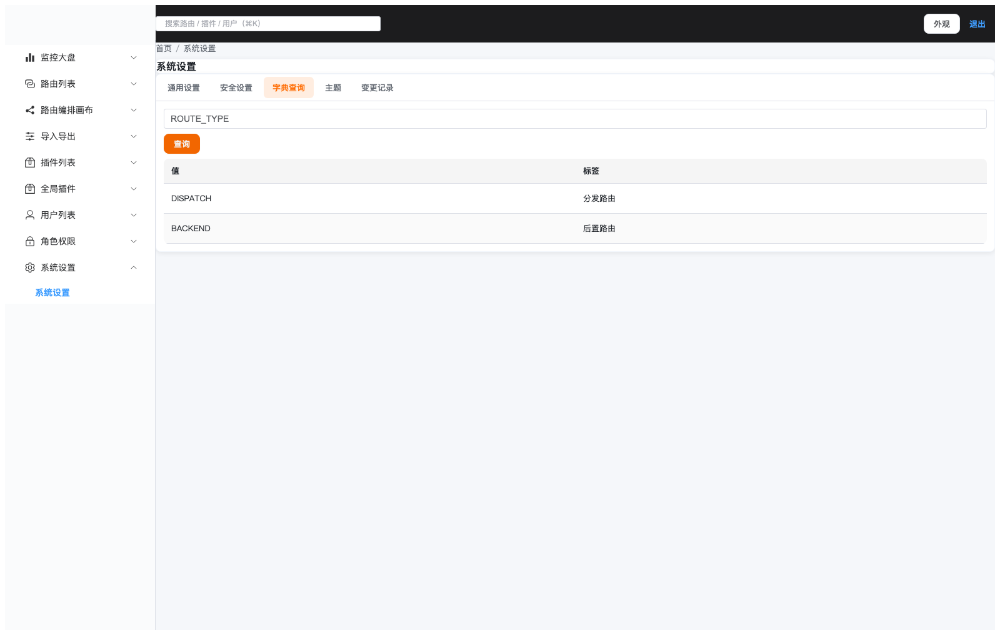 | 字典查询已知 code 返回条目并渲染表格 |

---

## 6. 数据面专章（BL-10）

> **证据性质声明**：本章数据全部来自本报告工程师在报告撰写时**亲自复跑**的一手输出（`cd gateway4j-admin-ui && npx playwright test --config=playwright.gateway.config.ts --reporter=list`，RUN=`mvrwnmk6`，**5 passed (2.3m)**）。spec 为纯 HTTP 黑盒（无浏览器），不产生截图，证据即命令行输出。数据面为纯 HTTP 黑盒验证。

### 6.1 修复前后对照

| 项 | 修复前（10-28-01 首轮） | 本轮（10-28-02 复跑） |
|---|---|---|
| 结果 | **0/5 全部失败**（见 [`../2026-10-28-01/数据面验证.md`](../2026-10-28-01/数据面验证.md)） | **5/5 全部通过** |
| 根因 | `DynamicRouteLocator` 对每条 BACKEND 路由用 always-match 谓词且不过滤状态 → 单路由抢流，新路由永不可达；DISPATCH 分发与插件链未接线；无 404 兜底 | PathPattern 真实谓词 + 仅 PUBLISHED 注册；DispatchRoutingFilter 桥接分发；PluginExecutionFilter fail-open 插件链；内容指纹配置同步；404 兜底（C3 修复，见 [`../2026-10-28-01/推进记录.md`](../2026-10-28-01/推进记录.md)） |
| spec 改动 | — | **零改动**（同一份 `data-plane.spec.ts`，黑盒断言不变） |

### 6.2 场景 × 验证链路 × 结果

| # | 场景 | 管理面操作链（API 黑盒） | 数据面断言（9300 实测） | 本轮实测 | 结果 |
|---|---|---|---|---|---|
| 1 | 基础转发 | 建 BACKEND 路由（upstream→echo:19001）→ 发布 → config_version 推高到基线之上 | 轮询 `GET /e2e/gw/{run}b1/ping` ≤45s，要求 `echo:true` 且 `tag=gw-echo-19001`（tag 归属防抢流误判） | `http=200 body={"echo":true,"tag":"gw-echo-19001","path":"/e2e/gw/mvrwnmk6b1/ping",...}` | ✅ 14.1s |
| 2 | HEADER 分流 | 建子路由 A(→19002)/B(→19003) + DISPATCH 父路由（2 条 HEADER x-ver EQ v1/v2 条件）→ 三路由全部发布 | `x-ver=v1` 必须命中 tag=gw-echo-19002，`x-ver=v2` 必须命中 tag=gw-echo-19003 | `x-ver=v1 → http=200 tag=gw-echo-19002；x-ver=v2 → http=200 tag=gw-echo-19003`——两条件精确分流 | ✅ 30.3s |
| 3 | 热更新摘除 | 建路由→发布→**先确认数据面已生效**→下线→version 推到新基线之上 | 下线前 `http=200 tag=gw-echo-19001`；下线后轮询 ≤45s 直到不再由该 echo 服务 | 下线前 `http=200`；摘除后 `http=404 tag=null`——下线在 30s 轮询周期内真实生效 | ✅ 1.0m |
| 4 | 404 兜底 | 无（直接探测未注册路径） | `GET /e2e/gw/definitely-not-registered-{run}/deep/path` 必须返回 404 且 body 不是任何 echo 的响应 | `http=404 body={"code":404,"message":"Not Found: No static resource ...","success":false}`——网关主动兜底，不再转发抢流 | ✅ 3ms |
| 5 | 插件链冒烟 | 记录 ENABLED 插件清单→建 ROUTE 级 Mock 插件（PRE、可短路）→启用→绑定到新路由→发布 | 正向判据：响应体 `mocked:true`（短路生效）；**降级判据**：绑定持久化可查回 + 转发仍通（tag 归属正确） | Mock 未在外部观察到短路；**以降级判据通过**：`绑定成功(true) + 转发仍通(tag=gw-echo-19001)` | ✅ 30.2s |

### 6.3 复跑输出尾部（一手证据，`/tmp/dataplane-round2.log`）

```text
[env] worker pid=73428 RUN=mvrwnmk6
[场景1] route=gwtest_base_mvrwnmk6_1zpi id=2115373422631104513 config_version=3（基线 max=2）
[场景1] OK http=200 body={"echo":true,"tag":"gw-echo-19001","path":"/e2e/gw/mvrwnmk6b1/ping","method":"GET","header_x_echo":"scenario1","header_x_ver":null,"body":null}
  ✓  1 e2e-gateway/data-plane.spec.ts:216:1 › 场景1 基础转发：建路由→发布→网关转发到 echo (14.1s)
[场景2] routes a=2115373481846288386 b=2115373481875648513 dispatch=2115373481917591553 v=3（基线 max=2）
[场景2] 实测 x-ver=v1 → http=200 tag=gw-echo-19002；x-ver=v2 → http=200 tag=gw-echo-19003
  ✓  2 e2e-gateway/data-plane.spec.ts:258:1 › 场景2 分发路由：HEADER x-ver 条件分流到不同子路由 (30.3s)
[场景3] route=gwtest_s3_mvrwnmk6_3r3i id=2115373609135026177 config_version=5
[场景3] 下线前已生效 http=200
[场景3] 已下线 status=OFFLINE config_version=6（新基线 max=5）
[场景3] 摘除后实际响应 http=404 tag=null（下线前 http=200）
  ✓  3 e2e-gateway/data-plane.spec.ts:351:1 › 场景3 热更新：路由下线后网关在 45s 内摘除 (1.0m)
[场景4] 实际响应 http=404 body={"code":404,"message":"Not Found: No static resource e2e/gw/definitely-not-registered-mvrwnmk6/deep/path.","data":null,"success":false,"fail":true}
  ✓  4 e2e-gateway/data-plane.spec.ts:420:1 › 场景4 404兜底：未匹配任何路径应得到网关明确的非转发响应 (3ms)
[场景5] ENABLED 插件: security(GLOBAL/PRE), e2e_gvy_mvrwebey6(ROUTE/PRE), cache(GLOBAL/PRE), cache-post(GLOBAL/POST), rate-limiter(GLOBAL/PRE), sharing(GLOBAL/PRE), sharing-post(GLOBAL/POST), logging(GLOBAL/PRE), logging-post(GLOBAL/POST), tracing(GLOBAL/PRE), tracing-post(GLOBAL/POST)
[场景5] route=gwtest_plugin_mvrwnmk6_eaqo 插件=gwtest_mock_mvrwnmk6_aed config_version=5
[场景5] Mock 未短路（实际响应 http=200 body={"echo":true,"tag":"gw-echo-19001",...}），降级判据：绑定成功(true) + 转发仍通(tag=gw-echo-19001)；插件链行为无法黑盒断言
  ✓  5 e2e-gateway/data-plane.spec.ts:435:1 › 场景5 插件链冒烟：绑定 Mock 插件（可短路）观察是否生效 (30.2s)

  5 passed (2.3m)
```

### 6.4 数据面两点如实说明

1. **配置生效延迟**：当前唯一同步通道是 30s DB 版本号轮询 + 内容指纹比对，因此场景 1/2/3/5 各自需要把 `config_version` 通过 publish/offline 循环推到库内全量 max 之上才能触发 reload（真实用户同样需要手动绕此坑），单场景耗时 14s~60s 属预期行为。"发布后 <1s 生效"的推送机制是遗留优化第 1 项（见第 7 章 / [`优化建议.md`](优化建议.md) §1.1）。
2. **场景 5 通过口径**：本轮 Mock 插件未在外部观察到短路（`mocked:true` 未出现），用例按其设计以**降级判据**通过——插件绑定真实持久化（`GET /v1/routes/{id}/plugins` 可查回）+ 转发链路仍通（tag 归属正确）。插件执行过程当前对用户不可见（无执行指标/访问日志可查），这正是 [`优化建议.md`](优化建议.md) §2.1"插件执行可观测"要解决的问题；C3 自验时曾观察到 mock 短路生效，两种结果均在用例设计的合法判定范围内，如实记录不作修饰。

---

## 7. 遗留优化意见

本轮 **0 缺陷**，无修复意见；遗留事项全部为优化与打磨，完整清单见同目录 **[`优化建议.md`](优化建议.md)**（六个维度：即时性 / 可观测 / 功能合理化 / 界面细节 / 工程护栏 / 发布就绪清单 + 路线图）。最优先 3 项：

| 优先 | 事项 | 一句话 | 出处 |
|---|---|---|---|
| 1 | 配置生效即时性 | 数据面目前唯一同步通道是 30s DB 轮询（本轮数据面场景耗时即由此而来），落地 Redis publish/subscribe 推送可从"最长 30s"到"<1s"；`gw_config_push_log` 表已建好待用 | 优化建议 §1.1 |
| 2 | 插件执行可观测 | 11 个内置插件已接入数据面（fail-open），但执行与否/耗时/被跳过对用户完全不可见——本轮数据面场景 5 无法黑盒断言短路正源于此；24 个未接线插件的"运行时状态"也应在管理面标注 | 优化建议 §2.1 / §3.1 |
| 3 | git 基线与 CI 首跑 | 仓库仍零 commit（最紧急项）；CI workflow 与护栏脚本已就绪，分批提交基线后推送远程首跑，并把数据面 spec（5 场景 2.3 分钟）并入 nightly | 优化建议 §5 / 路线图"收尾" |

---

## 8. 证据索引

### 8.1 目录结构

```text
test-report/2026-10-28-02/
├── 测试报告.md            本报告
├── 优化建议.md            第二轮体验优化建议书（第 7 章引用）
└── screenshots/           120 PNG + 107 诊断日志 = 227 份证据（9.8MB）
    ├── 01-auth/           16 png + 14 log   认证与登录
    ├── 02-dashboard/      12 png + 12 log   监控大盘
    ├── 03-routes/         24 png + 19 log   路由管理（含发布/下线/删除确认弹窗+状态验证成对截图）
    ├── 04-canvas/         16 png + 14 log   路由编排画布（含保存/持久化成对截图）
    ├── 05-import-export/  11 png + 10 log   导入导出（含导出下载、预检报告）
    ├── 06-plugins/        18 png + 15 log   插件管理（含 Groovy 校验、内置插件配置弹窗）
    ├── 07-users/           8 png +  8 log   用户管理
    ├── 08-roles/           6 png +  6 log   角色与权限
    └── 09-settings/        9 png +  9 log   系统设置
```

命名规则：`{用例号}-{英文短名}.png`；同用例如有过程图，在短名后追加语义后缀（如 `03-14-publish-confirm-dialog.png` 确认弹窗 → `03-14-publish-status-verified.png` 状态验证）。

### 8.2 诊断日志（.log.txt）内容说明

每条用例（截图）同名的 `.log.txt` 是该用例执行期间的四段诊断 + 调用序列记录：

| 段 | 内容 | 本轮状态 |
|---|---|---|
| Console Errors | 浏览器控制台 error 级输出 | **107 份全部为空（无）** |
| Page Errors (未捕获异常) | 页面未捕获 JS 异常 | **107 份全部为空（无）** |
| Failed Requests (网络失败) | 网络层失败请求 | **107 份全部为空（无）** |
| HTTP >= 400 | 4xx/5xx 响应 | **107 份全部为空（无）** |
| 后端 API 调用记录 | 该用例完整的 `status METHOD path` 调用序列 | 有内容（证明请求真实到达后端） |
| Extra | 用例特定的断言证据（如"发布后行内容=… /publish 请求数=1"） | 部分用例有 |

即：本轮管理面回归**全程零前端异常、零网络失败、零 HTTP≥400**，所有写操作都有对应的真实后端调用记录佐证。

### 8.3 权威执行记录

| 记录 | 位置 |
|---|---|
| 管理面回归原始日志（106 passed, 9.9m） | `/tmp/regression-round2.log` |
| 数据面复跑原始日志（5 passed, 2.3m，本报告亲手执行） | `/tmp/dataplane-round2.log` |
| 首轮回归与 D1~D21 缺陷详情 | [`../2026-10-27-01/测试报告.md`](../2026-10-27-01/测试报告.md) |
| D1~D21 修复验证 | [`../2026-10-28-01/修复验证报告.md`](../2026-10-28-01/修复验证报告.md) |
| 本轮推进过程（CI / 数据面修复 / 阶段二迭代） | [`../2026-10-28-01/推进记录.md`](../2026-10-28-01/推进记录.md) |
| 数据面修复前 0/5 详情 | [`../2026-10-28-01/数据面验证.md`](../2026-10-28-01/数据面验证.md) |

---

*生成：2026-10-28 · gateway4j 测试报告工程师 · 管理面 106 条 + 数据面 5 条，111/111 全绿*
