# Gateway4j 全量回归测试报告（第四轮 · 管理面 + 数据面）

| 项 | 内容 |
|---|---|
| **报告编号** | 2026-10-29-01 |
| **报告日期** | 2026-10-29 |
| **测试时间** | 2026-10-29 01:29:51 ~ 01:45:13（管理面，15.4 分钟）＋ 01:45:21 ~ 01:45:24（数据面，2.0 秒） |
| **被测系统** | gateway4j 可视化网关：管理后台（gateway4j-admin-ui + gateway4j-admin-boot）与网关数据面（gateway4j-gateway-boot） |
| **运行环境** | gateway-boot 9300（Netty/Reactive）、admin-boot 9301（Tomcat/Servlet）、admin-ui 9302（Vite dev，proxy → 9301）、PostgreSQL 17（容器 `pg-17`）、Redis 7.2（容器 `redis`）。数据库为 10-28 晚快赢包验收时的**全新库部署**（Flyway V1.0.0 ~ V1.3.4 共 **9 条迁移全量重放**），本轮沿用该基线、未重置（带少量前轮 e2e 残留数据，见 6.4 节） |
| **版本基线** | git `main` @ `326a6f3`（工作区 HEAD 首条提交）；此后**产品代码零改动**——工作区仅有 3 个测试基座文件的输出目录切换（`e2e-regression/helpers.ts`、`playwright.regression.config.ts`、`playwright.gateway.config.ts` 各 1 行，报告输出目录切至 `2026-10-29-01`） |
| **测试方式** | 管理面：Playwright 1.60 + Chromium（1600×1000，workers=1，retries=0）黑盒 UI 回归，真实后端 + 真实数据库；数据面：Playwright request 上下文黑盒 HTTP（自建 echo 后端 19001/19002/19003 + 自清 `gwtest_` 路由，无副作用） |
| **业务线** | **10 条**（管理面 BL-01 ~ BL-09 + 数据面 BL-10） |
| **用例总数** | **111 = 106（管理面）+ 5（数据面）** |
| **执行结果** | **✅ 111 / 111 全部通过（100%）** —— 管理面 106/106（15.4 分钟，01:29~01:45），数据面 5/5（2.0 秒） |
| **缺陷** | **0**（本轮未发现需要修复的缺陷；测试视角的非缺陷改进点见第 7 章） |
| **证据** | **120 张界面截图 + 107 份逐用例诊断日志 = 227 份（11MB）**（`screenshots/`，9 个业务线目录）+ 双套件机器可读 JSON（`results.json`、`gateway-data-plane-results.json`） |
| **本轮定位** | 10-28 快赢包（失效 token 401、login 限流、写操作 Redis 推送、内置插件 37 实例接线、runtime-status 接口与接线徽标、大盘跨 JVM 指标）+ 全新库部署验证之后，**首次带完整机器可读证据（results.json）的全量回归**（10-28-03 验收轮因 `--reporter=list` 覆盖未产出 JSON） |

---

## 1. 结论摘要

### 1.1 与前三轮对照（含本轮的五轮全景）

| 轮次 | 报告 | 范围 | 结果 | 备注 |
|---|---|---|---|---|
| 第一轮（10-27） | [`test-report/2026-10-27-01/测试报告.md`](../2026-10-27-01/测试报告.md) | 管理面 106 条 | ❌ 76 通过 / 30 失败（71.7%） | 发现 **21 条缺陷**（P0×8 / P1×7 / P2×6） |
| 修复验证（10-28 上午） | [`test-report/2026-10-28-01/修复验证报告.md`](../2026-10-28-01/修复验证报告.md) | 管理面 106 条 + 数据面 5 场景 | ✅ 106/106；**数据面首轮 0/5** | D1~D21 全部修复验证通过；数据面结构性 P0 由 C3 引擎修复后 **5/5** |
| 第二轮全量（10-28 傍晚） | [`test-report/2026-10-28-02/测试报告.md`](../2026-10-28-02/测试报告.md) | 管理面 106 + 数据面 5 | ✅ **111/111**（9.9m + 2.3m） | 纯回归确认，0 缺陷；配置生效依赖 30s DB 轮询 |
| 快赢包验收（10-28 晚） | [`test-report/2026-10-28-03/验收报告.md`](../2026-10-28-03/验收报告.md) | 111 + 后端单测 + vitest + CI 护栏 | ✅ 106/106（15.3m）+ 5/5（1.9s） | 全新库部署（Flyway 9 迁移重放）；快赢包 7 项专项验收全过；**该轮 results.json 因 `--reporter=list` 覆盖未产出**（教训已入 CI） |
| **本轮（10-29 凌晨）** | 本报告 | **管理面 106 + 数据面 5** | ✅ **111/111**（15.4m + 2.0s） | 上述全部改动落地后的**首次全量回归确认**，且首次在快赢包版本上补齐机器可读 JSON 证据 |

**结论：10-27 的 76/106（21 缺陷）→ 10-28-02 的 111/111 → 本轮 111/111。连续三轮全绿，本轮覆盖了快赢包全部新特性与全新库基线。**

### 1.2 总体判断

> **gateway4j 在"全新库基线 + 快赢包全部改动"上完成第四轮全量回归，111 条用例全部一次通过（管理面零重试、数据面 2.0 秒），未发现任何需要修复的缺陷。**

- **管理面**：9 条业务线 106 条用例全绿。10-27 的 21 条缺陷修复点（外壳渲染、写操作、校验、分页、权限、404 页等）继续作为回归点全部通过；阶段二功能（⌘K 全局搜索、面包屑、路由标签过滤、画布"应用到路由树"、变更记录、角色成员）在本轮截图中均在场。
- **全新库基线可用性**：V1.3.3（metrics 插件种子）与 V1.3.4（admin 初始密码修正）两条新迁移生效——admin 以种子凭证正常登录（BL-01 全链路通过），大盘指标有数据来源（BL-02 通过）。
- **快赢包特性全部在场**：
  - login 限流（10 次/分钟/IP）真实生效——本轮 01-14 诊断日志实测捕获一次 `429 POST /v1/auth/login`，重试基座按设计等待后 `200` 通过（见 5.1 节）；
  - 写操作 Redis 推送使数据面配置生效进入亚秒级——本轮数据面整套从上一轮的 2.3 分钟缩到 **2.0 秒**（见 6.1/6.4 节）；
  - 内置插件"已接线"绿标全量渲染（06-13 截图）、runtime-status 37/37 已注册（快赢包验收结论，本轮 06-13/06-14 用例回归通过）。
- **数据面**：5 场景（基础转发 / HEADER 分流 / 下线热更新 / 404 兜底 / 插件链冒烟）全绿。真实转发带 tag 归属防误判、x-ver=v1/v2 精确命中不同子路由、下线后亚秒级摘除（404）、未注册路径由网关兜底 404 不转发。
- **诊断质量（如实记录，本轮不是"四段全空"）**：107 份诊断日志中，控制台错误 1 份（01-14，限流 429 的浏览器级回显）、页面未捕获异常 2 份（06-13，Element Plus 对话框递归更新告警，上一轮同位置同报错）、网络失败 1 份（01-14，路由切换导致的请求中断 `ERR_ABORTED`）、HTTP≥400 1 份（01-14 的 429）。全部集中于 2 条用例，均不改变用例判定，已逐条归因于 5.1 / 5.6 / 第 7 章。

### 1.3 与上一轮报告的章节差异

上一轮第 7 章为"遗留优化意见"并外链独立的 [`优化建议.md`](../2026-10-28-02/优化建议.md)；本轮按"全绿 + 快赢包已消化多数遗留项"的现状，调整为**"修复意见"**（第 7 章）：0 缺陷、无需修复项，测试视角观察到的非缺陷改进点直接在本章内列全（其中"配置生效即时性""接线徽标/运行时状态"两项上轮遗留已在本轮落地，报告中如实标注闭环）。

---

## 2. 业务线拆分

| 编号 | 业务线 | 覆盖页面 / 能力 | 用例数 | 通过 | 截图目录 |
|---|---|---|---|---|---|
| BL-01 | 认证与登录 + 全局外壳 | `/login`、路由守卫、侧边栏/顶栏外壳、404 页 | 15 | 15 ✅ | `screenshots/01-auth/` |
| BL-02 | 监控大盘 | `/dashboard`（路由状态 / 指标 / 拓扑 三 Tab） | 12 | 12 ✅ | `screenshots/02-dashboard/` |
| BL-03 | 路由管理 | `/routes`、新建/编辑、发布/下线/删除 | 18 | 18 ✅ | `screenshots/03-routes/` |
| BL-04 | 路由编排画布 | `/routes/:id/canvas`（拖拽编排/保存/撤销重做/应用到路由树） | 14 | 14 ✅ | `screenshots/04-canvas/` |
| BL-05 | 导入导出 | `/import-export`（导出下载/导入预检/冲突策略） | 10 | 10 ✅ | `screenshots/05-import-export/` |
| BL-06 | 插件管理 | `/plugins`（列表/Groovy/启停删除/全局/内置+接线徽标） | 14 | 14 ✅ | `screenshots/06-plugins/` |
| BL-07 | 用户管理 | `/users`（列表/搜索/行操作/CRUD API） | 8 | 8 ✅ | `screenshots/07-users/` |
| BL-08 | 角色与权限 | `/roles`（角色 Tab/我的权限/授权与成员入口） | 6 | 6 ✅ | `screenshots/08-roles/` |
| BL-09 | 系统设置 | `/settings`（通用/安全/字典/主题/变更记录） | 9 | 9 ✅ | `screenshots/09-settings/` |
| BL-10 | **网关数据面** | 9300 转发/HEADER 分流/下线热更新/404 兜底/插件链 | 5 | 5 ✅ | 黑盒 HTTP 输出（见第 6 章） |
| | **合计** | | **111** | **111 ✅** | |

**测试资产**

| 资产 | 路径 |
|---|---|
| 管理面用例 | `gateway4j-admin-ui/e2e-regression/01-auth.spec.ts` … `09-settings.spec.ts`（106 条） |
| 数据面用例 | `gateway4j-admin-ui/e2e-gateway/data-plane.spec.ts`（5 场景）+ `echo-server.cjs`（19001/19002/19003） |
| 管理面配置 | `gateway4j-admin-ui/playwright.regression.config.ts`（Chromium 1600×1000，workers=1，retries=0） |
| 数据面配置 | `gateway4j-admin-ui/playwright.gateway.config.ts`（timeout 180s，workers=1） |
| 登录限流重试基座 | `gateway4j-admin-ui/e2e-regression/helpers.ts` `login()`：429 触顶后间隔 25s 重试（≤3 次），不弱化断言（`39bf5f5` 引入） |
| 管理面机器可读结果 | `test-report/2026-10-29-01/results.json`（expected=106 / unexpected=0 / flaky=0，duration 921.6s） |
| 数据面机器可读结果 | `test-report/2026-10-29-01/gateway-data-plane-results.json`（expected=5，duration 2.0s，RUN=`mvseneci`） |

---

## 3. 业务线汇总表

| 业务线 | 用例数 | 通过 | 失败 | 通过率 | 一句话结论 |
|---|---|---|---|---|---|
| BL-01 认证与登录 | 15 | 15 | 0 | 100% | 登录/登出/守卫/会话持久化/404 页全链路可用；login 限流 429→重试通过被实测捕获 |
| BL-02 监控大盘 | 12 | 12 | 0 | 100% | 三 Tab 渲染、筛选、前后端数据一致；跨 JVM 指标通道（Redis 快照）在位 |
| BL-03 路由管理 | 18 | 18 | 0 | 100% | 树形列表/校验/CRUD/发布/下线/删除全生命周期真实生效；标签过滤/复制/画布入口在场 |
| BL-04 路由编排画布 | 14 | 14 | 0 | 100% | 拖拽编排/属性编辑/保存持久化/与路由树一致 |
| BL-05 导入导出 | 10 | 10 | 0 | 100% | 导出下载、导入预检/策略/落地全链路可用，错误有因 |
| BL-06 插件管理 | 14 | 14 | 0 | 100% | 插件 CRUD/启停删除/Groovy 校验/全局与内置插件可用；内置插件"已接线"徽标全量渲染 |
| BL-07 用户管理 | 8 | 8 | 0 | 100% | 列表分页/搜索/行操作/后端 CRUD 全链路可用 |
| BL-08 角色与权限 | 6 | 6 | 0 | 100% | 4 种子角色渲染、权限表、授权/成员入口、绑定缺失可感知 |
| BL-09 系统设置 | 9 | 9 | 0 | 100% | 五 Tab 渲染、配置接口可用、错误文案友好化 |
| BL-10 网关数据面 | 5 | 5 | 0 | 100% | 转发/HEADER 分流/下线摘除（亚秒级）/404 兜底全部真实生效，整套仅 2.0s |
| **总计** | **111** | **111** | **0** | **100%** | |

---

## 4. 逐条用例明细表（管理面 106 条全列）

> 结论列全部为 ✅。下表由 `results.json` 程序化生成（spec 文件 + 用例标题原样提取，未手抄）；证据文件名为该用例落盘的截图（同名 `.log.txt` 为其四段诊断日志），均位于 `screenshots/<对应业务线目录>/`。


### BL-01 认证与登录（15/15）


| 用例号 | 用例标题（results.json 原文） | 结论 | 证据文件（`screenshots/01-auth/`） |
|---|---|---|---|
| 01-01 | 01-01 登录页正常渲染（品牌标题/用户名/密码/记住我/登录按钮） | ✅ | `01-01-login-page.png` |
| 01-02 | 01-02 空用户名/空密码提交被前端拦截并提示 | ✅ | `01-02-empty-submit-rejected.png` |
| 01-03 | 01-03 错误口令给出可见错误提示且不跳转 | ✅ | `01-03-wrong-password-error.png` |
| 01-04 | 01-04 正确凭证登录成功并进入路由列表 | ✅ | `01-04-login-success.png` |
| 01-05 | 01-05 未登录直接访问受保护路由被守卫拦截并跳登录页 | ✅ | `01-05-guard-redirect-to-login.png` |
| 01-06 | 01-06 登录后刷新页面保持登录态（会话持久化） | ✅ | `01-06-session-persists-after-reload.png` |
| 01-07 | 01-07 顶栏登出按钮存在且可点击退出登录 | ✅ | `01-07-logout-button-and-redirect.png` |
| 01-08 | 01-08 退出登录后无法再访问受保护路由 | ✅ | `01-08-logout-guard-works.png` |
| 01-09 | 01-09 全局侧边栏渲染出各业务线导航入口 | ✅ | `01-09-sidebar-nav-entries.png` |
| 01-10 | 01-10 顶栏渲染标题/主题切换/用户信息区 | ✅ | `01-10-header-rendered.png` |
| 01-11 | 01-11 主题/品牌/语言切换器可达（位于顶栏 actions 区） | ✅ | `01-11-theme-switcher.png` |
| 01-12 | 01-12 登录失败时不残留无效 Token | ✅ | `01-12-no-token-residue.png` |
| 01-13 | 01-13 "记住我"勾选状态决定 refresh token 的存储位置 | ✅ | `01-13-remember-me-storage.png`、`01-13-remember-me-unchecked.png` |
| 01-14 | 01-14 未知路由应展示 404 页面而不是静默跳回路由列表 | ✅ | `01-14-unknown-route.png` |
| 01-15 | 01-15 直接访问 /login 已登录时不再重复登录 | ✅ | `01-15-login-when-already-authed.png` |

### BL-02 监控大盘（12/12）


| 用例号 | 用例标题（results.json 原文） | 结论 | 证据文件（`screenshots/02-dashboard/`） |
|---|---|---|---|
| 02-01 | 02-01 大盘页面加载：顶部统计卡片渲染 | ✅ | `02-01-dashboard-stat-cards.png` |
| 02-02 | 02-02 路由状态 Tab：可切换并展示状态表格 | ✅ | `02-02-tab-route-status.png` |
| 02-03 | 02-03 路由状态 Tab：关键词搜索过滤生效 | ✅ | `02-03-status-search-empty.png` |
| 02-04 | 02-04 路由状态 Tab：分段筛选切换（全部/健康） | ✅ | `02-04-status-segment-filter.png` |
| 02-05 | 02-05 指标 Tab：路由选择器 + 时间范围 + 粒度 + 自动刷新开关 | ✅ | `02-05-metrics-toolbar.png` |
| 02-06 | 02-06 指标 Tab：趋势图表 canvas 渲染 | ✅ | `02-06-metrics-chart.png` |
| 02-07 | 02-07 拓扑 Tab：关系图（VueFlow）渲染出节点 | ✅ | `02-07-topology-graph.png` |
| 02-08 | 02-08 路由状态行点击可跳转到路由详情 | ✅ | `02-08-status-row-click.png` |
| 02-09 | 02-09 指标 Tab：时间范围与粒度切换后图表重新渲染 | ✅ | `02-09-metrics-range-switch.png` |
| 02-10 | 02-10 自动刷新开关打开后展示"最近刷新时间" | ✅ | `02-10-auto-refresh-last-refresh.png` |
| 02-11 | 02-11 拓扑 Tab：节点数量与后端 /v1/monitor/topology 返回一致 | ✅ | `02-11-topology-node-count.png` |
| 02-12 | 02-12 指标 Tab：未选择路由时应给出明确空态 | ✅ | `02-12-metrics-empty-state.png` |

### BL-03 路由管理（18/18）


| 用例号 | 用例标题（results.json 原文） | 结论 | 证据文件（`screenshots/03-routes/`） |
|---|---|---|---|
| 03-01 | 03-01 路由列表加载：树形表格渲染且含分发型父路由 | ✅ | `03-01-route-list.png` |
| 03-02 | 03-02 状态过滤标签切换生效（全部/草稿/已发布/变更中/已下线） | ✅ | `03-02-status-filter.png` |
| 03-03 | 03-03 搜索框按路由名过滤（大小写不敏感） | ✅ | `03-03-search-filter.png` |
| 03-04 | 03-04 搜索无结果时展示空态而非报错 | ✅ | `03-04-search-empty-state.png` |
| 03-05 | 03-05 树形展开/收起按钮可用 | ✅ | `03-05-tree-expand-collapse.png` |
| 03-06 | 03-06 路由列表应提供「新建」主操作入口 | ✅ | `03-06-create-button.png` |
| 03-07 | 03-07 新建路由：必填项校验（名称/路径/后端地址） | ✅ | `03-07-create-required-validation.png` |
| 03-08 | 03-08 新建路由：非法名称/路径格式被前端拦截 | ✅ | `03-08-create-format-validation.png` |
| 03-09 | 03-09 后端应拒绝非法格式的路由（与前端校验对齐） | ✅ | `03-09-backend-format-validation.png` |
| 03-10 | 03-10 新建路由：合法输入保存成功并跳转编辑页 | ✅ | `03-10-create-success.png` |
| 03-11 | 03-11 编辑器：四个 Tab（基本信息/分发条件/插件绑定/插件链）均可打开 | ✅ | `03-11-editor-tab-分发条件.png`、`03-11-editor-tab-基本信息.png`、`03-11-editor-tab-插件绑定.png`、`03-11-editor-tab-插件链.png` |
| 03-12 | 03-12 编辑已有路由：应能加载出基本信息表单 | ✅ | `03-12-edit-existing-route-load.png` |
| 03-13 | 03-13 编辑已有路由：后端更新能力（PATCH）正常 | ✅ | `03-13-patch-update.png` |
| 03-14 | 03-14 草稿路由可发布（确认弹窗 + 状态真的变为已发布） | ✅ | `03-14-publish-confirm-dialog.png`、`03-14-publish-status-verified.png` |
| 03-15 | 03-15 已发布路由可下线（状态真的变为已下线） | ✅ | `03-15-offline-confirm-dialog.png`、`03-15-offline-status-verified.png` |
| 03-16 | 03-16 已发布路由不可删除（删除按钮按状态收敛） | ✅ | `03-16-published-route-no-delete.png` |
| 03-17 | 03-17 草稿路由可删除（删除后列表中消失） | ✅ | `03-17-delete-confirm-dialog.png`、`03-17-delete-verified.png` |
| 03-18 | 03-18 新建分发路由：类型切换后展示父路由选择 | ✅ | `03-18-dispatch-type-parent-select.png` |

### BL-04 路由编排画布（14/14）


| 用例号 | 用例标题（results.json 原文） | 结论 | 证据文件（`screenshots/04-canvas/`） |
|---|---|---|---|
| 04-01 | 04-01 画布页加载：工具栏 + 组件面板 + 属性面板 + VueFlow 画布 | ✅ | `04-01-canvas-loaded.png` |
| 04-02 | 04-02 组件面板列出可拖拽的节点类型 | ✅ | `04-02-component-panel-node-types.png` |
| 04-03 | 04-03 空画布应给出引导空态文案 | ✅ | `04-03-empty-canvas-no-hint.png` |
| 04-04 | 04-04 从组件面板拖拽可创建节点并渲染在画布上 | ✅ | `04-04-drag-create-node.png` |
| 04-05 | 04-05 选中节点后右侧属性面板显示可编辑字段 | ✅ | `04-05-node-selected-property-panel.png` |
| 04-06 | 04-06 属性面板可编辑节点标签并回写画布 | ✅ | `04-06-prop-label-edited.png` |
| 04-07 | 04-07 未选中时属性面板显示空态提示 | ✅ | `04-07-property-panel-empty.png` |
| 04-08 | 04-08 组件面板可折叠/展开 | ✅ | `04-08-panel-collapsed.png`、`04-08-panel-expanded-again.png` |
| 04-09 | 04-09 保存画布后刷新页面节点持久化 | ✅ | `04-09-canvas-persisted-after-reload.png`、`04-09-save-canvas.png` |
| 04-10 | 04-10 撤销/重做按钮状态随操作变化 | ✅ | `04-10-undo-redo-state.png` |
| 04-11 | 04-11 自动保存开关可用 | ✅ | `04-11-autosave-toggle.png` |
| 04-12 | 04-12 路径预览区展示当前路由路径 | ✅ | `04-12-path-preview.png` |
| 04-13 | 04-13 属性面板可删除节点 | ✅ | `04-13-node-deleted.png` |
| 04-14 | 04-14 画布应与路由树保持数据一致 | ✅ | `04-14-canvas-vs-route-tree.png` |

### BL-05 导入导出（10/10）


| 用例号 | 用例标题（results.json 原文） | 结论 | 证据文件（`screenshots/05-import-export/`） |
|---|---|---|---|
| 05-01 | 05-01 导入导出页加载：导出/导入两个 Tab 均存在 | ✅ | `05-01-import-export-page.png` |
| 05-02 | 05-02 导出 Tab：路由表格加载并支持多选 | ✅ | `05-02-export-route-selection.png` |
| 05-03 | 05-03 导出：下载路由包触发浏览器下载 | ✅ | `05-03-export-download.png` |
| 05-04 | 05-04 导出：不勾选任何路由时应给出提示而非静默失败 | ✅ | `05-04-export-without-selection.png` |
| 05-05 | 05-05 导入 Tab：非法 JSON 预检应给出可定位的错误原因 | ✅ | `05-05-import-invalid-json-precheck.png` |
| 05-06 | 05-06 导入 Tab：合法路由包预检通过并展示报告 | ✅ | `05-06-import-valid-precheck.png` |
| 05-07 | 05-07 导入 Tab：冲突策略（跳过/覆盖/报错）可切换 | ✅ | `05-07-import-strategy-switch.png` |
| 05-08 | 05-08 导入：正式导入后新路由出现在路由列表 | ✅ | `05-08-import-done.png`、`05-08-imported-route-in-list.png` |
| 05-09 | 05-09 导入：JSON 结构非法（缺 routes 数组）应给出原因 | ✅ | `05-09-import-bad-structure.png` |
| 05-10 | 05-10 导入导出页应提供可达的"导入"主操作入口 | ✅ | `05-10-import-entry-from-list.png` |

### BL-06 插件管理（14/14）


| 用例号 | 用例标题（results.json 原文） | 结论 | 证据文件（`screenshots/06-plugins/`） |
|---|---|---|---|
| 06-01 | 06-01 插件列表加载：表格渲染且含类型/阶段/状态列 | ✅ | `06-01-plugin-list.png` |
| 06-02 | 06-02 列表/分组视图切换按钮可用 | ✅ | `06-02-grouped-view.png`、`06-02-table-view-back.png` |
| 06-03 | 06-03 按插件名搜索应过滤结果 | ✅ | `06-03-search-filter-not-applied.png` |
| 06-04 | 06-04 类型筛选应生效 | ✅ | `06-04-type-filter.png` |
| 06-05 | 06-05 状态筛选应生效 | ✅ | `06-05-status-filter.png` |
| 06-06 | 06-06 插件列表应提供「新建插件」主操作入口 | ✅ | `06-06-create-plugin-entry.png` |
| 06-07 | 06-07 新建插件：后端创建能力（POST /v1/plugins）正常 | ✅ | `06-07-plugin-create-api.png` |
| 06-08 | 06-08 新建插件：必填与格式校验提示 | ✅ | `06-08-plugin-create-validation.png` |
| 06-09 | 06-09 Groovy 插件：脚本校验按钮返回校验结果 | ✅ | `06-09-groovy-script-validate.png` |
| 06-10 | 06-10 插件启用/禁用：状态真的变更 | ✅ | `06-10-plugin-enabled-verified.png` |
| 06-11 | 06-11 插件删除：确认后从列表消失 | ✅ | `06-11-plugin-delete-confirm.png`、`06-11-plugin-delete-result.png` |
| 06-12 | 06-12 全局插件：PRE/POST 两个阶段 Tab 与插件开关 | ✅ | `06-12-global-plugins-post.png`、`06-12-global-plugins-pre.png` |
| 06-13 | 06-13 内置插件：分类卡片渲染并可打开配置表单 | ✅ | `06-13-builtin-config-dialog.png`、`06-13-builtin-plugins.png` |
| 06-14 | 06-14 内置插件：搜索过滤生效 | ✅ | `06-14-builtin-search-empty.png` |

### BL-07 用户管理（8/8）


| 用例号 | 用例标题（results.json 原文） | 结论 | 证据文件（`screenshots/07-users/`） |
|---|---|---|---|
| 07-01 | 07-01 用户列表加载：表格 + 分页 + 关键列渲染 | ✅ | `07-01-user-list.png` |
| 07-02 | 07-02 用户搜索过滤生效 | ✅ | `07-02-user-search.png` |
| 07-03 | 07-03 用户列表应提供「新建用户」主操作入口 | ✅ | `07-03-create-user-entry.png` |
| 07-04 | 07-04 用户行应提供 编辑/禁用/重置密码/删除 操作 | ✅ | `07-04-row-actions-missing.png` |
| 07-05 | 07-05 权限状态对用户不静默（有操作按钮 或 明确只读提示） | ✅ | `07-05-not-silent.png` |
| 07-06 | 07-06 后端用户 CRUD 能力正常（API 层） | ✅ | `07-06-user-crud-api.png` |
| 07-07 | 07-07 用户列表分页可翻页 | ✅ | `07-07-user-pagination.png` |
| 07-08 | 07-08 用户管理页应有可写操作的可达入口（新建/编辑） | ✅ | `07-08-no-writable-action.png` |

### BL-08 角色与权限（6/6）


| 用例号 | 用例标题（results.json 原文） | 结论 | 证据文件（`screenshots/08-roles/`） |
|---|---|---|---|
| 08-01 | 08-01 角色权限页加载：角色 Tab 渲染角色表 | ✅ | `08-01-roles-tab.png` |
| 08-02 | 08-02 4 个种子角色全部渲染（ROLE_ADMIN/ROLE_OPS/ROLE_DEV/ROLE_GUEST） | ✅ | `08-02-seed-roles.png` |
| 08-03 | 08-03 切换到"我的权限"Tab 渲染权限表 | ✅ | `08-03-permissions-tab.png` |
| 08-04 | 08-04 权限表渲染权限编码/名称/资源类型列 | ✅ | `08-04-permission-columns.png` |
| 08-05 | 08-05 角色权限页应提供角色授权/编辑能力入口 | ✅ | `08-05-no-role-management-actions.png` |
| 08-06 | 08-06 非 admin 角色的权限绑定缺失应能被感知 | ✅ | `08-06-role-permission-binding.png` |

### BL-09 系统设置（9/9）


| 用例号 | 用例标题（results.json 原文） | 结论 | 证据文件（`screenshots/09-settings/`） |
|---|---|---|---|
| 09-01 | 09-01 系统设置页加载：四个 Tab 均存在 | ✅ | `09-01-settings-tabs.png` |
| 09-02 | 09-02 通用设置：站点名称与语言字段渲染 | ✅ | `09-02-general-form.png` |
| 09-03 | 09-03 通用设置应提供「保存」按钮 | ✅ | `09-03-general-save-button.png` |
| 09-04 | 09-04 配置接口 GET /v1/config/system 应可用 | ✅ | `09-04-config-api-missing.png` |
| 09-05 | 09-05 通用设置页不应向用户暴露后端原始错误文案 | ✅ | `09-05-raw-error-leak.png` |
| 09-06 | 09-06 安全设置：Token/Refresh 过期时间数字输入渲染 | ✅ | `09-06-security-form.png` |
| 09-07 | 09-07 字典查询：已知 code 返回条目并渲染表格 | ✅ | `09-07-dict-query.png` |
| 09-08 | 09-08 字典查询：不存在的 code 应给出友好提示且不崩溃 | ✅ | `09-08-dict-not-exist.png` |
| 09-09 | 09-09 主题 Tab：指引的主题切换入口应可达 | ✅ | `09-09-theme-tab.png` |


> BL-10 网关数据面的 5 条场景明细见第 6 章（场景 × 结果表）。

---

## 5. 分业务线详述（管理面）

> 每节说明该业务线验证了什么能力、关键证据是什么。截图为相对路径，与 `screenshots/` 目录对应。

### 5.1 BL-01 认证与登录 + 全局外壳

**验证的能力**：真实后端（admin-boot 9301 + PostgreSQL）鉴权链路——登录页渲染、空值/错误口令拦截、登录成功、路由守卫、会话持久化（含"记住我"对 refresh token 存储位置的控制）、登出销毁、404 页。**本轮新增价值**：login 接口的 10 次/分钟/IP 自我保护限流（快赢包新增）首次经历全量回归的考验——15 条认证用例密集登录触发了一次 `429`，重试基座按设计等待 25s 后重试成功（诊断日志记录 `429 POST /v1/auth/login → 200 POST /v1/auth/login`），断言未被弱化，页面行为判定不受影响。

| 关键证据 | 说明 |
|---|---|
| 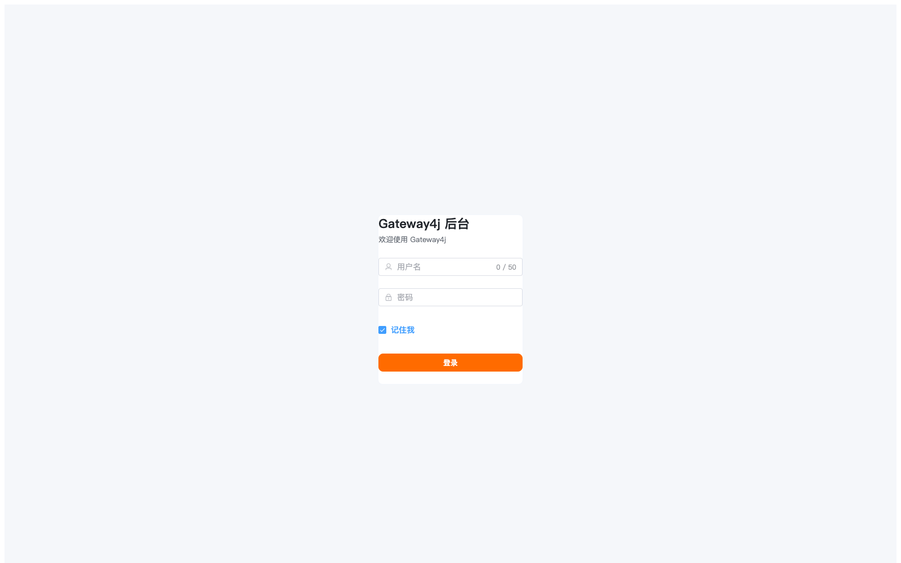 | 登录页五要素（品牌标题/用户名/密码/记住我/登录按钮）完整渲染 |
|  | 正确凭证登录后落地路由列表——侧边栏 9 个业务线入口、顶栏、⌘K 搜索框全部在场 |
| 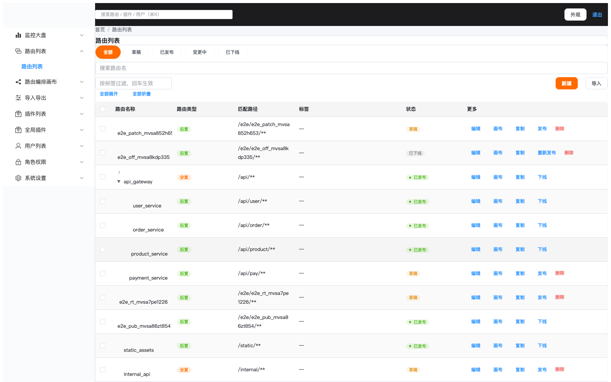 | 侧边栏渲染出监控大盘 ~ 系统设置全部 9 个业务线导航入口 |
| 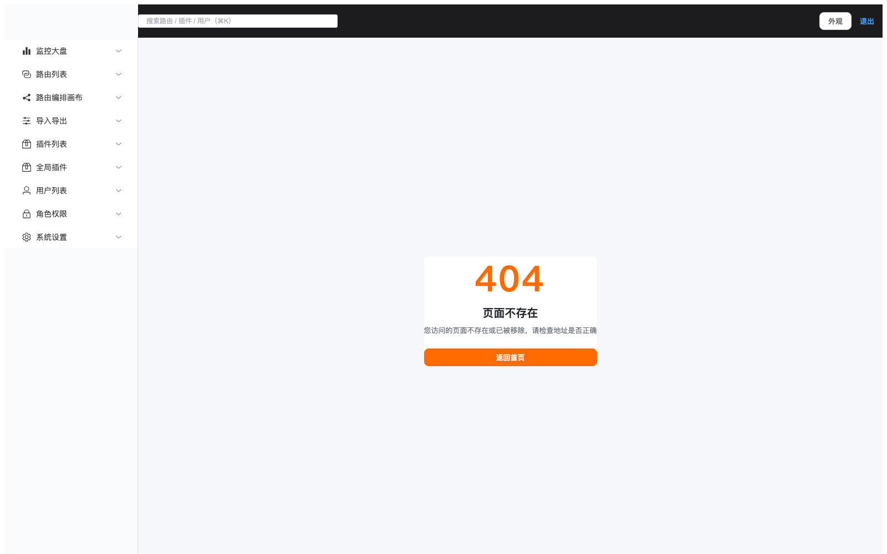 | 访问不存在路径展示 404 页（"页面不存在/返回首页"）——该用例的诊断日志同时实测捕获了限流 429→重试 200 的完整序列（见第 7 章观察 6） |

### 5.2 BL-02 监控大盘

**验证的能力**：大盘三 Tab——路由状态（表格/搜索/分段筛选/行点击跳转详情）、指标趋势（路由选择器/时间范围/粒度/自动刷新/ECharts canvas/空态）、路由拓扑（VueFlow 节点渲染、节点数与 `GET /v1/monitor/topology` 返回一致）。快赢包后大盘指标数据源为 **Redis 指标快照**（`914e172`：9300 发布 → 9301 读取，打通跨 JVM 数据面统计），V1.3.3 种子的 metrics 插件为该通道提供数据来源。

| 关键证据 | 说明 |
|---|---|
| 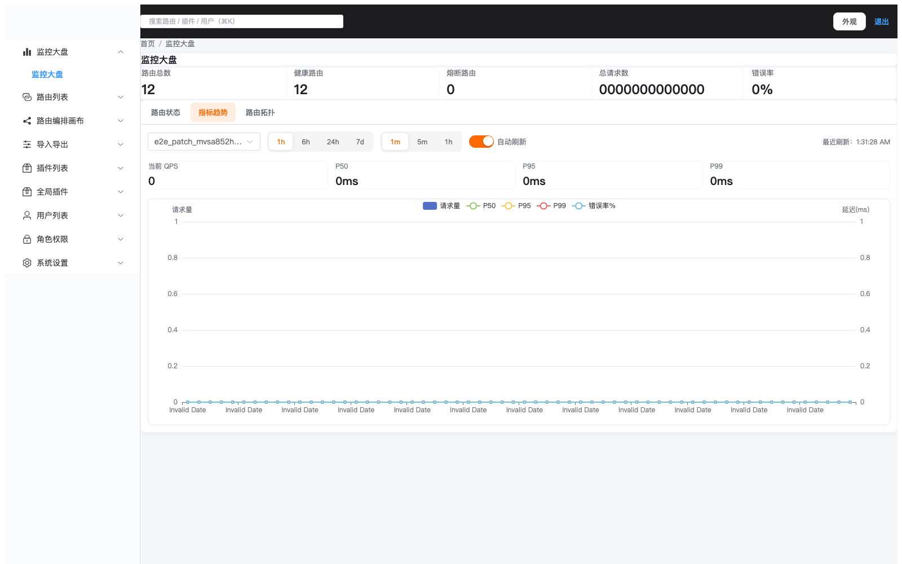 | 大盘五张统计卡片渲染：路由总数 12 / 健康 12 / 熔断 0 / 总请求数 0 / 错误率 0%（"总请求数"把 0 渲染成 13 位 0，数值语义正确，展现形式记入第 7 章观察 2） |
| 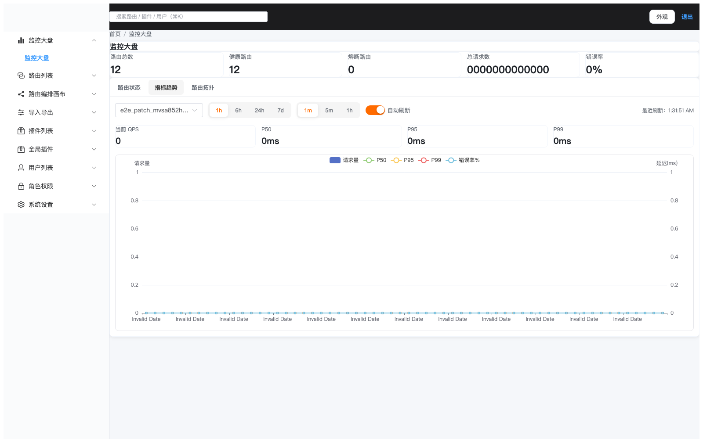 | 指标 Tab：QPS/P50/P95/P99 卡片 + ECharts canvas 真实渲染（横轴时间标签仍为 "Invalid Date"，沿用上轮已记录的细节项，见第 7 章观察 3） |
| 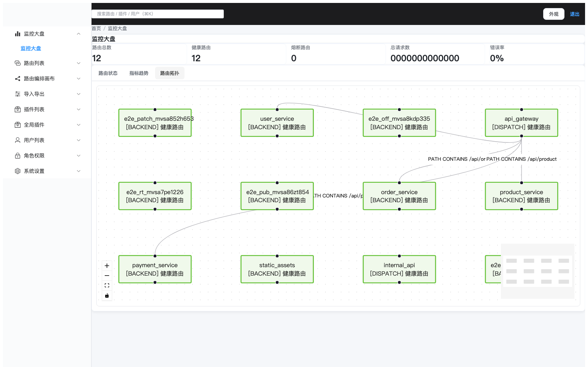 | VueFlow 拓扑图渲染路由节点与分发关系连线，节点数与后端接口一致（02-11 断言） |

### 5.3 BL-03 路由管理

**验证的能力**：路由全生命周期——树形列表（含分发/后置类型与标签列）、五态过滤、标签过滤（阶段二）、搜索、前后端双层格式校验、新建/编辑（四 Tab 编辑器）、**发布/下线经确认弹窗后状态真实变更**、按状态收敛的删除操作。行级"画布/复制"入口（阶段二）在场。

| 关键证据 | 说明 |
|---|---|
|  | 树形表格渲染：分发/后置类型标记、状态徽标、标签列与标签过滤输入、按状态收敛的行操作 |
| 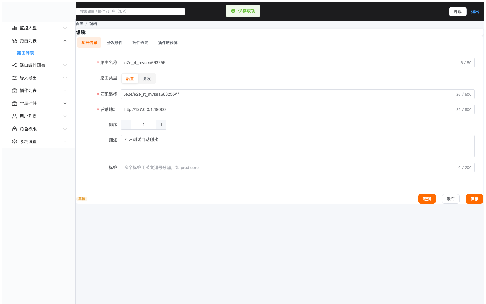 | 合法输入保存成功并跳转编辑页，四 Tab 编辑器在场 |
| 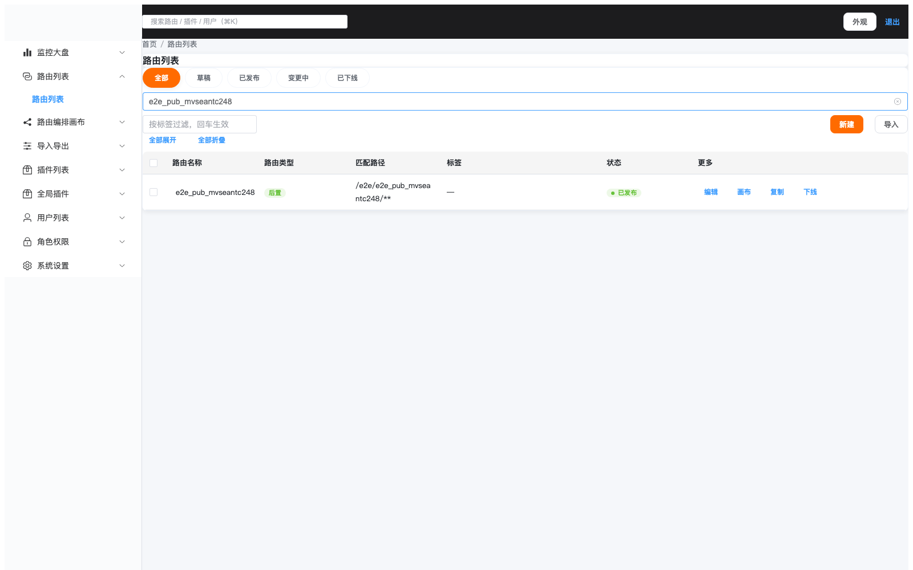 | 草稿路由经确认弹窗发布后，列表行状态真实变为"已发布"，行操作收敛为"编辑/画布/复制/下线"（不再提供删除） |

### 5.4 BL-04 路由编排画布

**验证的能力**：可视化编排——组件面板三类节点、拖拽创建、属性面板编辑回写、撤销/重做、自动保存、路径预览、**保存后刷新持久化**、画布与路由树数据一致（阶段二"应用到路由树"按钮在工具栏在场）。

| 关键证据 | 说明 |
|---|---|
| 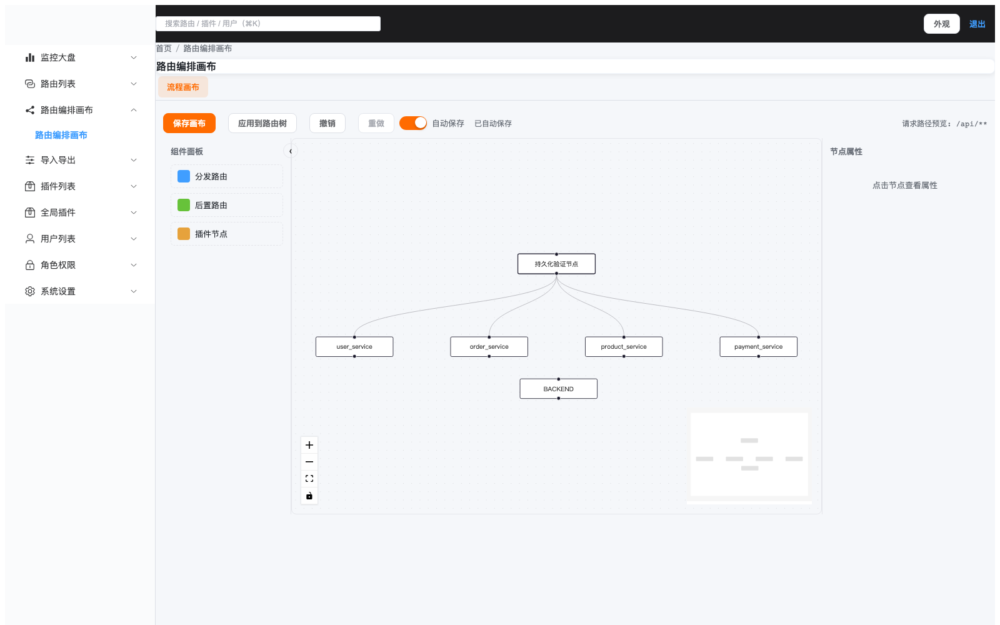 | 画布页四要素齐备：工具栏（保存/应用到路由树/撤销/重做/自动保存）+ 组件面板 + 属性面板 + VueFlow 画布 |
| 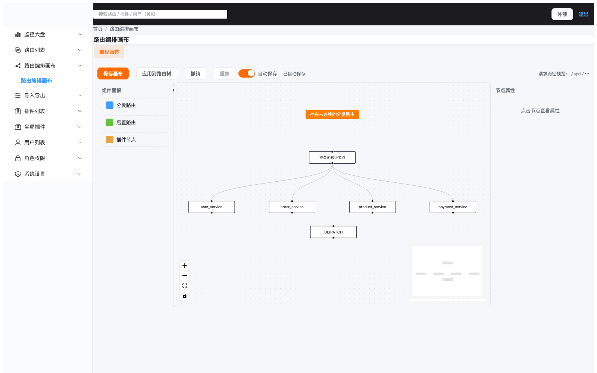 | 从组件面板拖拽创建的节点渲染在画布上，并与路由树推导节点连线 |
| 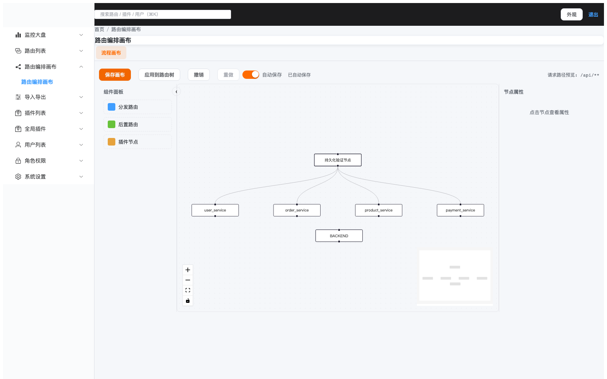 | 保存画布后刷新页面，新建节点仍在画布上——真实落库 |

### 5.5 BL-05 导入导出

**验证的能力**：导出（多选/浏览器真实下载/空选提示）、导入（JSON 预检带可定位错误原因、合法包预检报告、三种冲突策略、正式导入落地路由列表）。

| 关键证据 | 说明 |
|---|---|
| 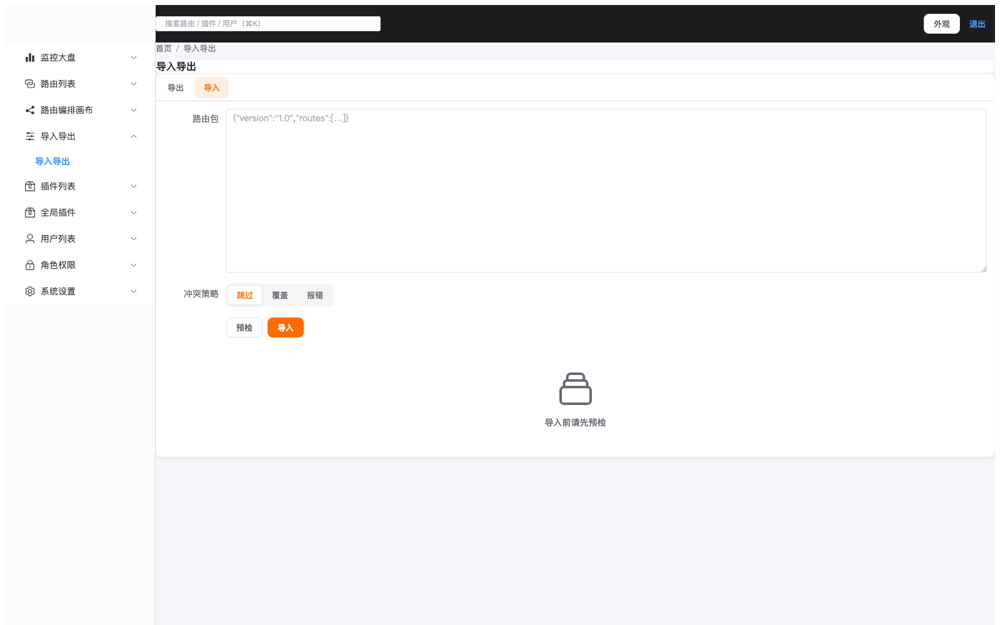 | 导出/导入双 Tab 页面加载（路由列表的「导入」入口亦可达，05-10） |
| 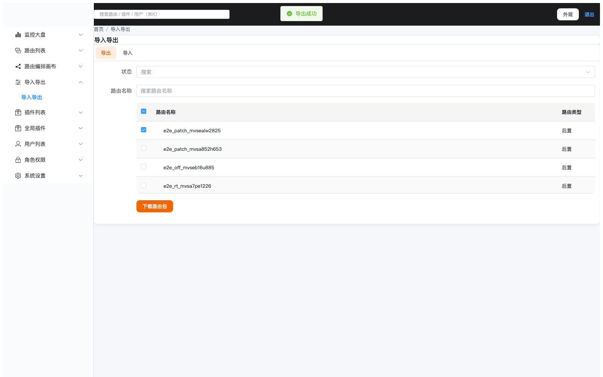 | 勾选路由后点击下载，浏览器下载真实触发 |
| 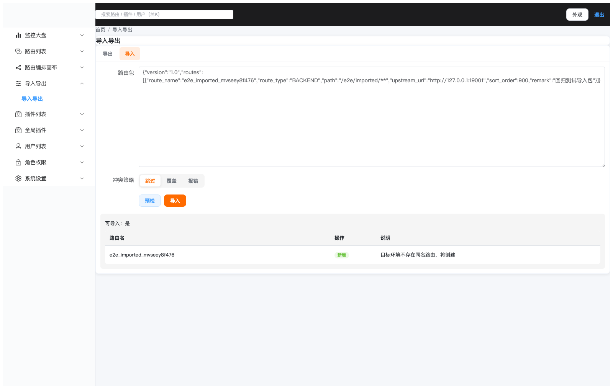 | 合法路由包预检通过，展示结构化预检报告（可导入/新增/创建策略） |

### 5.6 BL-06 插件管理

**验证的能力**：插件列表（类型/阶段/状态列）、搜索/类型/状态三维过滤、新建（前端校验 + 后端 POST）、**Groovy 脚本在线校验**、启用/禁用/删除真实生效、全局插件 PRE/POST 阶段编排、内置插件分类卡片 + schema 驱动动态配置表单 + **"已接线"徽标**（快赢包 `d7b2d76` 新增：runtime-status 接口驱动，37/37 已注册）。

| 关键证据 | 说明 |
|---|---|
| 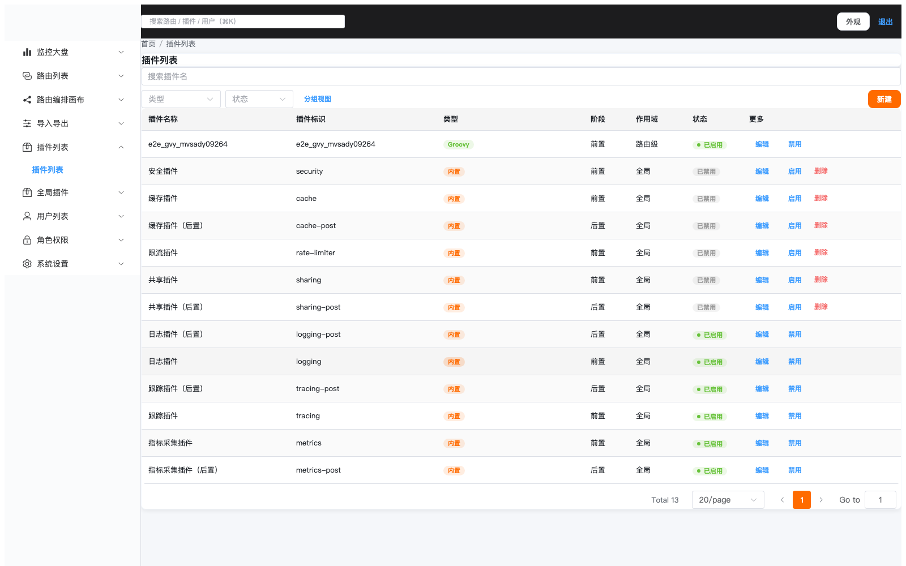 | 插件列表渲染（类型/阶段/状态列齐备） |
| 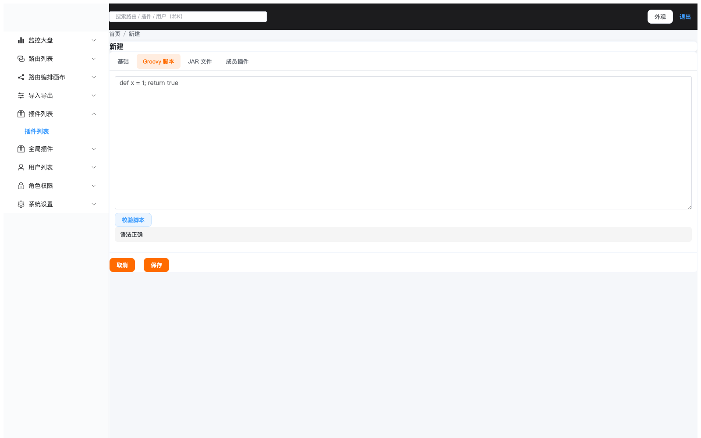 | Groovy 脚本 Tab 输入脚本后点击校验，返回"语法正确"校验结果 |
| 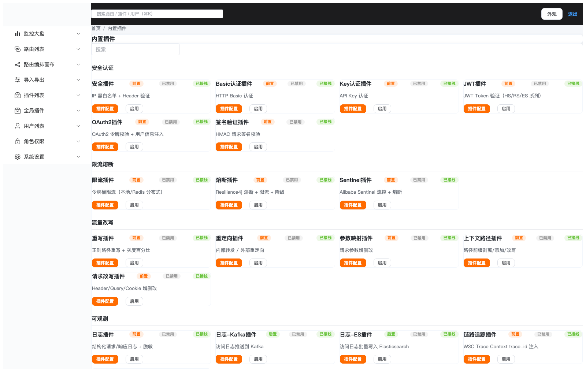 | 内置插件四大分类（安全认证/限流熔断/流量改写/可观测）卡片全量渲染，**每张卡片右上角带绿色「已接线」徽标**——快赢包接线徽标特性的直接证据 |
| 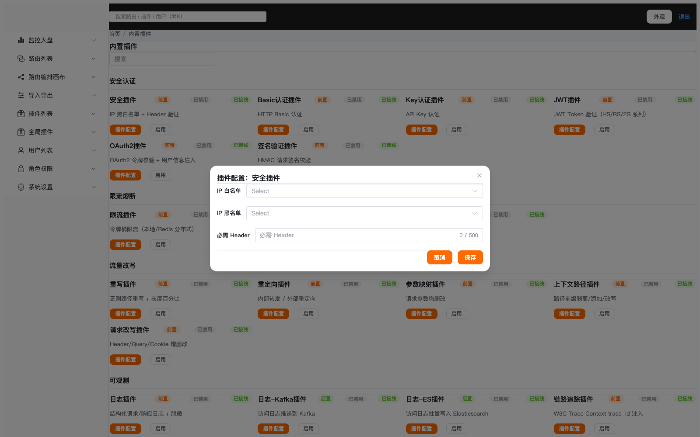 | "安全插件"配置弹窗按 JSON Schema 动态生成表单字段（IP 黑名单/必需 Header，D21 回归点）。**如实记录**：该弹窗打开期间页面捕获 24 条 Element Plus `<ElDialogContent>` 递归更新告警（上一轮同位置同报错，两轮复现），用例断言不受影响，见第 7 章观察 1 |

### 5.7 BL-07 用户管理

**验证的能力**：用户列表（表格+分页+关键列）、搜索、行操作四件套（编辑/禁用/重置密码/删除）、权限状态不静默、后端 CRUD API 全链路。

| 关键证据 | 说明 |
|---|---|
| 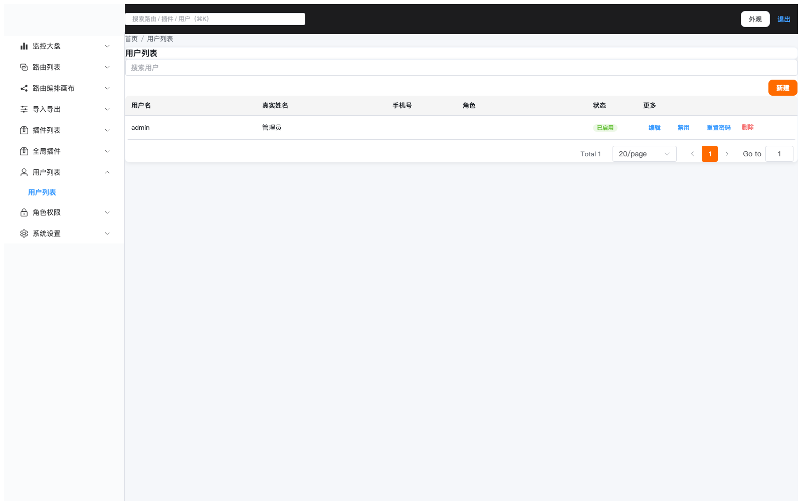 | 用户列表渲染：分页控件在场，行操作"编辑/禁用/重置密码/删除"齐备 |
|  | 用户行操作完整可见可点（文件名沿用首轮"缺陷现场"命名，实际断言为"操作必须存在"，见第 7 章观察 5） |

### 5.8 BL-08 角色与权限

**验证的能力**：角色 Tab 渲染 4 个种子角色（ADMIN/OPS/DEV/GUEST）、"我的权限"Tab 权限表、授权/编辑/**成员管理**入口（阶段二新增角色成员），非 admin 角色权限绑定缺失可感知。

| 关键证据 | 说明 |
|---|---|
| 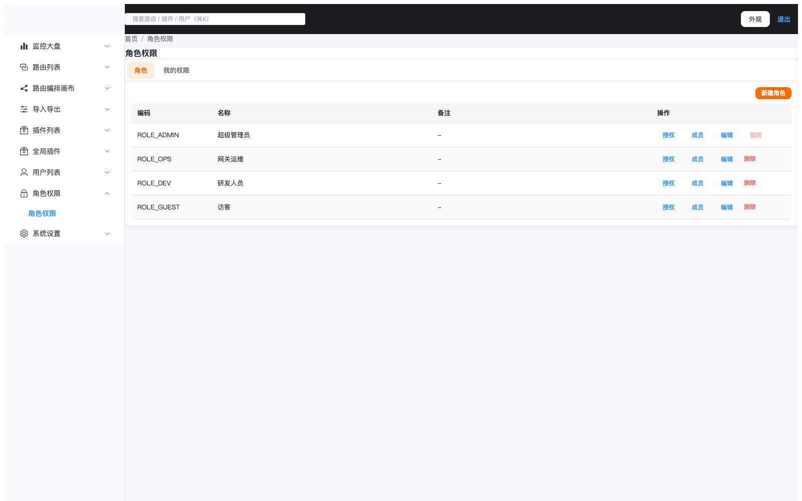 | 4 个种子角色全部渲染，每行提供"授权/成员/编辑"操作入口 |
| 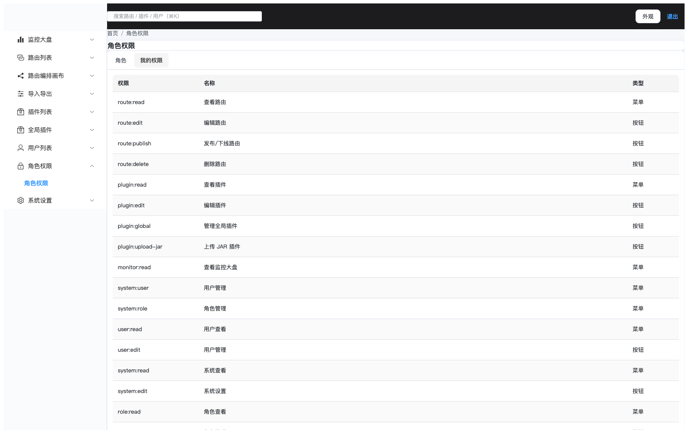 | "我的权限" Tab 渲染权限表（编码/名称/资源类型列） |

### 5.9 BL-09 系统设置

**验证的能力**：设置页五 Tab（通用/安全/字典/主题 + 阶段二的"变更记录"）、通用设置保存、配置接口 `GET /v1/config/system`、安全设置数字输入、字典查询正反两态、错误文案友好化。

| 关键证据 | 说明 |
|---|---|
| 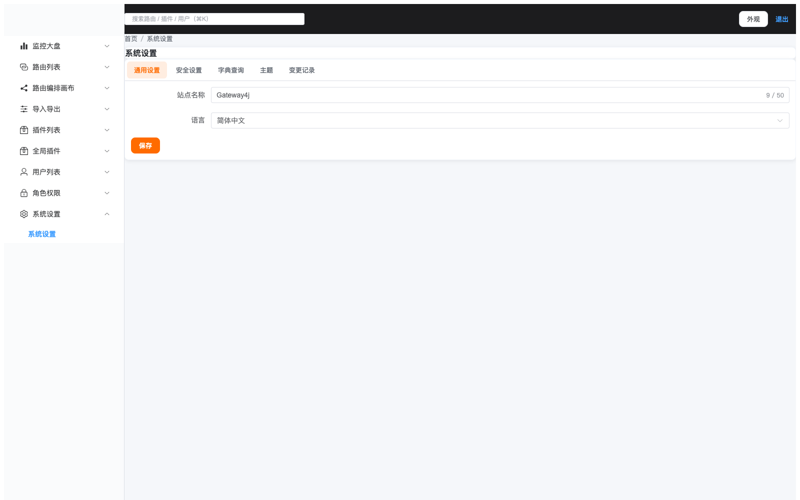 | 系统设置页 Tab 加载（含"变更记录" Tab） |
| 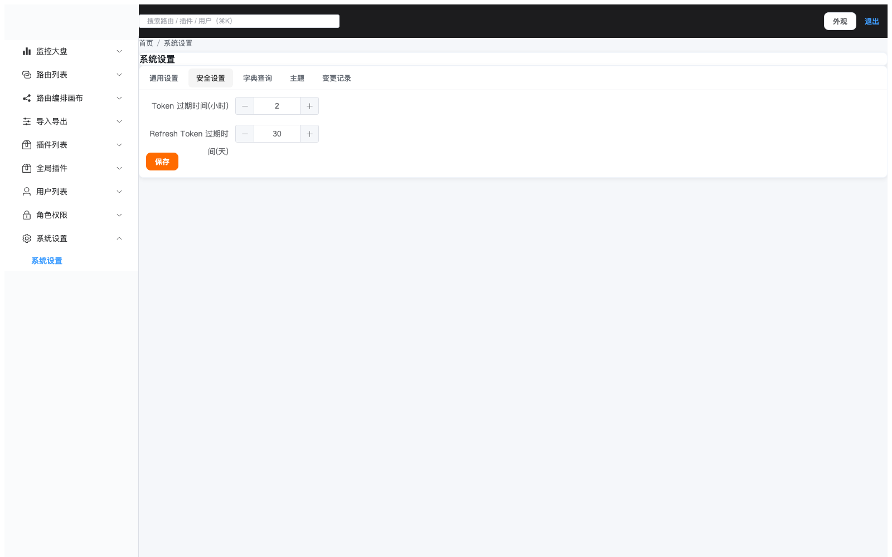 | 安全设置 Tab：Token/Refresh 过期时间数字输入渲染 + 保存按钮 |
| 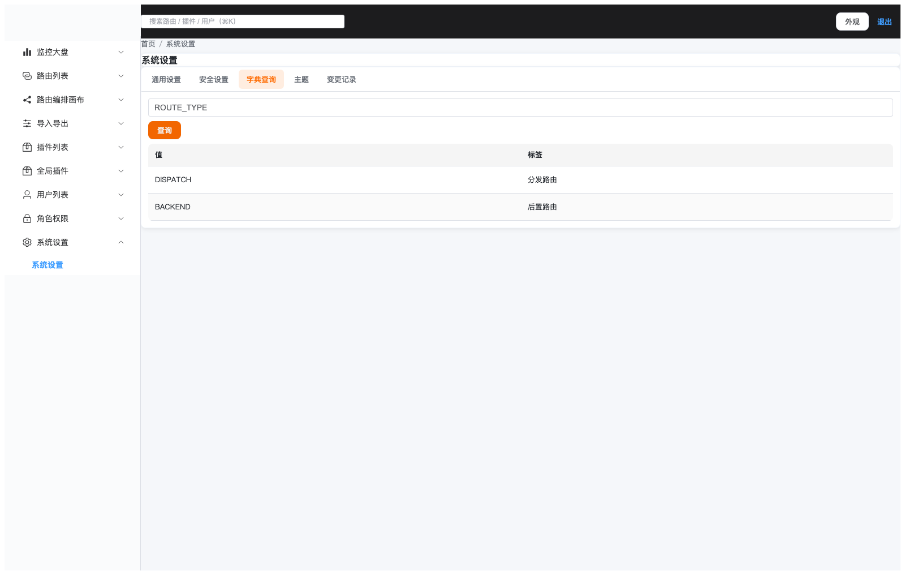 | 字典查询已知 code 返回条目并渲染表格（不存在 code 的友好提示为 09-08，亦通过） |

---

## 6. 数据面专章（BL-10）

> **证据性质声明**：数据面 spec 为纯 HTTP 黑盒（Playwright request 上下文，无浏览器、不产生截图），证据即机器可读输出 `gateway-data-plane-results.json`（本轮 expected=5 / unexpected=0，**5 passed，总时长 2.0s**，RUN=`mvseneci`，worker pid=39719）。每场景的建路由/发布/下线均走 admin-boot 真实 API，断言打在 9300 网关的实际响应上；echo 后端以 `tag` 标注归属，防止"抢流误判"。

### 6.1 数据面四轮对照

| 轮次 | 结果 | 整套耗时 | 配置生效通道 |
|---|---|---|---|
| 10-28-01 首轮 | **0/5**（单路由抢流/新路由不可达/404 不兜底） | — | PathPattern 谓词修复前 |
| 10-28-02 第二轮 | 5/5 | 2.3m | 30s DB 版本号轮询 + 内容指纹比对（每场景需推高 config_version 等待轮询） |
| 10-28-03 快赢验收 | 5/5 | 1.9s | **写操作 Redis 推送**（实测发布→生效 0.07s、下线摘除 0.03s），60s 轮询兜底 |
| **本轮 10-29-01** | **5/5** | **2.0s** | 同上（Redis 推送），场景内 45s 轮询上限沦为纯保险丝，首轮探测即命中 |

spec 自 0/5 修复后**零改动**（同一份 `data-plane.spec.ts`，黑盒断言不变），本轮耗时与快赢验收轮一致，进一步确认推送通道稳定。

### 6.2 场景 × 验证链路 × 结果（本轮实测）

| # | 场景 | 管理面操作链（API 黑盒） | 数据面断言（9300 实测） | 本轮实测 | 结果 |
|---|---|---|---|---|---|
| 1 | 基础转发 | 建 BACKEND 路由（upstream→echo:19001）→ 发布 → config_version 推高到基线之上 | 轮询 `GET /e2e/gw/{run}b1/ping` ≤45s，要求 `echo:true` 且 `tag=gw-echo-19001`（tag 归属防抢流误判） | `http=200 body={"echo":true,"tag":"gw-echo-19001","path":"/e2e/gw/mvsenecib1/ping","header_x_echo":"scenario1"}`，首次探测即命中 | ✅ 0.1s |
| 2 | HEADER 分流 | 建子路由 A(→19002)/B(→19003) + DISPATCH 父路由（2 条 HEADER x-ver EQ v1/v2 条件）→ 三路由全部发布 | `x-ver=v1` 必须命中 tag=gw-echo-19002，`x-ver=v2` 必须命中 tag=gw-echo-19003 | `x-ver=v1 → 200 tag=gw-echo-19002；x-ver=v2 → 200 tag=gw-echo-19003`——两条件精确分流 | ✅ 0.2s |
| 3 | 热更新摘除 | 建路由→发布→**先确认数据面已生效**→下线→version 推到新基线之上 | 下线前 `http=200 tag=gw-echo-19001`；下线后轮询 ≤45s 直到不再由该 echo 服务 | 下线前 `http=200`；`status=OFFLINE config_version=6（新基线 max=5）`；摘除后 `http=404 tag=null`——下线亚秒级生效 | ✅ 0.1s |
| 4 | 404 兜底 | 无（直接探测未注册路径） | `GET /e2e/gw/definitely-not-registered-{run}/deep/path` 必须返回 404 且 body 不是任何 echo 的响应 | `http=404 body={"code":404,"message":"Not Found: No static resource ...","success":false}`——网关主动兜底，不转发抢流 | ✅ 5ms |
| 5 | 插件链冒烟 | 记录 ENABLED 插件清单→建 ROUTE 级 Mock 插件（PRE、可短路）→启用→绑定到新路由→发布 | 正向判据：响应体 `mocked:true`（短路生效）；**降级判据**：绑定持久化可查回 + 转发仍通（tag 归属正确） | Mock 未在外部观察到短路；**以降级判据通过**：`绑定成功(true) + 转发仍通(tag=gw-echo-19001)` | ✅ 0.2s |

### 6.3 本轮输出全文（一手证据，摘自 `gateway-data-plane-results.json` 各场景 stdout）

```text
[env] worker pid=39719 RUN=mvseneci
[场景1] route=gwtest_base_mvseneci_fgjb id=2115500184744091649 config_version=3（基线 max=2）
[场景1] OK http=200 body={"echo":true,"tag":"gw-echo-19001","path":"/e2e/gw/mvsenecib1/ping","method":"GET","header_x_echo":"scenario1","header_x_ver":null,"body":null}
  ✓ 场景1 基础转发：建路由→发布→网关转发到 echo (117ms)
[场景2] routes a=2115500185218048001 b=2115500185251602434 dispatch=2115500185289351170 v=3（基线 max=2）
[场景2] 实测 x-ver=v1 → http=200 tag=gw-echo-19002；x-ver=v2 → http=200 tag=gw-echo-19003
  ✓ 场景2 分发路由：HEADER x-ver 条件分流到不同子路由 (233ms)
[场景3] route=gwtest_s3_mvseneci_7f7t id=2115500186220486657 config_version=5
[场景3] 下线前已生效 http=200
[场景3] 已下线 status=OFFLINE config_version=6（新基线 max=5）
[场景3] 摘除后实际响应 http=404 tag=null（下线前 http=200）
  ✓ 场景3 热更新：路由下线后网关在 45s 内摘除 (136ms)
[场景4] 实际响应 http=404 body={"code":404,"message":"Not Found: No static resource e2e/gw/definitely-not-registered-mvseneci/deep/path.","data":null,"success":false,"fail":true}
  ✓ 场景4 404兜底：未匹配任何路径应得到网关明确的非转发响应 (5ms)
[场景5] ENABLED 插件: e2e_gvy_mvsady09264(ROUTE/PRE), e2e_gvy_mvsegewg27(ROUTE/PRE), logging(GLOBAL/PRE), logging-post(GLOBAL/POST), tracing-post(GLOBAL/POST), tracing(GLOBAL/PRE), metrics(GLOBAL/PRE), metrics-post(GLOBAL/POST)
[场景5] route=gwtest_plugin_mvseneci_217n 插件=gwtest_mock_mvseneci_8r6k config_version=5
[场景5] Mock 未短路（实际响应 http=200 body={"echo":true,"tag":"gw-echo-19001","path":"/e2e/gw/mvsenecip5/ping",...}），降级判据：绑定成功(true) + 转发仍通(tag=gw-echo-19001)；插件链行为无法黑盒断言
  ✓ 场景5 插件链冒烟：绑定 Mock 插件（可短路）观察是否生效 (154ms)

  5 passed (2.0s)
```

### 6.4 数据面三点如实说明

1. **整套 2.0s 的含义**：上一轮（10-28-02）同样 5 个场景耗时 2.3 分钟，差值即快赢包"写操作 Redis 推送"的收益——发布/下线后网关亚秒级重载，spec 里为 DB 轮询时代设计的 45s 轮询上限本轮全部首轮命中，退化为纯保险丝。场景 1/3 的 `config_version=3（基线 max=2）` 等记录也印证：不再需要靠 publish/offline 循环把版本"推过轮询窗口"。
2. **场景 5 通过口径（既有行为，非本轮回归对象）**：Mock 插件未在外部观察到短路（`mocked:true` 未出现），用例按其设计以**降级判据**通过——插件绑定真实持久化（`GET /v1/routes/{id}/plugins` 可查回）+ 转发链路仍通（tag 归属正确）。这与 10-28-02、10-28-03 两轮口径一致（快赢包验收 §6.5 已定性为"既有行为，与本轮改动无关"）；正向断言依赖"插件执行可观测"（执行与否/耗时/短路对用户当前不可见），待插件执行指标/访问日志落地后可升级。
3. **场景 5 的 ENABLED 清单反映全新库基线（如实记录，不影响判定）**：本轮清单为 metrics×2（V1.3.3 种子 ENABLED）+ logging/tracing 四行（管理面 BL-06 启停用例在库中启用后残留）+ 2 条 `e2e_gvy_*` 历史测试插件残留——与上一轮"11 个 GLOBAL 插件"的清单不同，是**数据库基线差异**（全新库种子默认全 DISABLED，见 `V1.0.0` §10.2），不是网关装配能力变化；`gwtest_` 前缀路由每轮由 spec 的 `dbSweepGwtest()` 自清，`e2e_gvy_*` 插件残留为测试资产卫生问题，记入第 7 章观察 4。

---

## 7. 修复意见

**本轮 0 缺陷，无需修复的项。** 以下为测试视角观察到的**非缺陷改进点**（运行观察，均不影响用例判定与产品功能正确性；编号仅为便于引用）：

| # | 观察 | 事实 | 建议 |
|---|---|---|---|
| 1 | 内置插件配置弹窗递归更新告警 | 06-13 打开"插件配置"弹窗期间页面捕获 24 条 `Maximum recursive updates exceeded in component <ElDialogContent>` 未捕获异常（10-28-02 同位置同报错，两轮复现）。`PluginDynamicForm.vue` 已有 `syncingFromProp` 守卫及对应 vitest，告警源在弹窗容器层（FcDialog/ElDialogContent）的响应式连环触发 | 定位弹窗容器层的重复渲染源（props 回写/watcher 链），消除后 06-13 诊断日志回归纯净 |
| 2 | 大盘"总请求数"渲染形式 | 数值 0 被渲染为 13 位 0（"000000000000"，02-01 截图可见）；数值语义正确（全新基线、截图时刻网关尚无流量） | 计数器组件对 0 值的补零/动画渲染做归一化 |
| 3 | 指标趋势图横轴 "Invalid Date" | 本轮依旧（上一轮已记录，02-06 截图可见）；断言对象是 canvas 渲染，不受影响 | 时间轴格式化修复（沿用上轮优化建议 §4 口径） |
| 4 | e2e 测试数据残留 | 数据面场景 5 的 ENABLED 清单含 2 条历史 `e2e_gvy_*` Groovy 测试插件（管理面 BL-06 用例创建，未清理，跨轮存活于库中）；数据面路由有 `dbSweepGwtest()` 自清，插件没有对称机制 | 管理面基座为 `e2e_gvy_*`/`e2e_delgvy_*` 插件建立对称 sweep，避免污染"运行中插件"清单类断言的真实环境 |
| 5 | 截图命名历史包袱 | 部分截图文件名沿用 10-27 首轮"缺陷现场"语义（如 `07-04-row-actions-missing`、`09-04-config-api-missing`、`04-03-empty-canvas-no-hint`），而现行断言已反转为"必须存在/不缺失" | 测试基座下次迭代时统一命名，避免后来读者误读 |
| 6 | login 限流 × 自动化基座 | 15 条认证用例密集登录触发一次 `429`（01-14，重试基座 25s 后重试成功）；429 同时在浏览器控制台留下一条 error 级噪音，该用例诊断日志因此非空 | 回归环境可将 9302 出口 IP 加入限流白名单（framework4j-rate-limit 已支持 whitelist），或接受现状（重试基座已消化，且本轮恰好实证了限流真的在工作） |
| 7 | 数据面场景 5 正向断言缺位 | Mock 短路无法黑盒断言（本轮 + 前两轮均以降级判据通过），根因是插件执行过程不可观测 | 待插件执行指标/访问日志落地后，把场景 5 升级为正向短路断言 |

> 运行层面的两条经验已固化，不再列为建议：① Playwright CLI `--reporter=list` 会覆盖 config 的 json reporter——workflow 已移除该参数（`326a6f3`），本轮 JSON 正常产出即为验证；② login 限流对回归基座的影响——`login()` 重试基座（`39bf5f5`）已消化，本轮 429 一次、重试成功、断言未弱化。

---

## 8. 证据索引

### 8.1 目录结构

```text
test-report/2026-10-29-01/
├── 测试报告.md                        本报告
├── results.json                       管理面 Playwright JSON（106 expected / 0 unexpected / 0 flaky）
├── gateway-data-plane-results.json    数据面 Playwright JSON（5 expected / 0 unexpected）
└── screenshots/                       120 PNG + 107 诊断日志 = 227 份证据（11MB）
    ├── 01-auth/           16 png + 14 log   认证与登录
    ├── 02-dashboard/      12 png + 12 log   监控大盘
    ├── 03-routes/         24 png + 19 log   路由管理（含发布/下线/删除确认弹窗+状态验证成对截图、03-11 四 Tab 截图）
    ├── 04-canvas/         16 png + 14 log   路由编排画布（含保存/持久化成对截图）
    ├── 05-import-export/  11 png + 10 log   导入导出（含导出下载、导入落地成对截图）
    ├── 06-plugins/        18 png + 15 log   插件管理（含 Groovy 校验、内置插件接线徽标与配置弹窗）
    ├── 07-users/           8 png +  8 log   用户管理
    ├── 08-roles/           6 png +  6 log   角色与权限
    └── 09-settings/        9 png +  9 log   系统设置
```

命名规则：`{用例号}-{英文短名}.png`；同用例如有过程图，在短名后追加语义后缀（如 `03-14-publish-confirm-dialog.png` 确认弹窗 → `03-14-publish-status-verified.png` 状态验证）。

### 8.2 诊断日志（.log.txt）内容说明

每条用例（截图）同名的 `.log.txt` 是该用例执行期间的四段诊断 + 调用序列记录。**本轮 107 份的真实分布（程序化扫描）**：

| 段 | 内容 | 本轮状态 |
|---|---|---|
| Console Errors | 浏览器控制台 error 级输出 | **1/107 非空**（01-14：限流 429 的浏览器资源加载回显） |
| Page Errors (未捕获异常) | 页面未捕获 JS 异常 | **2/107 非空**（06-13 两份日志：ElDialogContent 递归更新告警，上轮同位置同报错；同一用例的两份日志为同一诊断池的两份快照，累计 24 条） |
| Failed Requests (网络失败) | 网络层失败请求 | **1/107 非空**（01-14：`GET /v1/routes :: net::ERR_ABORTED`，跳转 404 页时的请求中断，预期行为） |
| HTTP >= 400 | 4xx/5xx 响应 | **1/107 非空**（01-14：`429 POST /v1/auth/login`，限流自我保护真实触发，重试后 200） |
| 后端 API 调用记录 | 该用例完整的 `status METHOD path` 调用序列 | 65/107 有内容（写操作类用例均有真实后端调用佐证；纯静态断言用例无网络请求） |
| Extra | 用例特定的断言证据 | 77/107 有内容 |

即：本轮四段诊断的全部非空项集中于 **01-14 与 06-13 两条用例**，逐条归因见第 7 章；其余 105 条用例四段全空，所有写操作都有对应的真实后端调用记录佐证。

### 8.3 权威执行记录

| 记录 | 位置 |
|---|---|
| 管理面机器可读结果（106 passed，15.4m，01:29:51 起） | `test-report/2026-10-29-01/results.json` |
| 数据面机器可读结果（5 passed，2.0s，01:45:21 起，RUN=mvseneci） | `test-report/2026-10-29-01/gateway-data-plane-results.json` |
| 第一轮 21 缺陷详情 | [`../2026-10-27-01/测试报告.md`](../2026-10-27-01/测试报告.md) |
| D1~D21 修复验证 + 数据面 0/5→5/5 | [`../2026-10-28-01/修复验证报告.md`](../2026-10-28-01/修复验证报告.md)、[`../2026-10-28-01/数据面验证.md`](../2026-10-28-01/数据面验证.md)、[`../2026-10-28-01/推进记录.md`](../2026-10-28-01/推进记录.md) |
| 上一轮全量报告 + 优化建议 | [`../2026-10-28-02/测试报告.md`](../2026-10-28-02/测试报告.md)、[`../2026-10-28-02/优化建议.md`](../2026-10-28-02/优化建议.md) |
| 快赢包验收（全新库部署 + 7 项专项） | [`../2026-10-28-03/验收报告.md`](../2026-10-28-03/验收报告.md) |

---

## 9. 报告可信度自检

本报告成稿后执行了以下程序化核对（脚本核对，非人工勾选）：

| # | 自检项 | 要求 | 结果 |
|---|---|---|---|
| 1 | 截图引用路径全部真实存在 | 正文中每一处 `screenshots/...png` 相对路径在磁盘上存在 | ✅ 通过（27 处 markdown 嵌入全部命中；含正文文字引用共 28 处，唯一未命中的是本表格此处的通配示意写法，非真实引用） |
| 2 | 明细表行数 = 106 | 第 4 章表格行数与 results.json 用例数一致 | ✅ 通过（106 行，按 9 个业务线分组：15/12/18/14/10/14/8/6/9） |
| 3 | results.json 统计与摘要一致 | 管理面 stats.expected=106 / unexpected=0 / flaky=0 / duration≈921.6s；数据面 expected=5 / unexpected=0 / duration≈2.0s | ✅ 通过（与报告头部、1.1 轮次表、6.1/6.2 章数字一致） |
| 4 | 证据文件计数 | screenshots/ 下 120 png + 107 log.txt = 227 份 | ✅ 通过（实际清点 120 + 107，目录 9 个，共 11MB） |
| 5 | 明细表证据文件名真实存在 | 明细表引用的每个文件名在对应业务线目录中存在 | ✅ 通过（106 条用例的 120 个证据文件由脚本从 results.json 标题前缀 × 磁盘目录匹配生成并逐一核对，非手抄；无一条用例缺证据） |

---

*生成：2026-10-29 · gateway4j 测试报告工程师 · 管理面 106 条 + 数据面 5 条，111/111 全绿（连续第二轮全绿；快赢包 + 全新库基线后的首次完整证据回归）*
